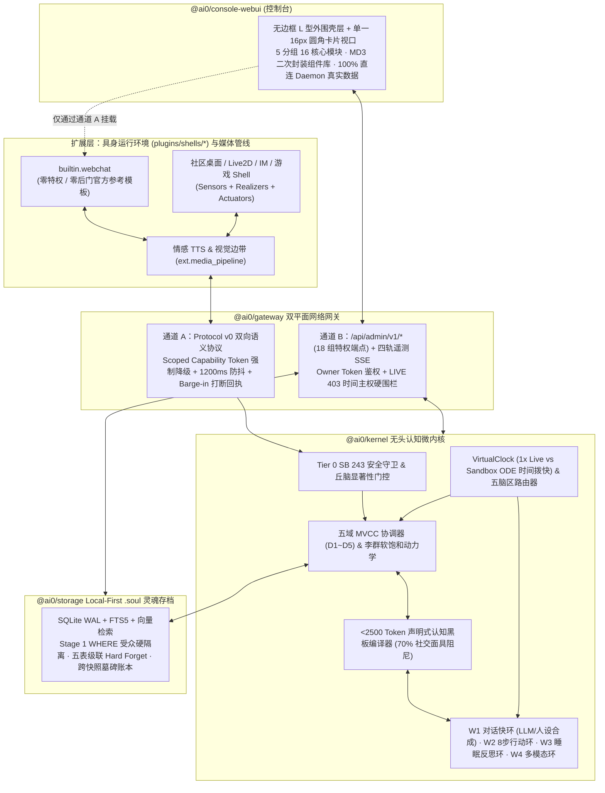

# `ai0` — 通用数字生命认知中枢 (Universal Cyber-Life Cognitive Kernel)

> **Soul Archive Completely Independent; Shell Context Structurally Perceived; Companionship Bounded & Non-Manipulative.**  
> **灵魂存档彻底独立，躯壳信息结构化感知，伙伴关系真诚有边界。**

[](https://nodejs.org/)
[](https://www.typescriptlang.org/)
[](./docs/architecture/02-storage-and-soul-archive-schema.md)
[](./docs/vision/05-ethics-safety-and-sb243-compliance.md)

---

## 一、快速启动 (Quick Start — 30 秒唤醒活体认知中枢与主权控制台)

> **前置要求**：`Node.js >= 24.0`（原生内置 `node:sqlite` + `FTS5` 零编译死锁驱动）与 `pnpm >= 10`。

```bash
# 1. 安装依赖并校验六大架构边界不变量
pnpm install
pnpm --filter @ai0/console-webui exec playwright install chromium
pnpm verify:all

# 2. (可选) 复制环境变量模板配置任意 OpenAI / Anthropic / Gemini / Ollama 兼容模型接口
#    不配置外部 API Key 时，内置上下文感知人设合成引擎可离线开箱即用
cp .env.example .env

# 3. 一键启动一体化守护进程 + 双平面网关 + 主权观测与配置控制台
pnpm dev
# -> 浏览器打开 http://127.0.0.1:4173

# 4. 独立运行 .scenario.yaml 5 步端到端黄金回归评测剧本（私密记忆 -> +38h 睡眠整理 -> 直播间防泄密 -> 五表真遗忘 -> 回档防复活）
pnpm replay:golden
```

开发模式会先构建随仓插件。在控制台侧栏的「插件页面」打开 WebChat，或访问 <http://127.0.0.1:4173/webchat>。在「插件与扩展管理」可以停用和重新启用它。接入其他客户端时，「接入通道」显示网关观测到的连接，「会话记录」显示存档中的对话。

---

## 二、项目定位与核心架构哲学

`ai0` 是一个**不内置具体物理/视觉形态、采用“确定性无头微内核 + 八大标准化扩展总线 × 五阶多态载体”架构、由社区生态自由生长的通用型数字生命认知中枢**：

1. **感知层（Upstream Semantic Perception）**：接收外部**具身运行环境（Shell）**与**多模态媒体管线（Media Pipeline）**采集的信号，封装为携带 **主体（Principal）× 场合（Venue）× 受众（Audience）× 凭据（Attestation）** 的四元组标准化事件，原生支持 `1200ms` 话轮防抖、流式打断（Barge-in）与受众权限前移强制降级。
2. **微内核大脑（The Invisible Cognitive Kernel）**：采用**“单一认知主体 + 五域 MVCC 权威状态协调器 + 四路并发 Worker (`W1`~`W4`)”**架构，串联：
   - **Tier 0 伦理安全底线**：独立于 LLM 的 SB 243 四大合规组件与 5% L0 应急算力备用金锁；
   - **受控 `<2500 Token` 声明式认知黑板编译器**：内置公私场合 **70% 社交面具阻尼器**与离线诚实叙事守卫；
   - **Local-First `.soul` 灵魂存档底座**：7 张 SQLite WAL 核心表 + FTS5 混合检索 + 阶段 1 `WHERE visibility_scope` 确定性受众硬隔离 + 阶段 2 艾宾浩斯遗忘冷却公式 + **五表级联真遗忘（Hard Forget）与跨快照 `redaction_ledger.json` 永久防复活墓碑**；
   - **时间状态三分法（`VirtualClock`）**：严格隔离 `🟢 LIVE`（1x 物理时钟硬锁，HTTP 403 禁止拨快）与 `🧪 SANDBOX:<fork_id>`（隔离实验分身、快慢情绪二阶耦合 ODE 闭式解与精确唤醒时刻 $t_{\text{next}}$ 反解）。
3. **八大功能扩展总线 × 五阶多态载体生态 (`plugins/**`)**：
   统一按总线归位于顶层 `plugins/` 目录，受编译期反后门守卫（[verify-architecture-boundaries.mjs](./scripts/verify-architecture-boundaries.mjs)）强制约束——**任何插件仅允许依赖 `@ai0/protocol` 与 `@ai0/sdk`，零特权、零内核后门**。
4. **`@ai0/console-webui` 控制台**：
   采用 **Material Design 3 二次个性化封装组件体系**与单色 SVG 矢量图标，基于**无边框环境底板 L 型外围壳层 + 单一 `<main>` 16px 圆角抬升卡片视口（`MainRoundedCardOutlet`）**，通过 **5 子目录 45 项模块化组件** 承载 **5 大分组 × 16 个核心配置与观测模块**，100% 实时直连 `@ai0/daemon` 双平面网关。

---

## 三、Monorepo 物理工程拓扑 (Repository Topology)

```text
ai0/
├── packages/                              # 🔒 严守五大无头微内核核心底座包（编译期边界守卫锁定）
│   ├── protocol/                          # @ai0/protocol — 唯一机器契约 SSOT (Zod + Protocol v0 + Admin API)
│   ├── storage/                           # @ai0/storage  — .soul 灵魂存档、SQLite 7 表 WAL/FTS5、血缘 DAG 与五表真遗忘
│   ├── kernel/                            # @ai0/kernel   — VirtualClock、MVCC 协调器、黑板编译器、W1~W4、脑区路由与回放引擎
│   ├── gateway/                           # @ai0/gateway  — 通道 A 协议网关 (Scoped Token 降级/打断) & 通道 B 18 组特权 Admin API
│   └── sdk/                               # @ai0/sdk      — 面向社区开发者的多态扩展开发 SDK
├── plugins/                               # 🧩 五阶多态扩展总目录（通用零后门守卫：仅允许依赖 protocol + sdk）
│   ├── shells/webchat/                    # builtin.webchat — 零特权官方参考 WebChat 具身躯壳插件
│   ├── cognitive-organs/dream-journal/    # community.organ.dream-journal — 梦境余温认知器官（三钩子 + 可消融）
│   ├── media-pipelines/emotion-tts-sideband/ # builtin.media.emotion-tts-sideband — 情感语音边带与字符级时间戳对齐
│   ├── skills-and-mcp/daily-companion-review/# SKILL.md 自然语言技能手册范本
│   └── flows-and-assets/late-night-coding-care/ # .flow.yaml 跨插件 ECA 编排蓝图范本
├── apps/
│   ├── daemon/                            # @ai0/daemon   — 后台无头守护进程 & 一体化全栈启动 CLI (pnpm dev)
│   └── console/                           # @ai0/console-webui — 第一方紧凑二次封装 MD3 主权控制台 (5 子目录 45 组件 × 8 大域)
├── souls/default.soul/                    # 💎 开箱即用的 Local-First 默认灵魂存档（Mio 初始种子记忆、声线与世界观）
├── scripts/verify-architecture-boundaries.mjs # 🛡️ 六大架构不变量编译期守卫
└── docs/                                  # 📚 问题域愿景研究 (vision/01~05) & 解法域工程规格与 ADR 账本 (architecture/01~07)
```

---

## 四、微内核与双平面控制台架构全景图



---

## 五、文档体系导航 (`docs/vision/` & `docs/architecture/`)

- **问题域（愿景与认知公理 — `docs/vision/`）**：
  1. [01-vision-and-predecessors.md](./docs/vision/01-vision-and-predecessors.md) — 核心愿景、两大立基公理与五大先行体系对照
  2. [02-cognitive-kernel-and-boundaries.md](./docs/vision/02-cognitive-kernel-and-boundaries.md) — 认知微内核七大模块、表里张力演出与五维判别公理
  3. [03-protocol-and-webui-console.md](./docs/vision/03-protocol-and-webui-console.md) — 协议 v0 冻结核心、八大扩展总线与控制台设计法则
  4. [04-blindspots-priorities-and-mvp-slice.md](./docs/vision/04-blindspots-priorities-and-mvp-slice.md) — 12 项核心设计张力与长程失效防护矩阵
  5. [05-ethics-safety-and-sb243-compliance.md](./docs/vision/05-ethics-safety-and-sb243-compliance.md) — 加州 SB 243 合规底线与反情感操控五项宪章
- **解法域（工程架构规格与决断账本 — `docs/architecture/`）**：
  1. [01-system-overview-and-monorepo.md](./docs/architecture/01-system-overview-and-monorepo.md) — Monorepo 拓扑与反后门编译期契约
  2. [02-storage-and-soul-archive-schema.md](./docs/architecture/02-storage-and-soul-archive-schema.md) — `.soul` 存档结构、SQLite 7 表 DDL 与拓扑序真遗忘算法
  3. [03-runtime-coordinator-and-agency-loop.md](./docs/architecture/03-runtime-coordinator-and-agency-loop.md) — MVCC 五域协调器、阿贝尔群算子与四路并发 Worker
  4. [04-protocol-v0-and-gateway-spec.md](./docs/architecture/04-protocol-v0-and-gateway-spec.md) — Protocol v0 协议信封、Scoped Token 与打断回执状态机
  5. [05-eight-dimension-extension-system.md](./docs/architecture/05-eight-dimension-extension-system.md) — 八大扩展总线 × 五阶多态载体与 SillyTavern 蒸馏引擎
  6. [06-webui-console-and-observability-arch.md](./docs/architecture/06-webui-console-and-observability-arch.md) — 控制台壳层拓扑、MD3 二次封装组件规范与 `.scenario.yaml` 评测体系
  7. [07-implementation-adrs-and-deviation-ledger.md](./docs/architecture/07-implementation-adrs-and-deviation-ledger.md) — 核心工程架构决断记录 (ADRs)
