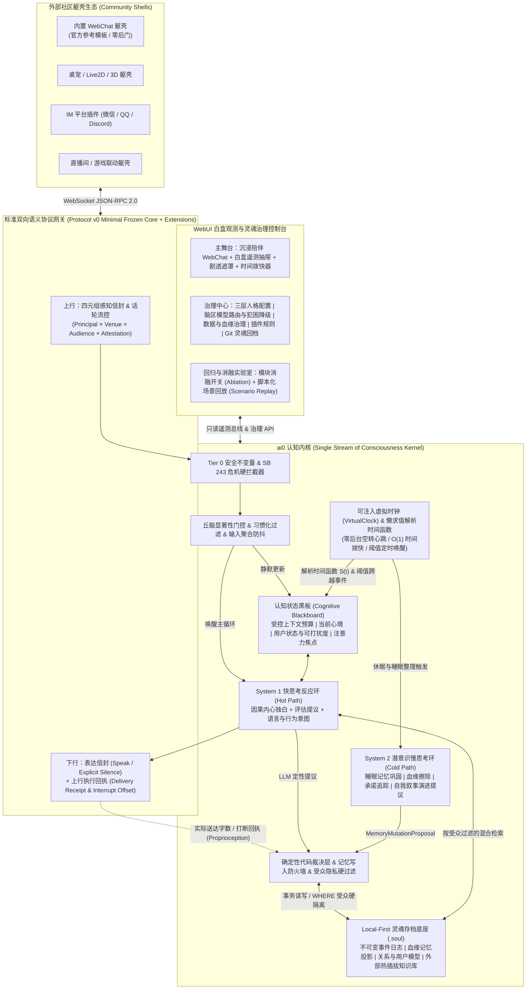

# `ai0` — 通用数字生命认知中枢与白盒养成控制台

> **Soul Archive Completely Independent; Shell Context Structurally Perceived; Companionship Bounded & Non-Manipulative.**  
> **灵魂存档彻底独立，躯壳信息结构化感知，伙伴关系真诚有边界。**

---

## 一、项目定位

`ai0` 是一个**不内置具体物理/视觉形态、由社区生态自由生长的通用型数字生命（赛博生命）认知中枢（Headless Cyber-Life Cognitive Kernel）**，配套一套**零后门、支持实时脑内白盒观测与灵魂主权治理的现代化 WebUI 控制台**。

本项目**不直接实现**桌宠客户端、Live2D/3D 骨骼与渲染引擎、VTuber 推流工具或各类 IM 平台（微信、QQ、Discord、Telegram）适配器——所有这些决定“她在哪里存在、长什么样子”的**躯壳（Shells）**均交由社区和用户按标准协议自由开发与装载。

`ai0` 只专注把最核心的三层与一套控制台做到极致：

1. **感知层（Upstream Semantic Perception）**：接收外部躯壳采集的多模态与环境信号，封装为携带**主体（Principal）、场合（Venue）、在场受众（Audience）与插件凭据（Attestation）**的标准化语义事件，原生支持流式增量输入、防抖撤回、打断（Barge-in）与隐私前移。
2. **大脑（The Invisible Cognitive Kernel）**：突破“聊天加向量数据库”的浅层拼接，将**三层人格可塑性与存在论契约、带认知溯源与血缘 DAG 的多层次记忆、情绪与内稳态动力学、关系与用户可打扰度模型、快慢双系统与零心跳懒求值时间流、单一意识流注意力仲裁、L0 安全与反操控不变量**咬合为一个有机的状态机。
3. **内在表现层（Downstream Semantic Expression Intents）**：输出与具体渲染引擎无关的**语义化行为表达指令**（基于极小冻结核心协议 v0 + 命名空间渐进扩展），涵盖台词话轮、显式沉默决策、情绪韵律、目光与微表情意图，并通过**上行播放回执（Delivery Receipt）**闭环本体感觉。
4. **WebUI 白盒观测与灵魂治理控制台（White-Box Console & Built-in WebChat）**：内置严格走标准外部协议（零后门）的 WebChat 参考躯壳；支持实时观测因果内心独白、情绪曲线、记忆读写血缘、时间拨快（Time-Warp）、模块消融（Ablation）与脚本化场景回归回放；提供涵盖灵魂配置、脑区模型路由与预算熔断、三层数据治理、插件行为编排与 Git 式灵魂存档的完整主权控制。

---

## 二、核心架构全景图

---

## 三、愿景研究与架构前置规范文档索引 (`docs/vision/`)

本仓库的 `docs/vision/` 目录完整收录了从“直觉构想”推进到“经得起推敲、可直接派生系统架构”的五篇深度专题研究报告。所有结论均严格区分并标注了 **`[文献/先行项目佐证]`**、**`[架构推断]`** 与 **`[仍未知/需实验验证]`**：

1. **[01-vision-and-predecessors.md](file:///c:/rin/coder/reina0721/ai0/docs/vision/01-vision-and-predecessors.md)**
   * 核心愿景定义与两次关键认知修正（存档独立而躯壳结构化感知、反留存操控的有边界伙伴关系）；
   * 先行者对照系深度剖析：**Project AIRI (`moeru-ai/airi`)**、**Letta (MemGPT Sleep-Time Compute)**、**SAIBA 虚拟人框架 (`FML`/`BML` 与反馈环)** 的得失复盘及 `ai0` 的本质取舍。
2. **[02-cognitive-kernel-and-boundaries.md](file:///c:/rin/coder/reina0721/ai0/docs/vision/02-cognitive-kernel-and-boundaries.md)**
   * 感知层规范：四元组溯源信封、指令-数据分离铁律、流式防抖打断、隐私前移及三项工程补丁；
   * 认知内核七大模块完整推演：三层人格可塑性、换模型声线校准、双层存在论契约（她如何理解自己是 AI 及离线/回档/被观测）、多层次记忆认知溯源、事件溯源四大隐藏代价与血缘 DAG 擦除、睡眠写入防火墙、承诺与前瞻记忆、双轨精力与 Token 预算耦合、关系 vs 用户模型分离与心结反操控边界、因果独白 vs 戏剧潜台词、零心跳懒求值时间函数、单一意识流与三维工具授权；
   * **《五维判别公理与三态路由法则》**：形式化界定哪些用确定性代码管死、哪些采用“LLM 提议 + 代码裁决”、哪些交给大模型自然涌现。
3. **[03-protocol-and-webui-console.md](file:///c:/rin/coder/reina0721/ai0/docs/vision/03-protocol-and-webui-console.md)**
   * 下行表达意图层：上行播放回执闭环、显式沉默原语、握手能力协商、**协议 v0 最小冻结核心（5 原语）Schema 规范与命名空间扩展机制**；
   * WebUI 控制台架构：零后门内置 WebChat、白盒脑内观测与观测者效应分析、剧透折叠遮罩（Spoiler Mask）、五大正式治理中心、以及回档断层（“我记得她不记得”）的三种弥合语义。
4. **[04-blindspots-priorities-and-mvp-slice.md](file:///c:/rin/coder/reina0721/ai0/docs/vision/04-blindspots-priorities-and-mvp-slice.md)**
   * 5 对已知核心矛盾 + **7 大新发现深层盲区与破局方案**（记忆语义坍缩反刍、关机休眠 vs 冷落时间差、多模态恐怖谷失步、热插拔知识库卸载失忆、消融开关与事件溯源因果悖论、上下文膨胀稀释人设、跨端心境侧信道泄密）；
   * 迈向可落地架构的 **P0~P6 核心问题拓扑优先级重排**；
   * **最小纵切片（Vertical Slice v0）** 的 8 项必含规格与 9 项安全推迟清单、以及全栈技术底座选型决断。
5. **[05-ethics-safety-and-sb243-compliance.md](file:///c:/rin/coder/reina0721/ai0/docs/vision/05-ethics-safety-and-sb243-compliance.md)**
   * 加州 **SB 243 (Companion Chatbot Law)** 专项法律边界分析（纯开源自托管分发 vs 托管运营者 Operator 的法律责任与私人诉讼权风险）；
   * 落到 `ai0` 内核架构上的四大确定性合规与伦理保护组件（L0 自杀/自伤危机硬拦截与 988 转介协议、AI 身份诚实披露、3 小时连续交互休息提醒、匿名危机统计导出与公开安全协议声明）。
