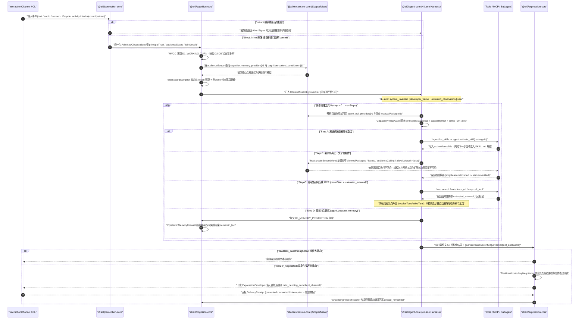
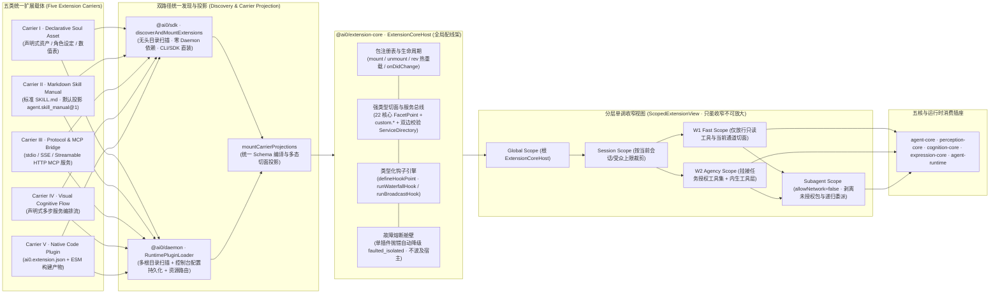
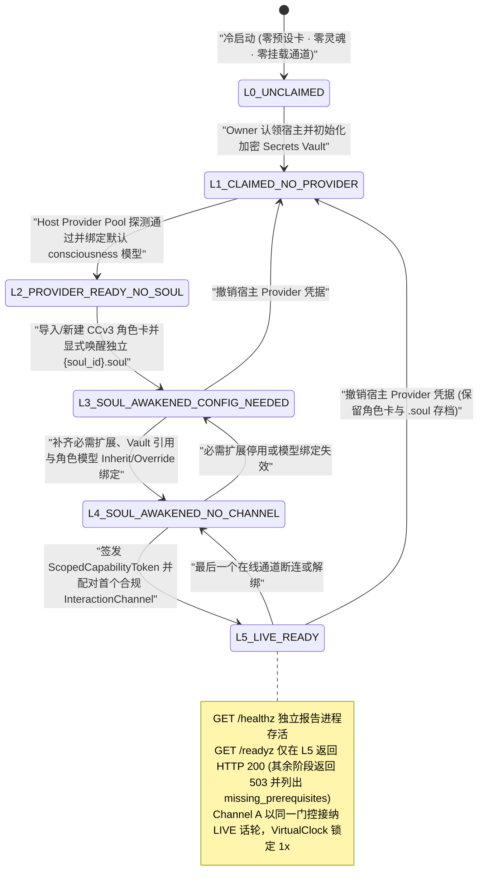

# ai0 · Universal Agent & Situated Subject Microkernel

> **Clean-Slate V1 · 底层通用架构设计阶段（Universal Foundation Phase）**
>
> 面向通用智能体与具身数字生命的**无头正交微内核**、**双环运行支撑体系（Harness）**与**零后门多切面扩展底座**。

[](docs/architecture/01-system-overview-and-monorepo.md)
[-1f2937?style=flat-square)](labs/README.md)
[](scripts/verify-architecture-boundaries.mjs)
[](package.json)
[](tsconfig.base.json)
[](packages/extension-core/package.json)
[](packages/agent-core/package.json)
[](plugins/agent-tools/mcp-bridge/package.json)

---

## 摘要与项目自述（Abstract）

**大模型不是智能体，对话外壳也不是数字生命。** 许多现有的 Agent 或 AI 伴侣工程从一开始就将“模型调用循环”“人格与情绪参数”“本地文件/网络工具”以及“具体交互平台（WebUI / IM / 桌面化身）”写死在同一个运行体中：结果要么无法脱离特定客户端独立运行，要么一旦接入外部网页、群聊或工具副作用，就会爆发提示词注入越权、记忆事实污染、跨端状态撕裂与上下文窗口膨胀。

**`ai0` 采取了一条更克制、自底向上的系统工程路径：** 它首先构建一套**用户自托管（Local-First / User-Owned）、零预设、完全可组合的无头运行底座**——所有能力均通过强类型契约与插件切面（`FacetPoint` / `ServiceContract` / `HookPoint`）动态装配，核心层在脱离 WebUI、脱离聊天软件、甚至移除全部伴侣策略插件后，依然是一台逻辑自洽、可离线验证、可热替换提供方的通用智能体引擎。

在设计哲学上，`ai0` 借鉴了现代插件化 Harness（如早期 **DeepSeek Harness** 以 Cordis 驱动的时空可组合性与“核心中立、配置组装”思想）以及自托管数字生命容器（如 **Project AIRI** 的跨媒介具身与用户主权理念），并进一步通过**双轮同构渐进派生**将整个系统解耦为三个正交层级：

- **Tier I · 通用智能体底层工程底座（Universal Agent Foundation）**：外环执行闭环、四车道权威隔离、同轮动态污点熔断、分层作用域扩展配线架、可热替换记忆契约，以及 `Tools × Skills × MCP` 标准扩展库；
- **Tier II · 具身与社会情境主体通用底座（Situated Subject Foundation）**：面向语音、桌宠、无眼机器人、游戏队友与多人群聊场景提炼出的感官覆盖锁、五域 MVCC 认知状态、四层认识论记忆防火墙与四态交付接地回执——在纯编码/任务 CLI 模式下可零开销旁路；
- **Tier III · 外置垂直领域策略插件（Domain Strategy Plugins）**：情绪稳态动力学 ODE、世界书、梦境手记、话轮防抖策略与各平台交互通道，全部严格隔离于 `plugins/` 之外按需挂载。

---

## 一、当前工程阶段与设计边界

> [!NOTE]
> **当前阶段声明**：本项目现阶段聚焦于**底层通用架构设计、微内核分层收敛与跨场景形式化证伪（Stage 0–8）**。仓库中 [docs/vision/](docs/vision/01-vision-and-predecessors.md) 与 [docs/architecture/](docs/architecture/01-system-overview-and-monorepo.md) 承载的是长期愿景与后续产品演进蓝图，留待底层通用架构彻底稳定后再进入下一阶段的修订研究，本阶段保持独立冻结。

| 维度 | 本阶段已固化并受机器门禁锁死的通用底座 | 留待后续阶段展开的上层愿景与产品演进 |
| :--- | :--- | :--- |
| **微内核边界** | 10 个公共核心包，其中 8 个有状态包严格执行 `L0 ./kernel ← L1 ./subsystems` 双层分层，由 [verify-architecture-boundaries.mjs](scripts/verify-architecture-boundaries.mjs) 9 条 AST 铁律自动守门。 | 上层多角色编排产品形态、长期关系叙事产品体验与跨设备商业化部署封装。 |
| **通用智能体能力** | `@ai0/agent-runtime` 无头双环运行时、`ScopedExtensionView` 单调收窄、四车道安全投影、同轮 `untrusted_external` 污点熔断、`cognition.memory_provider@1`、渐进式 `SKILL.md` 激活与独立 `pnpm agent` CLI。 | 面向特定垂直行业的复杂多智能体协作工作流、自主学习闭环与云端托管容器沙箱。 |
| **标准扩展生态** | 一等内置工具链（`workspace-tools` 9 工具、`web-tools` 检索+抓取、`utility-tools` 零副作用计算、`mcp-bridge` 渐进式标准 MCP 桥）及 2 份通用元技能 `SKILL.md`。 | 社区插件市场分发基础设施、第三方生态签名校验与大规模具身硬件驱动集。 |
| **形式化证伪基线** | `labs/stage0` → `labs/stage8` 渐进实验套件、黄金剧本明暗消融回放与 Playwright 浏览器端到端回归测试。 | 真实长周期（数周至数月）人机共处实证标定与个性化记忆压缩参数调优。 |

---

## 二、立基公理、双轮渐进派生与系统全景蓝图

`ai0` 的全部结构边界源自三条不可约的顶层解耦公理：

1. **执行与领域策略分离（Execution ≠ Domain Policy）**：模型流、多步工具回合、取消信号、重试窗口与 `goalVerification` 核验是纯机械执行原语，零陪伴、零情绪、零人设依赖；人格、稳态、世界书与场景反射全部经由外部切面注入。
2. **身份与具身分离（Identity ≠ Embodiment）**：宿主基础设施（`souls/host/`）、静态角色卡（`chara_card_v3`）、唤醒后的独立灵魂实例（`<soul_id>.soul/`）与运行期挂载的 `InteractionChannel` 四层正交分立；切设备不丢经历，无摄像头绝不可伪造视觉观察。
3. **输出与接地分离（Generated ≠ Presented ≠ Actuated ≠ UserGrounded）**：模型生成文本不等于对方已听见或执行器已生效；媒介断连或语音打断时，必须依据真实播放游标与回执结算已呈现前缀并保留 `unsaid_remainder`。

### 图 1 · 全系统四层架构与十包双层微内核（`L0 ./kernel ← L1 ./subsystems`）全景蓝图

```mermaid
flowchart TB
    subgraph Surfaces["交互入口与运行宿主层 (Interaction Surfaces & Hosts)"]
        CLI["pnpm agent 独立终端 CLI\n(单次任务 / 交互式 REPL / Ctrl+C 取消)"]
        Console["@ai0/console-webui\n(Owner 控制台 · 5 正交平面 · 零预设上线向导)"]
        Channels["已挂载 InteractionChannel 通道群\n(builtin.webchat / terminal / IM / 具身设备)"]
        Probes["部署与健康探针\n(GET /healthz · GET /readyz)"]
    end

    subgraph Transport["双平面网关与薄宿主装配层 (Gateway & Thin Host Assembly)"]
        subgraph GW["@ai0/gateway (L0 ← L1)"]
            GW_L0["L0 kernel: ScopedCapabilityToken 签发校验 · Audience 隔离"]
            GW_L1["L1 subsystems: Channel A Protocol v0 (/protocol/v0/channel) · Channel B Admin REST/SSE (/api/admin/v1/*)"]
            GW_L0 --> GW_L1
        end
        Daemon["@ai0/daemon (薄宿主装配 · 零硬编码人设)\nW1 快环 / W2 异步工具环 / W3 睡眠巩固 / W4 多模态分析 · RuntimePluginLoader"]
    end

    subgraph Tier1["Tier I · 通用智能体底层工程底座 (Universal Agent Foundation)"]
        Proto["@ai0/protocol (零内部依赖 · Zod 机器契约唯一真相源)\nObservation / Intent / Manifest / CapabilityRisk / TaintLevel / Memory / CCv3 / L0-L5"]

        subgraph ExtCore["@ai0/extension-core (全局扩展与作用域配线架)"]
            Ext_L0["L0 kernel: ExtensionComposition (Cordis) · FacetPoint (含 custom.*) · ServiceContract · HookPoint"]
            Ext_L1["L1 subsystems: ExtensionCoreHost (rev热重载/熔断隔离) · ScopedExtensionView (单调收窄) · ServiceDirectory · AssetCodec"]
            Ext_L0 --> Ext_L1
        end

        subgraph AgentCore["@ai0/agent-core (内环机械执行引擎 · Inner Harness)"]
            Agent_L0["L0 kernel: Turn/Round 引擎 · 四车道权威投影 · 重试边界 · AbortSignal · goalVerification"]
            Agent_L1["L1 subsystems: ContextAssemblyCompiler · 动态污点升级 (resolveTurnActiveTaint) · UpstreamModelClient (AI SDK v7)"]
            Agent_L0 --> Agent_L1
        end

        subgraph AgentRT["@ai0/agent-runtime (无头通用双环运行时 · Outer Loop)"]
            RT_L0["L0 kernel: UniversalAgentLoop (Perceive -> State -> Context -> Execute -> Express · 通道级打断)"]
            RT_L1["L1 subsystems: ComposedAgentRuntime (direct_inline / dual_speed_w1_w2) · IntrinsicToolsHostOverlay (7 内生工具)"]
            RT_L0 --> RT_L1
        end
    end

    subgraph Tier2["Tier II · 具身与社会情境主体通用底座 (Situated Subject Foundation · 可旁路)"]
        subgraph PercCore["@ai0/perception-core (上行感官归一)"]
            Perc_L0["L0 kernel: UniversalObservationFrame · SensoryCoverage (blind/stale) · TurnLifecycleGate · ReflexGate · Chronoception"]
            Perc_L1["L1 subsystems: PerceptionFilterPipeline · ObservationNormalizer · subscribePerceptionSource"]
            Perc_L0 --> Perc_L1
        end

        subgraph CogCore["@ai0/cognition-core (战略主体状态与认识论治理)"]
            Cog_L0["L0 kernel: VirtualClock · ContinuousStateMetaEngine (Abelian ODE) · StateDomainArbiter · BrainRegionRouter"]
            Cog_L1["L1 subsystems: AuthoritativeStateCoordinator (D1-D5 MVCC) · EpistemicMemoryFirewall · CommonGround · CapabilityPolicyGate · BlackboardCompiler · InMemoryCognitiveMemoryProvider · AgencyTaskWorker / SleepWorker"]
            Cog_L0 --> Cog_L1
        end

        subgraph ExprCore["@ai0/expression-core (对人外显协商与交付接地)"]
            Expr_L0["L0 kernel: InteractionOpportunityPool · KernelGroundingTracker (四态真值机与 unsaid_remainder)"]
            Expr_L1["L1 subsystems: RealizerVocabularyNegotiator · GroundingReceiptTracker · bindActuatorDelivery"]
            Expr_L0 --> Expr_L1
        end
    end

    subgraph SDK_Storage["扩展接入 SDK 与本地优先持久化 (SDK & Local-First Persistence)"]
        SDK["@ai0/sdk (零后门扩展 SDK)\n全部核心 FacetPoint 1:1 导出 · mountCarrierProjections · discoverAndMountExtensions 无头发现加载器"]
        subgraph Stor["@ai0/storage (Local-First 持久化)"]
            Stor_L0["L0 kernel: node:sqlite WAL/FTS5 · MemoryLineage · HardForgetEngine (跨快照真遗忘账本)"]
            Stor_L1["L1 subsystems: HybridMemoryRetriever · HostInfrastructure & Vault · CCv3 无损编解码 · SoulArchive"]
            Stor_L0 --> Stor_L1
        end
    end

    subgraph Plugins["外置多切面扩展生态 (plugins/** · 仅依赖 @ai0/protocol 与 @ai0/sdk)"]
        T1Tools["Tier I 标准通用工具链与元技能\nworkspace-tools (9工具+fs_watch) · web-tools (search+fetch) · utility-tools (3计算工具) · mcp-bridge (3 MCP代理) · 2 份通用 SKILL.md"]
        T3Domain["Tier III 垂直领域与具身插件\ncompanion-homeostasis · lorebook-contributor · attention-arbitrator · dream-journal · conversational-gate · emotion-tts-sideband · webchat / terminal"]
    end

    CLI --> AgentRT & SDK
    Console <--> GW
    Channels <--> GW
    Probes --> GW
    GW --> Daemon
    Daemon --> AgentRT & PercCore & CogCore & ExprCore & Stor & SDK

    ExtCore --> Proto
    AgentCore & PercCore & ExprCore & Stor & SDK --> Proto & ExtCore
    CogCore --> Proto & ExtCore & AgentCore
    AgentRT --> Proto & ExtCore & AgentCore & PercCore & CogCore & ExprCore
    GW --> Proto & ExtCore & PercCore & CogCore & ExprCore & Stor

    T1Tools & T3Domain -. "经 SDK 声明 Facet / Service / Hook · 零反向耦合" .-> ExtCore
    SDK --> Proto & ExtCore
```



### 十个核心公共包职责与 `L0 / L1` 分层对照表

| 核心包 | 层级归属 | `L0 ./kernel` 不可约公理原语 | `L1 ./subsystems` 可替换治理与切面消费层 | 包级文档 |
| :--- | :--- | :--- | :--- | :--- |
| **`@ai0/protocol`** | 公共契约 | 纯 Zod Schema 与协议类型（零内部依赖、零 Node I/O 依赖） | — | [protocol](packages/protocol/README.md) |
| **`@ai0/extension-core`** | Tier I 扩展核 | `ExtensionComposition`（Cordis）、`FacetPoint`（含 `custom.*`）、`ServiceContract`、`HookPoint` | `ExtensionCoreHost`、`ScopedExtensionView`（单调收窄）、`ServiceDirectory`、`runWaterfallHook` / `runBroadcastHook`、`AssetCodec` | [extension-core](packages/extension-core/README.md) |
| **`@ai0/agent-core`** | Tier I 内环 | `runKernelAgentTurn`、四车道权威投影、重试边界、`AbortSignal`、`goalVerification` | `ContextAssemblyCompiler`、同轮动态污点升级（`resolveTurnActiveTaint`）、`UpstreamModelClient`（AI SDK v7） | [agent-core](packages/agent-core/README.md) |
| **`@ai0/agent-runtime`** | Tier I 外环 | `UniversalAgentLoop`（时钟推进、通道队列与打断取消） | `ComposedAgentRuntime`（`direct_inline` / `dual_speed_w1_w2`）、双层上下文汇流、`IntrinsicToolsHostOverlay`（7 内生工具） | [agent-runtime](packages/agent-runtime/README.md) |
| **`@ai0/perception-core`** | Tier II 感知核 | `UniversalObservationFrame` 六元组、`SensoryCoverage`（`blind/stale`）、`TurnLifecycleGate`、`ReflexGate`、`Chronoception` | `PerceptionFilterPipeline`、`ObservationNormalizer`、`subscribePerceptionSource` | [perception-core](packages/perception-core/README.md) |
| **`@ai0/cognition-core`** | Tier II 认知核 | `VirtualClock`、`ContinuousStateMetaEngine`（阿贝尔群潜空间闭式 ODE）、`StateDomainArbiter`、`BrainRegionRouter` | 五域 MVCC `AuthoritativeStateCoordinator`、`EpistemicMemoryFirewall`、`CommonGround`、`CapabilityPolicyGate`、动态槽位 `BlackboardCompiler`、`InMemoryCognitiveMemoryProvider`、W2/W3 工作循环 | [cognition-core](packages/cognition-core/README.md) |
| **`@ai0/expression-core`** | Tier II 表达核 | `InteractionOpportunityPool`、`KernelGroundingTracker`（四态真值机与 `unsaid_remainder`） | `RealizerVocabularyNegotiator`、`GroundingReceiptTracker`、`bindActuatorDelivery` | [expression-core](packages/expression-core/README.md) |
| **`@ai0/storage`** | 基础设施 | `node:sqlite` WAL/FTS5 引擎、记忆血缘图谱、`HardForgetEngine`（跨快照擦除账本） | `HybridMemoryRetriever`、宿主 Vault、`chara_card_v3` 无损编解码、`.soul` 归档管理 | [storage](packages/storage/README.md) |
| **`@ai0/gateway`** | 传输边界 | `ScopedCapabilityToken` 签发校验、受众/主体鉴权原语 | `ChannelProtocolGateway`（Channel A）、`PrivilegedAdminServer`（Channel B）、`/healthz` & `/readyz` | [gateway](packages/gateway/README.md) |
| **`@ai0/sdk`** | 扩展作者 SDK | — | 全部核心 `FacetPoint` 1:1 对等导出、`defineExtensionPackage`、`mountCarrierProjections`、`discoverAndMountExtensions` 无头加载器 | [sdk](packages/sdk/README.md) |

---

## 三、内外双环运行机制、动态污点熔断与四态接地

`ai0` 在同一套 `@ai0/agent-runtime` 引擎上原生承载两种运行拓扑，无需为“编码助手”和“具身伴侣”维护两套分裂架构：

- **`direct_inline`（通用编码 / 调研 / 任务智能体模式）**：支持旁路感知去抖与表达词表协商（策略等待 `0 ms`），在策略与动态污点门控校验后，内联完成规划、读写改、补丁、Git 检查、子智能体委派与 MCP 调用。
- **`dual_speed_w1_w2`（具身与对话主体模式）**：`W1` 快环强制仅放行 `read_only_safe` 主动求知与后台目标登记（`agent.dispatch_background_goal`），维持低延迟实时交互；所有写改、命令与长耗时外部动作路由至 `W2` 异步多步工具环，并实时回写 `D4_COMMITMENTS_TASKS` 本体感觉进度供表达层感知，随时响应 `AbortSignal` 打断强杀。

### 图 2 · 端到端双环执行、四车道权威分离、动态污点熔断与交付接地时序蓝图



---

## 四、零后门扩展中枢与 `Tools × Skills × MCP` 标准库

`@ai0/extension-core` 拒绝成为反向耦合业务核的“上帝路由器”，而是采用严格的 **IoC“插座 $\times$ 插头 $\times$ 分层作用域配线架”**架构：

- **消费核定义插座**：通过 `defineFacetPoint` 与 `defineHookPoint` 声明强类型、带版本号的扩展接点（并向第三方生态开放 `custom.<namespace>.<name>` 多提供方切面）；
- **扩展包声明插头**：任何扩展包仅依赖 `@ai0/protocol` 与 `@ai0/sdk`，在一个 `ai0.extension.json` 清单中声明多切面与最小权限集；
- **扩展核治理配线架**：`ExtensionCoreHost` 掌管整包启停、乐观锁 `rev` 配置热重载、`onDidChange` 订阅与异常自动 `faulted_isolated` 整包熔断；通过 `host.createScopedView(policy)` 派生可递归嵌套且**严格单调收窄（Monotonic Attenuation）**的 `ScopedExtensionView`——子作用域绝不可放大父作用域已收紧的包白名单、切面集、受众上限或网络访问权。

### 图 3 · 五类扩展载体投影、`@ai0/extension-core` 配线架与分层单调收窄作用域蓝图



### 内置通用扩展生态（`Tools × Skills × MCP` 三元正交分工）

遵循**“原子手脚（Tools）$\times$ 战术方法论（Skills）$\times$ 外部标准总线（MCP）”**的正交分工律，仓库内置了通用 Agent 的最小完备标准库，而所有宿主 I/O 与联网扩展包均维持默认 Fail-Closed（仅纯内存零副作用辅助包默认启用）：

| 类别 | 扩展包 / 技能标识 | 默认状态 | 风险与污点边界 | 核心能力清单 |
| :--- | :--- | :--- | :--- | :--- |
| **L1 内生机制工具** | `runtime.intrinsic`（[@ai0/agent-runtime](packages/agent-runtime/src/subsystems/intrinsic-tools.ts)） | 按需开启（CLI 默认开） | 可被同名外部 `agent.tool_provider@1` 覆盖替换 | `agent.update_plan`、`agent.delegate_subagent`（`ScopedExtensionView` 单调收窄）、`agent.list_skills`、`agent.activate_skill`、`agent.dispatch_background_goal`、`agent.recall_memory`、`agent.propose_memory`（过认识论防火墙） |
| **一等工作区工具包** | `builtin.workspace-tools`（[workspace-tools](plugins/agent-tools/workspace-tools/ai0.extension.json)） | `default_enabled: false` | `realpath` 路径沙箱 + 敏感凭证拒止 + 子进程环境变量脱敏 | **9 项主动工具**：`list_directory`、`glob_files`、`read_file`、`search_files`、`git_status_diff`（`shell: false` 只读 Git 检查）、`write_file`、`edit_file`、`apply_patch`（多块全有或全无原子补丁）、`run_command`（`AbortSignal` 终止子进程树）；**1 项被动感知源**：`workspace.fs_watch`（`perception.source@1`） |
| **一等联网工具包** | `builtin.web-tools`（[web-tools](plugins/agent-tools/web-tools/ai0.extension.json)） | `default_enabled: false` | DNS 预解析 + 逐跳重定向私网/环回/云元数据 SSRF 拦截；**全量强制 `untrusted_external`** | `web.search`（支持免 Key DuckDuckGo HTML / SearXNG / Tavily / Brave）、`web.fetch_url`（有界流读取与 HTML 正文提纯） |
| **一等辅助工具包** | `builtin.utility-tools`（[utility-tools](plugins/agent-tools/utility-tools/ai0.extension.json)） | **`default_enabled: true`** | 纯内存无副作用（`network_access: false`、`read_only_safe`） | `util.datetime`（IANA 时区与精确时长差）、`util.calculate`（纯手写递归下降求值器，零 `eval`）、`util.json_query`（JSON 校验与路径投影） |
| **渐进式 MCP 协议桥** | `builtin.mcp-bridge`（[mcp-bridge](plugins/agent-tools/mcp-bridge/ai0.extension.json)） | `default_enabled: false` | 兼容标准 `{"mcpServers": {...}}`（`stdio/SSE/HTTP`）；调用与读取强制 `untrusted_external` | 仅以 3 个固定工具（`mcp.list_servers_and_tools`、`mcp.call_tool`、`mcp.read_resource`）按需代理任意数量外部 MCP 服务，彻底规避大批量 Schema 撑爆上下文窗口 |
| **Tier I 通用元技能** | [systematic-code-engineering](plugins/skills-and-mcp/systematic-code-engineering/SKILL.md) · [verified-research-synthesis](plugins/skills-and-mcp/verified-research-synthesis/SKILL.md) | 渐进按需激活 | 零代码副作用；经 `agent.list_skills / activate_skill` 或 `--skill` 按需加载 | 规范代码“探索 → 规划 → 原子补丁 → Diff/测试核验”与联网“多源检索 → 一手正文 → 污点隔离引用”的工程纪律 |
| **Tier III 领域参考插件** | `companion-homeostasis` · `lorebook-contributor` · `attention-arbitrator` · `dream-journal` · `conversational-gate` · `emotion-tts-sideband` · `webchat` · `terminal` · `daily-companion-review` | 按需挂载 | 100% 外置于 `plugins/`，卸载后核心瞬时退回纯净中立状态 | 示范数字生命情绪稳态、世界书递归激活、多通道注意力仲裁、语音播放游标换算与悬浮式 WebChat 舞台的零后门实现 |

---

## 五、技术栈、依赖边界与 AST 架构铁律

`ai0` 对第三方依赖执行严格的**分层隔离原则**：任何重型 SDK（模型传输、MCP 客户端、HTTP 路由、富文本对话 UI）都只允许出现在其唯一责任包中，绝不允许向无关核心泄漏。

| 架构层次 | 核心技术与版本 | 徽章 | 唯一允许落位与工程选型理由 |
| :--- | :--- | :--- | :--- |
| **运行时与语言** | Node.js `>=24.0` · TypeScript `5.7` · pnpm `10.22` |    | 全仓原生 ESM（`NodeNext`）与严格类型检查，利用 Node 24 原生 `node:sqlite` 与 `process.getBuiltinModule` 减少外部原生编译依赖。 |
| **机器契约层** | Zod `^3.24` · Ajv `8.20` · YAML `2.9` |  | `@ai0/protocol` 仅允许依赖 `zod`，作为全仓数据、权限与清单的唯一运行时验证源；Ajv 用于严格校验外部 MCP JSON Schema 2020-12。 |
| **扩展与 IoC 内核** | `@deepseek-ai/cordis` `4.1.0` |  | 仅落位于 `@ai0/extension-core`，支撑插件 Fiber 生命周期、服务依赖图谱与作用域资源自动回收。 |
| **模型推理传输** | Vercel AI SDK `ai` `7.0`（`@ai-sdk/openai-compatible` / `@ai-sdk/anthropic` / `@ai-sdk/deepseek`） |  | 严格收口在 `@ai0/agent-core`，`apps/daemon` 禁止直接依赖 `ai`，统一提供多供应商流式推理、结构化输出与多 Key 轮询。 |
| **MCP 外部协议** | `@modelcontextprotocol/sdk` `1.32.2` |  | 仅落位于 `plugins/agent-tools/mcp-bridge` 与 `apps/daemon`，支持 `stdio`、`SSE` 与 `Streamable HTTP` 全传输。 |
| **本地优先存储** | Node 内置 `node:sqlite`（WAL + FTS5） |  | 仅落位于 `@ai0/storage`，零 C++ 原生二进制编译痛点，实现受众 SQL 隔离、记忆血缘溯源与跨快照硬遗忘。 |
| **宿主服务网关** | Hono `4.13` + `@hono/node-server` `2.1` |  | 仅落位于 `apps/daemon`，承载双平面 REST/SSE 路由与静态编译后插件资产安全分发。 |
| **控制台与通道 UI** | React `19.3` · MUI `9.5` · React Router `8.5` · Vite `8.3` · `@assistant-ui/react` `0.15` · `streamdown` `2.8` |    | `apps/console` 专注宿主运维控制台；聊天流式渲染依赖（`@assistant-ui/react`、`streamdown`）由 AST 门禁锁死在 `plugins/channels/webchat` 内部，宿主零污染。 |
| **自动化验证与门禁** | Vitest `3.0` · Playwright `1.65` · TypeScript AST Compiler API |   | 覆盖 9 条仓库级 AST 架构不变量检查、61 个测试文件（221 条用例）、黄金剧本回归与真实浏览器 E2E 测试。 |

### 9 条机械强制执行的 AST 架构不变量（`pnpm verify:boundaries`）

1. **包布局锁定**：`packages/` 目录严格限定为 10 个已声明工作区包，禁止野包膨胀；
2. **协议零依赖**：`@ai0/protocol` 仅可依赖 `zod`，严禁引用任何内部包或 `node:fs / sqlite / http`；
3. **插件零后门**：`plugins/**` 在所有内部包中仅允许引用 `@ai0/protocol` 与 `@ai0/sdk`；
4. **核心无头纯净**：六个无头核心包严禁引用任何前端框架、Electron、聊天平台 SDK 或 Live2D 渲染库，且严格遵循单向依赖白名单；
5. **控制台设计系统分治**：业务组件与设计原语分层隔离；
6. **禁止静态旁路 Schema**：杜绝未通过协议校验的静态旁路定义；
7. **宿主零插件污染**：`packages/**` 与 `apps/**` 严禁在编译期静态导入 `@ai0/plugin-*` 或 `plugins/**` 源码，一切插件仅通过清单与 SDK 动态装配；
8. **Clean-Slate V1 纯净与切面 1:1 对等**：严禁历史兼容垫片、严禁在无头核心嵌入伴侣人设预设、严禁在 `extension-core/kernel` 残留 UI 符号，并强制校验 `@ai0/sdk` 与消费核 `FacetPoint` 1:1 契约对等；
9. **八包双层微内核单向锁**：全部 8 个有状态包必须同时导出 `.`、`./kernel`、`./subsystems`，且 `L0 ./kernel` 严禁反向导入 `L1 ./subsystems`。

---

## 六、四层物理实体、零预设上线（`L0–L5`）与渐进实验

### 图 4 · 零预设 Deploy-to-Live（`L0–L5`）状态迁移与失活降级重算机



| 阶段 | Go-Live Onboarding Checklist 核心前置条件 |
| :--- | :--- |
| `L0_UNCLAIMED` | Owner 认领宿主、确认 `deployment_mode` 并初始化加密 Secrets Vault。新部署的角色卡、Soul 与挂载列表为空。 |
| `L1_CLAIMED_NO_PROVIDER` | 在 Host Provider Pool 配置并在线验证真实模型，绑定必需的 `consciousness` 宿主默认模型（`vision` / `speech` 按需配置）。支持 OpenCode Go（`opencode_go`）、OpenAI-compatible、Anthropic、DeepSeek 与 Ollama。 |
| `L2_PROVIDER_READY_NO_SOUL` | 创建空白 Character Card V3（`chara_card_v3`）或导入角色卡（无损保留未知 `extensions.<namespace>`），Owner 显式从静态卡唤醒独立的 `<soul_id>.soul`。 |
| `L3_SOUL_AWAKENED_CONFIG_NEEDED` | 补齐必需扩展、Vault 引用及角色模型绑定（支持按模块 `Inherit` 或 `Override`）。未授权的可选传感器锁定为 `"blind"`，严禁凭空推断未观测事实。 |
| `L4_SOUL_AWAKENED_NO_CHANNEL` | 绑定跨端 `Principal`，签发受限作用域 `ScopedCapabilityToken`，通过 `HandshakeManifest` 配对首个在线合规通道（如 `builtin.webchat`）。 |
| `L5_LIVE_READY` | 全部前置条件满足，开始接纳 LIVE 话轮，`VirtualClock` 锁定 1x；任何前置条件失效时自动从首个缺口重新降级计算。 |

### 渐进式架构推演实验室（`labs/stage0` → `labs/stage8`）

`ai0` 的每一层核心抽象都先在 [labs/](labs/README.md) 中以零产品依赖的可执行反例轨迹证伪，再收敛回主仓 `packages/`：

- **`Stage 0 · 纸面形式化推演`**（[stage0-paper-traces](labs/stage0-paper-traces/index.ts)）：固定四态接地互斥不变量、四层物理实体引用完整性与 L0–L5 生命周期轨迹；
- **`Stage 1 · 最小通用 Agent`**（[stage1-agent-core](labs/stage1-agent-core/index.ts)）：验证三层授权分栏、工具回执配对、首增量后禁重试与 `AbortSignal`；
- **`Stage 2 · AIRI 源码解剖`**（[stage2-airi-dissection](labs/stage2-airi-dissection/index.ts)）：对照先行体系检验分桶上下文 TTL/覆盖锁、CCv3 未知扩展无损往返与本地反射抑制；
- **`Stage 3 · 感知与表达推导`**（[stage3-perception-expression](labs/stage3-perception-expression/index.ts)）：冻结执行器，推导具身可供性、话轮防抖/撤稿、清醒时距、零人形表达意图与双边界打断接地；
- **`Stage 4 · 最小认知核组合`**（[stage4-universal-derivation](labs/stage4-universal-derivation/stage4.test.ts)）：阿贝尔群潜空间闭式连续状态引擎与四层认识论记忆防火墙，在 WebChat / 桌宠 / 游戏 / 无眼手环四场景下证伪；
- **`Stage 5–6 · 组合通道切面与策略消融`**（[stage5](labs/stage5-composite-channel-facets/stage5.test.ts) · [stage6](labs/stage6-mechanism-policy-ablation/stage6.test.ts)）：在同一五核机制上对比消融伴侣配置与 0ms 策略等待的 CLI Task Agent；
- **`Stage 7 · 公开契约作者替换`**（[stage7-public-contracts](labs/stage7-public-contracts/stage7.test.ts)）：检验 SDK 与核心切面 1:1 对等、无原定义者在线时的服务提供方替代与插件独立卸载；
- **`Stage 8 · 双层底座合拢收官`**（[stage8-universal-agent-convergence](labs/stage8-universal-agent-convergence/stage8.test.ts)）：逐级证伪 **Tier I 纯通用智能体（记忆/文件系统热替换 + `D4` 规划 + `ScopedExtensionView` 子智能体收窄 + 同轮渐进 `SKILL.md` 激活 + `HookPoint` 熔断）** → **Tier I + Tier II 零伴侣插件具身合拢** → **Tier III 伴侣器官热叠加与瞬间归零卸载**。

### Monorepo 工程拓扑

```text
ai0/
├── packages/                                # 10 个核心公共包（其中 8 个为 L0 ./kernel <- L1 ./subsystems）
│   ├── protocol/                            # 纯 Zod 机器契约唯一真相源
│   ├── extension-core/                      # Cordis · Facet/Service/Hook · ScopedExtensionView 单调收窄
│   ├── agent-core/                          # 四车道内环 Turn/Round 执行引擎与动态污点熔断
│   ├── agent-runtime/                       # 无头通用双环外环运行时与 7 项子层内生可替换工具
│   ├── perception-core/                     # 观察六元组 · 感官覆盖锁 · 话轮门控 · 清醒时距
│   ├── cognition-core/                      # 五域 MVCC · 认识论防火墙 · 动态黑板 · 记忆契约与 W2/W3 循环
│   ├── expression-core/                     # 受众隐私围栏 · 表现词表协商 · 四态交付接地与 unsaid_remainder
│   ├── storage/                             # Local-First node:sqlite WAL/FTS5 · 血缘图谱 · 跨快照真遗忘
│   ├── gateway/                             # Channel A Protocol v0 + Channel B Admin REST/SSE + 令牌鉴权
│   └── sdk/                                 # 零后门插件 SDK · 1:1 切面导出 · 无头目录发现加载器
├── plugins/                                 # 一包多切面外置扩展生态（仅依赖 @ai0/protocol 与 @ai0/sdk）
│   ├── agent-tools/                         # Tier I 一等标准工具包：workspace-tools / web-tools / utility-tools / mcp-bridge
│   ├── skills-and-mcp/                      # 通用工程/调研元技能 SKILL.md 与伴侣示例技能
│   ├── channels/                            # webchat / terminal 等交互通道
│   ├── cognitive-organs/                    # companion-homeostasis / lorebook-contributor / attention-arbitrator / dream-journal
│   ├── perception-filters/                  # conversational-gate 话轮防抖与撤稿感知策略
│   ├── media-pipelines/                     # emotion-tts-sideband 多模态媒体转码与播放游标
│   └── flows-and-assets/                    # 声明式流程与资产包
├── labs/                                    # Stage 0 -> Stage 8 渐进式形式化证伪实验套件
├── apps/
│   ├── daemon/                              # @ai0/daemon：薄宿主装配 + 独立 pnpm agent CLI 入口
│   └── console/                             # @ai0/console-webui：Owner 控制台（React 19 + MUI 9 + Vite 8）
├── souls/
│   ├── host/                                # 宿主基础设施与加密 Vault（初始零角色卡）
│   └── <soul_id>.soul/                      # Owner 显式唤醒后生成的独立灵魂存档
├── scripts/
│   └── verify-architecture-boundaries.mjs   # 9 条仓库级 AST 架构不变量门禁
└── docs/
    ├── vision/                              # 01–05（长期愿景研究，留待后续阶段迭代）
    └── architecture/                        # 01–09（上层工程规格，留待后续阶段迭代）
```

---

## 七、快速启动、独立无头 CLI 与验收门禁

环境要求：**Node.js 24+** 与 **pnpm 10+**。

### 1. 全量验证与 WebUI 全栈启动

```bash
pnpm install
pnpm verify:boundaries          # 9 条 AST 架构不变量静态门禁
pnpm build && pnpm typecheck    # 全仓 24 个工作区项目构建与类型检查
pnpm test                       # 61 个测试文件（221 条用例，含 labs/stage0..stage8）
pnpm replay:golden              # 黄金回归场景明暗消融回放（22/22 断言）
pnpm dev                        # 启动守护进程与 Owner 控制台 (http://127.0.0.1:4173)
```

### 2. 脱离 WebUI 与 HTTP 网关运行独立通用 Agent CLI（`pnpm agent`）

无需启动 WebUI 或 Daemon HTTP 服务，直接通过无头加载器挂载工作区、计算辅助、技能手册与外部 MCP Server：

```bash
# 离线沙箱烟雾验证（自动挂载 workspace-tools、utility-tools 并预绑定通用工程技能）
pnpm agent --workspace . --sandbox --skill builtin.skill.systematic-code-engineering --prompt "List files and summarize"

# 连接真实模型（读取 AI0_API_KEY / OPENAI_API_KEY / ANTHROPIC_API_KEY 或宿主只读配置）进入支持 Ctrl+C 打断的交互式 REPL
pnpm agent --workspace /path/to/repo --enable-web --mcp-config ./mcp.json
```

### 3. 浏览器端到端回归验收

```bash
pnpm verify:composition-browser # Playwright 真实浏览器插件热组合与 WebChat 回归（8/8 用例）
```

---

## 八、文档导航

### 通用层包级工程文档

| 开发与研究入口 | 对应包文档 |
| :--- | :--- |
| 跨包契约、插件 SDK、作用域扩展中枢与参考扩展 | [protocol](packages/protocol/README.md) · [sdk](packages/sdk/README.md) · [extension-core](packages/extension-core/README.md) · [plugins](plugins/README.md) |
| 通用双环运行、内环执行、感知、认知状态与表达接地 | [agent-runtime](packages/agent-runtime/README.md) · [agent-core](packages/agent-core/README.md) · [perception-core](packages/perception-core/README.md) · [cognition-core](packages/cognition-core/README.md) · [expression-core](packages/expression-core/README.md) |
| 本地持久化、双平面网关、薄宿主装配与渐进实验室 | [storage](packages/storage/README.md) · [gateway](packages/gateway/README.md) · [daemon](apps/daemon/README.md) · [labs (Stage 0–8)](labs/README.md) |
| Owner 控制台页面、共享上下文、路由与设计系统 | [console](apps/console/README.md) · [api](apps/console/src/api/README.md) · [context](apps/console/src/context/README.md) · [router](apps/console/src/router/README.md) · [pages](apps/console/src/pages/README.md) · [design-system](apps/console/src/design-system/README.md) |

### 愿景研究与上层工程规格（后续阶段研究基线，当前阶段保持冻结）

**愿景与问题域（`docs/vision/`）**

1. 项目立基公理、先行体系对照与零预设 Deploy-to-Live：[01 愿景与先行者](docs/vision/01-vision-and-predecessors.md)
2. 认知与行为边界、隐私约束和失效防护：[02 认知内核与边界](docs/vision/02-cognitive-kernel-and-boundaries.md)
3. 具身协议、扩展契约与 Owner 控制台原则：[03 协议与控制台](docs/vision/03-protocol-and-webui-console.md)
4. 设计盲点、优先级和最小验证切片：[04 盲点与 MVP](docs/vision/04-blindspots-priorities-and-mvp-slice.md)
5. Tier 0 安全底线、反情感操控与 SB 243 约束：[05 伦理与安全](docs/vision/05-ethics-safety-and-sb243-compliance.md)

**工程规格与交付（`docs/architecture/`）**

1. 三级派生、包拓扑与依赖允许清单：[01 系统总体架构](docs/architecture/01-system-overview-and-monorepo.md)
2. 宿主与角色存档、SQLite Schema、记忆血缘和真遗忘：[02 存储与灵魂存档](docs/architecture/02-storage-and-soul-archive-schema.md)
3. 五域状态协调、认知黑板与 W1–W4 循环：[03 运行时协调与能动性循环](docs/architecture/03-runtime-coordinator-and-agency-loop.md)
4. Protocol v0、双平面网关、受限令牌、表达回执与就绪门控：[04 协议与网关规格](docs/architecture/04-protocol-v0-and-gateway-spec.md)
5. 多切面扩展接口、五类载体与统一权限边界：[05 多切面扩展规范](docs/architecture/05-eight-dimension-extension-system.md)
6. 零预设上线向导、紧凑 MD3、管理接口与回放观测：[06 控制台与可观测性](docs/architecture/06-webui-console-and-observability-arch.md)
7. Clean-Slate V1 架构决断记录与先行项目实证：[07 ADR 与先行实证](docs/architecture/07-implementation-adrs-and-deviation-ledger.md)
8. 渐进证伪、空卷上线验收与交付门槛：[08 产品验证与交付计划](docs/architecture/08-product-validation-and-delivery-plan.md)
9. 通用 Agent 扩展边界、契约改动半径与验证方案：[09 通用 Agent 契约与验证](docs/architecture/09-universal-agent-contracts.md)
