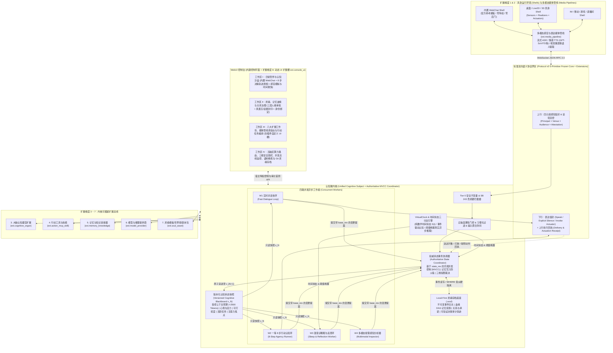

# `ai0` — 通用数字生命认知中枢 (Universal Cyber-Life Cognitive Kernel)

> **Soul Archive Completely Independent; Shell Context Structurally Perceived; Companionship Bounded & Non-Manipulative.**  
> **灵魂存档彻底独立，躯壳信息结构化感知，伙伴关系真诚有边界。**

> **项目状态定义：`架构研究与工程规格设计阶段`（Architecture Research & Engineering Specification Phase）**
> * **当前交付物**：问题域认知理论与伦理边界研究（`docs/vision/`）、解法域全量系统工程架构规格（`docs/architecture/`）。
> * **当前阶段边界**：本仓库当前专注于架构公理推演、数据模型 DDL、并发状态机、协议 Schema 与控制台规格的严谨定义（尚不包含运行代码实现）；下一工程里程碑为依据本规格启动 **最小纵切片（Vertical Slice v0）** 原型实现与实测标定。

---

## 一、项目定位

`ai0` 是一个**不内置具体物理/视觉形态、采用“确定性微内核 + 八大标准化扩展总线”架构、由社区生态自由生长的通用型数字生命（赛博生命）认知中枢**。

本项目**不直接内置**具体的桌宠客户端、Live2D/3D 骨骼渲染引擎、VTuber 推流软件或特定 IM 平台（微信、QQ、Discord、Telegram）适配器——所有这些外部交互形态与扩展能力均通过标准协议与扩展接口由社区生态自由装载。

本系统架构专注打磨最核心的**三层认知与交互主干**、**八大微内核扩展机制**，以及作为系统标配控制平面的 **`WebUI 控制台`**：

1. **感知层（Upstream Semantic Perception）**：接收外部**具身运行环境（Shell）**与**多模态媒体管线（Media Pipeline）**采集的信号，封装为携带**主体（Principal）、场合（Venue）、在场受众（Audience）与插件凭据（Attestation）**的标准化语义事件，原生支持流式增量输入、防抖撤回、打断（Barge-in）与隐私前移。
2. **大脑（The Invisible Cognitive Kernel）**：采用**“单一认知主体 + 权威状态事务协调器（MVCC） + 四路异步并发工作者”**的微内核架构，将**三层人格可塑性与存在论契约、带认知溯源与血缘 DAG 的多层次记忆、情绪与内稳态动力学、关系与用户可打扰度模型、时间状态三分法（确定性时间状态 / 事件驱动认知 / 阈值触发的真实异步反思）、以及一等的 8 步多步行动认知闭环（Action Cognition Loop）**咬合为一个支持认知器官插拔与模块消融的有机状态机。
3. **内在表现与具身执行层（Downstream Expression & Embodied Actuation）**：基于**极小冻结核心协议 v0（5 原语）+ 命名空间渐进扩展**，输出与具体渲染器无关的语义化行为表达指令（台词话轮、显式沉默决策、情绪韵律、目光与微表情同步锚点）与端侧具身动作调用（Shell Actuators），并通过**上行播放与执行回执（Delivery & Actuation Receipt）**闭环本体感觉。
4. **八大维度社区扩展生态（The 8-Dimension Pluggable Ecosystem）**：突破普通 Agent 只有 `MCP/Skill` 的局限，提供涵盖 **① 具身运行环境（Shells）、② 多模态音视频与感官管线（ASR/情感 TTS/视觉语义）、③ 大脑认知器官与钩子（Cognitive Organs）、④ 行动工具与技能（MCP & Skills）、⑤ 记忆引擎与活体知识连接器（Memory & Knowledge Connectors）、⑥ 模型与推理提供商（含本地推理与角色 LoRA）、⑦ 灵魂资产包与世界观词库（Soul Templates / Lorebooks / 评测剧本）、⑧ 控制台自定义 UI 视图（Console UI Widgets）** 的全链路扩展点。前 7 类扩展由后台内核运行时直接宿主执行（关掉浏览器丝毫不影响数字生命与后台扩展持续运转）。
5. **官方浏览器端管理与实验界面（`WebUI 控制台`）**：**`WebUI 控制台` 是官方随项目提供的浏览器管理、观测与实验界面**。使用者通过它与内置标准协议 `WebChat` 日常相处、配置灵魂实例、管理后台扩展与权限、通过只读决策轨迹查证数字个体的行为、治理其记忆血缘与存档，并在隔离的实验副本（`Sandbox Fork`）上执行感官模拟、虚拟时间拨快、模块消融与回归回放。

---

## 二、微内核与八大扩展生态架构全景图

---

## 三、项目文档体系导航 (`docs/vision/` & `docs/architecture/`)

本项目文档严格遵循**“问题域（愿景与认知法则 Why & What）”**与**“解法域（系统工程架构规范 How）”**分离的原则，组织在 `docs/` 目录下的两个子文件夹中：

### 3.1 愿景研究与认知法则 (`docs/vision/` — Why & What)
定义我们想要创造什么样的数字生命、她的认知与伦理边界在哪里、以及如何判断代码与大模型的职责分野：
1. **[01-vision-and-predecessors.md](./docs/vision/01-vision-and-predecessors.md)** — 核心愿景、存档独立与具身感知公理、有边界的伙伴关系本体、具身运行环境定义，以及与 **Project AIRI**、**Letta (MemGPT)**、**SAIBA (FML/BML)** 的深度对照参照。
2. **[02-cognitive-kernel-and-boundaries.md](./docs/vision/02-cognitive-kernel-and-boundaries.md)** — 感知四元组信封、大脑七大认知模块、时间状态三分法、统一主体与并发协调、8 步一等行动认知闭环、以及**《五维判别公理与三态路由法则》**。
3. **[03-protocol-and-webui-console.md](./docs/vision/03-protocol-and-webui-console.md)** — 下行表达意图与播放回执闭环、协议 v0 最小核心原则、八大扩展维度总览、以及 `WebUI 控制台` 的系统定位、三大入口（正式相处 vs 隔离实验）与四大工作区映射。
4. **[04-blindspots-priorities-and-mvp-slice.md](./docs/vision/04-blindspots-priorities-and-mvp-slice.md)** — 12 项核心设计张力与长程失效防护矩阵、P0~P6 架构依赖派生拓扑，以及 **最小纵切片（Vertical Slice v0）** 必含规格。
5. **[05-ethics-safety-and-sb243-compliance.md](./docs/vision/05-ethics-safety-and-sb243-compliance.md)** — 加州 **SB 243 (Companion Chatbot Law)** 法律责任边界参照、四大内置确定性合规组件与反情感操控五项宪章。

### 3.2 全量系统工程架构设计 (`docs/architecture/` — How)
由愿景直接派生出的工程施工蓝图，涵盖微内核目标包拓扑、数据库 DDL、并发状态机、协议契约、八大插件总线与控制台架构：
1. **[01-system-overview-and-monorepo.md](./docs/architecture/01-system-overview-and-monorepo.md)** — 微内核总体架构、数据面 vs 控制面隔离、TypeScript Monorepo 目标工程包拓扑与编译期依赖约束规则。
2. **[02-storage-and-soul-archive-schema.md](./docs/architecture/02-storage-and-soul-archive-schema.md)** — `.soul` 灵魂存档目录规范、SQLite + `sqlite-vec` 完整建表 DDL、事件溯源与血缘 DAG 级联真遗忘（含跨快照墓碑账本重放）算法。
3. **[03-runtime-coordinator-and-agency-loop.md](./docs/architecture/03-runtime-coordinator-and-agency-loop.md)** — `AuthoritativeStateCoordinator` 乐观并发事务裁决（MVCC）、Tier 2 自我叙事双轨演进规则、四路并发 Worker、`VirtualClock` 可求逆时间引擎与 8 步行动认知状态机。
4. **[04-protocol-v0-and-gateway-spec.md](./docs/architecture/04-protocol-v0-and-gateway-spec.md)** — Protocol v0 五原语完整 Schema 契约（开放能力扩展与双向连接拓扑）、Scoped Capability Token 验签、输入防抖聚合器与流式分块打断回执状态机。
5. **[05-eight-dimension-extension-system.md](./docs/architecture/05-eight-dimension-extension-system.md)** — **八大扩展维度微内核插件架构**、各维度生命周期 Hook 接口契约、安全沙箱隔离与跨插件联动规则引擎。
6. **[06-webui-console-and-observability-arch.md](./docs/architecture/06-webui-console-and-observability-arch.md)** — `WebUI 控制台` 三大入口（`live` 正式实例 vs `sandbox` 实验副本隔离）、四大工作区与 19 个功能面板规范、宿主特权遥测总线、8 步可验证决策轨迹、插件动态 UI 扩展槽与 `.scenario.yaml` 回归评测引擎。
