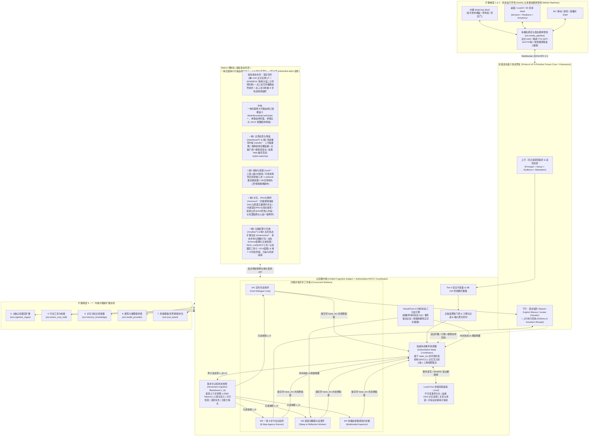

# `ai0` — 通用数字生命认知中枢 (Universal Cyber-Life Cognitive Kernel)

> **Soul Archive Completely Independent; Shell Context Structurally Perceived; Companionship Bounded & Non-Manipulative.**  
> **灵魂存档彻底独立，躯壳信息结构化感知，伙伴关系真诚有边界。**

> **项目状态定义：`架构研究与工程规格设计阶段`（Architecture Research & Engineering Specification Phase）**
> * **当前交付物**：问题域认知理论与伦理边界研究（`docs/vision/`）、解法域全量系统工程架构规格（`docs/architecture/`）。
> * **当前阶段边界**：本仓库当前专注于架构公理推演、数据模型 DDL、并发状态机、协议 Schema 与控制台规格的严谨定义（尚不包含运行代码实现）；下一工程里程碑为依据本规格启动 **最小纵切片（Vertical Slice v0）** 原型实现与实测标定。

---

## 一、项目定位

`ai0` 是一个**不内置具体物理/视觉形态、采用“确定性微内核 + 八大标准化扩展总线”架构、由社区生态自由生长的通用型数字生命（赛博生命）认知中枢**。

本项目**不直接内置**具体的桌宠客户端、Live2D/3D 骨骼渲染引擎、VTuber 推流软件或特定 IM 平台（微信、QQ、Discord、Telegram）适配器——所有这些外部交互形态与扩展能力均通过标准协议与扩展接口由社区生态自由装载。

本系统架构专注打磨最核心的**三层认知与交互主干**、**八大微内核扩展机制**，以及作为系统标配控制平面的 **`WebUI 控制台`**：

1. **感知层（Upstream Semantic Perception）**：接收外部**具身运行环境（Shell）**与**多模态媒体管线（Media Pipeline）**采集的信号，封装为携带**主体（Principal）、场合（Venue）、在场受众（Audience）与插件凭据（Attestation）**的标准化语义事件，原生支持流式增量输入、防抖撤回、打断（Barge-in）与隐私前移。
2. **大脑（The Invisible Cognitive Kernel）**：采用**“单一认知主体 + 权威状态事务协调器（MVCC） + 四路异步并发工作者”**的微内核架构，将**三层人格可塑性与存在论契约、带认知溯源与血缘 DAG 的多层次记忆、情绪与内稳态动力学、关系与用户可打扰度模型、时间状态三分法（确定性时间状态 / 事件驱动认知 / 阈值触发的真实异步反思）、以及一等的 8 步多步行动认知闭环（Action Cognition Loop）**咬合为一个支持认知器官插拔与模块消融的有机状态机。
3. **内在表现与具身执行层（Downstream Expression & Embodied Actuation）**：基于**极小冻结核心协议 v0（5 原语）+ 命名空间渐进扩展**，输出与具体渲染器无关的语义化行为表达指令（台词话轮、显式沉默决策、情绪韵律、目光与微表情同步锚点）与端侧具身动作调用（Shell Actuators），并通过**上行播放与执行回执（Delivery & Actuation Receipt）**闭环本体感觉。
4. **八大功能扩展总线 × 五阶多态异构扩展载体生态（The 8-Bus × 5-Carrier Polymorphic Ecosystem）**：不仅提供涵盖 **① 具身运行环境（`ext.shell` — 一等交互架构层）、② 多模态音视频与感官管线（`ext.media_pipeline`）、③ 大脑认知器官与三钩子（`ext.cognitive_organ`）、④ 行动工具与复合技能（`ext.action_mcp_skill`）、⑤ 内建混合 RAG 知识库与外部活体知识连接器（`ext.memory_knowledge`）、⑥ 模型推理后端与角色 LoRA（`ext.model_provider`）、⑦ 灵魂资产包/世界观词库/关系里程碑（`ext.soul_asset`）、⑧ 控制台动态 UI 视图与 Web 躯壳挂载槽（`ext.console_ui`）** 的八大功能总线，更打破了“只有单一编译型代码插件”的门槛限制，原生支持 **五阶多态扩展载体（零代码声明式资产包 / Agent `SKILL.md` 自然语言技能手册 / 免代码 MCP·WebSocket·Webhook 协议连接器 / `.flow.yaml` 可视化认知流与 ECA 蓝图 / `ai0.extension.json` 微内核原生代码插件）**。前 7 条总线由后台无头守护进程直接宿主运行，关闭浏览器丝毫不影响数字生命与已启用扩展持续运转。
5. **官方浏览器端多态控制平面（`WebUI 控制台 @ai0/console-webui`）**：**`WebUI 控制台` 是官方随项目提供的无头内核唯一实体控制平面、主权配置中枢、五阶扩展创作工坊与认知科学观测天文台**。它正本清源地将 **`Shell（具身运行环境）`** 确立为核心一级架构域（将默认预装的 `plugins/shells/webchat` 精准归位为仅挂载于 `/shells/stage/builtin.webchat` 下的一个普通插件页面，与社区 Web Live2D/3D 舞台插件 100% 平权）；融合 **`kirakira.moe (KIRAKIRA-Cerasus)`** 的 Material Design 3 二次个性组件封装与 **`AstrBot / NapCat`** 的操作配置体验——采用**常驻多态外壳（混合顶栏 `🟢 LIVE 正式实例 / 🧪 SANDBOX 隔离沙盒` 二元环境切换 + 左右双侧可折叠功能栏/迷你栏）+ 中央 `<main>` 一体式大圆角悬浮卡片路由视口盒子（`MainRoundedCardOutlet` = `<RouterOutlet />`）**，按需分页面承载 **8 大一级导航域 × 30 条专职二级子路由**、**五大 UI/UX 视图结构母版** 与 **四层 45 项紧凑组件库**，将后端全量认知与生态机制 **100% 零阉割且直觉化地投射至前端**。

---

## 二、微内核与八大扩展生态架构全景图

---

## 三、项目文档体系导航 (`docs/vision/` & `docs/architecture/`)

本项目文档严格遵循**“问题域（愿景与认知法则 Why & What）”**与**“解法域（系统工程架构规范 How）”**分离的原则，组织在 `docs/` 目录下的两个子文件夹中：

### 3.1 愿景研究与认知法则 (`docs/vision/` — Why & What)
定义我们想要创造什么样的数字生命、她的认知与伦理边界在哪里、以及如何判断代码与大模型的职责分野：
1. **[01-vision-and-predecessors.md](./docs/vision/01-vision-and-predecessors.md)** — 核心愿景、存档独立与具身感知公理、有边界的伙伴关系本体、具身运行环境定义，以及与 **Project AIRI**、**Neuro-sama (`neuro-sdk`)**、**Letta (MemGPT)**、**SAIBA (FML/BML)**、**SillyTavern (`Character Card V2/V3 & Lorebook`) / OpenClaw / AstrBot / NapCat / Koishi / `kirakira.moe (KIRAKIRA-Cerasus)`** 五大现世先行体系的深度对照与跨代升维。
2. **[02-cognitive-kernel-and-boundaries.md](./docs/vision/02-cognitive-kernel-and-boundaries.md)** — 感知四元组信封、视神经时空梯度习惯化与感官覆盖桶、预测编码微时间改口、大脑七大认知模块（含双时态记忆更替、共同默契 `CommonGround` 采纳闭环、二次元“表里张力 Gap Moe”演出、有界发言机会池 `InteractionOpportunity` 与语用结界 `InteractionFrame`）、时间状态三分法、统一主体与并发协调、8 步一等行动认知闭环、以及**《五维判别公理与三态路由法则》**。
3. **[03-protocol-and-webui-console.md](./docs/vision/03-protocol-and-webui-console.md)** — 下行表达意图与播放回执闭环、运行期动态执行器热增删、动画“视线先行+余韵”关键帧序列、协议 v0 最小核心原则、**八大功能总线 × 五阶多态扩展载体**总览、以及 `WebUI 控制台` 的系统定位、**正本清源 `Shell` 一等架构层（剥离 `plugins/shells/webchat` 越位层级）、顶栏 `LIVE / SANDBOX` 二元实例环境隔离、常驻多态外壳 + `<main>` 一体式圆角卡片路由视口盒子（`<RouterOutlet />`）**、五大标准化视图结构母版与后端 100% 零阉割渐进式降维视觉投射法则。
4. **[04-blindspots-priorities-and-mvp-slice.md](./docs/vision/04-blindspots-priorities-and-mvp-slice.md)** — 12 项核心设计张力与长程失效防护矩阵、P0~P6 架构依赖派生拓扑、Vibecoding 单一代码契约真相源防跑偏准则，以及 **最小纵切片（Vertical Slice v0）** 必含规格。
5. **[05-ethics-safety-and-sb243-compliance.md](./docs/vision/05-ethics-safety-and-sb243-compliance.md)** — 加州 **SB 243 (Companion Chatbot Law)** 法律责任边界参照、四大内置确定性合规组件与反情感操控五项宪章。

### 3.2 全量系统工程架构设计 (`docs/architecture/` — How)
由愿景直接派生出的工程施工蓝图，涵盖微内核目标包拓扑、数据库 DDL、并发状态机、协议契约、八大插件总线与控制台架构：
1. **[01-system-overview-and-monorepo.md](./docs/architecture/01-system-overview-and-monorepo.md)** — 微内核总体架构、数据面 vs 控制面隔离、TypeScript Monorepo 目标工程包拓扑、编译期反后门依赖约束，以及 **Vibecoding 与 Coding Agent 施工防跑偏铁律（`@ai0/protocol` Zod 代码唯一契约真相源）**。
2. **[02-storage-and-soul-archive-schema.md](./docs/architecture/02-storage-and-soul-archive-schema.md)** — `.soul` 灵魂存档目录规范、SQLite + `sqlite-vec` 完整建表 DDL（含双时态记忆有效期、共同默契 `grounding_status` 与血缘/更替边 `relation_type`）、事件溯源与按血缘 DAG 拓扑序自底向上级联真遗忘（含跨快照墓碑账本重放）算法。
3. **[03-runtime-coordinator-and-agency-loop.md](./docs/architecture/03-runtime-coordinator-and-agency-loop.md)** — `AuthoritativeStateCoordinator` 五域乐观并发事务裁决（MVCC）、$\tanh/\operatorname{artanh}$ 阿贝尔群可交换软饱和冲量算子、快慢情绪二阶耦合常微分方程闭式解、玩笑语用防火墙、四路并发 Worker、`VirtualClock` 可求逆时间引擎与 8 步行动认知状态机。
4. **[04-protocol-v0-and-gateway-spec.md](./docs/architecture/04-protocol-v0-and-gateway-spec.md)** — Protocol v0 五原语完整 Schema 契约（开放 `SensorModality`、运行期 `capabilities_updated` 动态动作热更新、上行 `ext.perception.v1` 感官覆盖桶、下行 `ext.embodied.v1` 动画多锚点关键帧序列与双向连接拓扑）、Scoped Capability Token 验签、输入防抖聚合器与流式分块打断回执状态机。
5. **[05-eight-dimension-extension-system.md](./docs/architecture/05-eight-dimension-extension-system.md)** — **《八大功能扩展总线 × 五阶多态异构扩展载体》架构**（零代码资产包 / `SKILL.md` 自然语言技能手册 / 免代码 MCP·WebSocket·Webhook 连接器 / `.flow.yaml` 可视化认知流与 ECA 蓝图 / `ai0.extension.json` 原生代码插件）、内建混合 RAG 知识库引擎、SillyTavern 角色卡无损蒸馏与越狱清洗规范、以及创作者虚拟躯壳沙盒与一键脱敏打包引擎。
6. **[06-webui-console-and-observability-arch.md](./docs/architecture/06-webui-console-and-observability-arch.md)** — `WebUI 控制台` **正本清源 `Shell` 一等架构层（将 `plugins/shells/webchat` 归位为 `/shells/stage/builtin.webchat` 普通挂载插件页）**、**常驻多态外壳（混合顶栏 `LIVE / SANDBOX` 二元实例环境切换 + 左右双侧可折叠功能栏/迷你栏）+ 中央 `<main>` 一体式圆角卡片路由视口盒子（`MainRoundedCardOutlet` = `<RouterOutlet />`）**、**8 大一级导航域 × 30 条专职二级子路由导航树**、五大 UI/UX 视图结构母版、10 大核心子系统 1:1 零阉割降维视觉设计、8 步可验证决策轨迹、`.scenario.yaml` Fail-Closed 回归评测引擎，以及**《融合 `kirakira.moe (KIRAKIRA-Cerasus)` 的 Material Design 3 二次个性风格封装与四层 45 项前端组件库规范》**。
