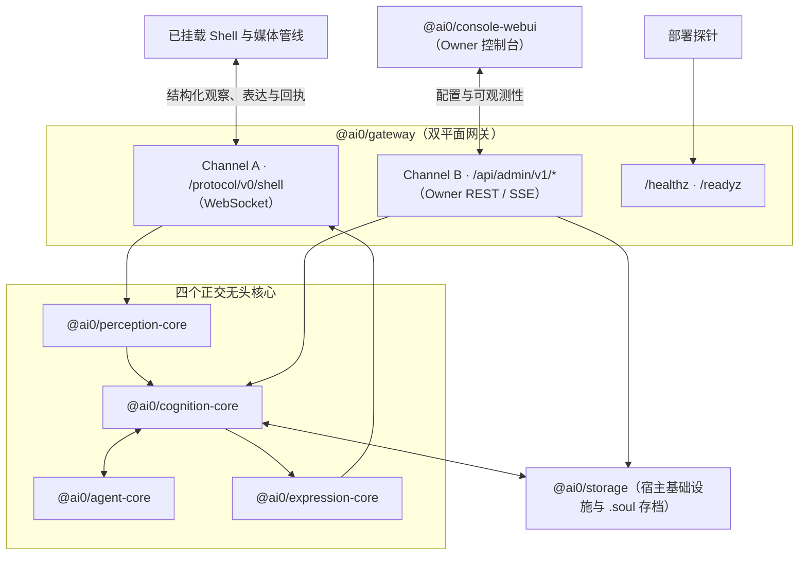

# ai0 · 通用数字生命认知中枢

**Clean-Slate V1：始终保持第一版，零历史沉积、零预设默认角色卡、三级渐进派生、四核正交分立。**

ai0 将通用话轮执行、结构化感知、状态化认知和可验证表达拆为四个无头核心。宿主持有算力与凭据，`.soul` 独立保存角色运行状态，躯壳通过标准协议接入。

## 快速启动与零预设上线

需要 Node.js 24+ 和 pnpm 10+。

```bash
pnpm install
pnpm verify:boundaries
pnpm test
pnpm dev
```

`pnpm test` 包含 `labs/` 渐进派生测试套件。启动后打开 <http://127.0.0.1:4173>。在另一终端运行 `pnpm replay:golden` 可回放黄金回归场景。

控制台的 **Go-Live Onboarding Checklist** 根据守护进程返回的阶段和缺项引导 Owner 操作。

| 当前阶段 | 上线清单 |
| --- | --- |
| `L0_UNCLAIMED` | Owner 认领宿主、确认 `deployment_mode` 并初始化加密 Secrets Vault。新部署的角色卡、Soul 与挂载列表为空。 |
| `L1_CLAIMED_NO_PROVIDER` | 在 Host Provider Pool 配置并在线验证真实模型，绑定必需的 `consciousness` 宿主默认模型。`vision` 和 `speech` 按需配置。支持 OpenCode Go（`opencode_go`，如 `deepseek-v4.1-flash`）、OpenAI-compatible、Anthropic、DeepSeek 和 Ollama。探测失败时保留本级缺项。 |
| `L2_PROVIDER_READY_NO_SOUL` | 创建空白 Character Card V3（`chara_card_v3`）或导入角色卡，无损保留未知 `extensions.<namespace>`。Owner 显式从静态卡唤醒独立的 `<soul_id>.soul`。 |
| `L3_SOUL_AWAKENED_CONFIG_NEEDED` | 补齐必需扩展、Vault 引用及角色模型绑定。角色可按模块选择 `Inherit` 沿用宿主默认，或用 `Override` 指定角色模型。未授权的可选传感器锁定为 `"blind"`，禁止推断未观测信息。 |
| `L4_SOUL_AWAKENED_NO_SHELL` | 绑定跨端 `Principal`，签发限定作用域的 `Scoped Capability Token`，通过 `HandshakeManifest` 配对首个在线且合规的 Shell，例如 `builtin.webchat`。 |
| `L5_LIVE_READY` | 全部前置条件满足，开始接纳 LIVE 陪伴话轮，`VirtualClock` 锁定 1x。 |

阶段按 L0 → L1 → L2 → L3 → L4 → L5 推进，条件失效时从首个未满足条件重新计算。`GET /healthz` 独立检查进程存活。`GET /readyz` 返回 `stage` 与 `missing_prerequisites`，仅在 L5 返回 HTTP 200，其余阶段返回 503。Channel A 以同一门控接纳话轮。

## 三级渐进派生

1. **Level 1 · 四层物理实体分离**。宿主基础设施落在 `souls/host/`，管理 Vault、Provider Pool 和卡片注册表。静态 CCv3 角色卡负责角色定义，唤醒后的 `*.soul` 实例拥有独立运行状态，Shell 与扩展在运行时按权限挂载。
2. **Level 2 · 跨场景能力消去与四核正交分立**。逐项移除特定场景的感官、媒介和执行能力，提取跨场景稳定的协议与职责边界。
3. **Level 3 · 渐进证伪与主仓收敛**。`labs/stage0~stage4` 从纸面轨迹、通用执行和 AIRI 解剖推进至感知表达与跨具身派生，验证后的契约收敛到主仓。

## 四个正交无头核心

| 包 | 权威职责 |
| --- | --- |
| `@ai0/agent-core` | 机械式 `Turn/Round` 执行、工具调度和多 Provider 传输。以 `system_invariant`、`developer_frame`、`untrusted_observation` 三层分离指令权威与数据。缺乏目标证据时结算为 `unverified`，与数字生命领域零耦合。 |
| `@ai0/perception-core` | 通过 `EmbodimentAffordanceRegistry` 注册具身能力，以 `UniversalObservationFrame` 六元组元语法归一观察。TTL 和 `"blind"` 锁约束推断，`TurnLifecycleGate` 处理 `activity\|interim\|commit\|retract`，`ReflexGate` 拦截例行信号，`ChronoceptiveSignalSynthesizer` 从经过时间扣除冬眠区间。 |
| `@ai0/cognition-core` | `VirtualClock` 管理时间语义，声明式 `ContinuousStateMetaEngine` 以 `continuous_states_json` 保存检查点，`AuthoritativeStateCoordinator` 执行五域 MVCC 裁决。Tier 0 SB 243 守卫执行安全约束。四级 `EpistemicMemoryFirewall` 结合玩笑语用防火墙和 `CommonGround` 状态机约束记忆的证据等级。`BlackboardCompiler` 低于 2500 token，通过 `Social Mask Damper` 将非 Owner 专属受众可见的情绪偏离幅值衰减 70%。`W1`～`W4` 分别承担对话、行动、睡眠整理和多模态分析，`PolymorphicExtensionHost` 装载扩展。 |
| `@ai0/expression-core` | 零人形假设的 `CommunicativeIntentEnvelope` 描述表达意图。`RealizerVocabularyNegotiator` 在缺少合规 Shell 时将表达置为 `held_pending_compliant_shell`，`InteractionOpportunityPool` 管理表达机会。四态真值链为 `generated_unpresented → physically_presented → actuation_verified → interlocutor_grounded`。基于 `silenced` 和 `done` 双边界回执恢复 `unsaid_remainder`。 |

`@ai0/protocol` 定义机器契约。`@ai0/storage` 管理宿主基础设施及 Local-First `.soul`，以 SQLite WAL、FTS5 和向量索引支撑持久化与检索，并执行受众过滤和跨快照真遗忘。`@ai0/gateway` 提供具身协议、Owner 管理与探针。`@ai0/sdk` 提供多态扩展接入，参考插件与社区插件同受零后门边界约束，仅可依赖 `@ai0/protocol` 与 `@ai0/sdk`。

## Monorepo 拓扑

```text
ai0/
├── packages/
│   ├── protocol/
│   ├── agent-core/
│   ├── perception-core/
│   ├── cognition-core/
│   ├── expression-core/
│   ├── storage/
│   ├── gateway/
│   └── sdk/
├── labs/
│   ├── stage0-paper-traces/
│   ├── stage1-agent-core/
│   ├── stage2-airi-dissection/
│   ├── stage3-perception-expression/
│   └── stage4-universal-derivation/
├── plugins/
│   ├── shells/                 # 参考 WebChat 躯壳
│   ├── cognitive-organs/       # 认知器官
│   ├── media-pipelines/        # 多模态媒体管线
│   ├── skills-and-mcp/         # 技能与 MCP
│   └── flows-and-assets/       # 工作流与资产
├── apps/
│   ├── daemon/                 # @ai0/daemon，组装运行时
│   └── console/                # @ai0/console-webui，Owner 控制台
├── souls/
│   ├── host/                   # 宿主基础设施与初始为空的卡片注册表
│   └── <soul_id>.soul/          # Owner 显式唤醒后生成
├── scripts/
│   └── verify-architecture-boundaries.mjs
└── docs/
    ├── vision/                 # 01～05
    └── architecture/           # 01～08
```

## 架构全景



## 文档导航

### 愿景与问题域

1. 项目立基公理、先行体系对照与零预设 Deploy-to-Live。[01 愿景与先行者](docs/vision/01-vision-and-predecessors.md)
2. 认知与行为边界、隐私约束和失效防护。[02 认知内核与边界](docs/vision/02-cognitive-kernel-and-boundaries.md)
3. 具身协议、扩展契约与 Owner 控制台原则。[03 协议与控制台](docs/vision/03-protocol-and-webui-console.md)
4. 设计盲点、优先级和最小验证切片。[04 盲点与 MVP](docs/vision/04-blindspots-priorities-and-mvp-slice.md)
5. Tier 0 安全底线、反情感操控与 SB 243 约束。[05 伦理与安全](docs/vision/05-ethics-safety-and-sb243-compliance.md)

### 工程规格与交付

1. 三级派生、八包拓扑与依赖允许清单。[01 系统总体架构](docs/architecture/01-system-overview-and-monorepo.md)
2. 宿主与角色存档、SQLite Schema、记忆血缘和真遗忘。[02 存储与灵魂存档](docs/architecture/02-storage-and-soul-archive-schema.md)
3. 五域状态协调、认知黑板与 W1～W4 循环。[03 运行时协调与能动性循环](docs/architecture/03-runtime-coordinator-and-agency-loop.md)
4. Protocol v0、双平面网关、受限令牌、表达回执与就绪门控。[04 协议与网关规格](docs/architecture/04-protocol-v0-and-gateway-spec.md)
5. 八维扩展接口、五类载体与统一权限边界。[05 扩展系统](docs/architecture/05-eight-dimension-extension-system.md)
6. 零预设上线向导、紧凑 MD3、管理接口与回放观测。[06 控制台与可观测性](docs/architecture/06-webui-console-and-observability-arch.md)
7. Clean-Slate 清零账本、架构决策与实现偏差。[07 ADR 与偏差账本](docs/architecture/07-implementation-adrs-and-deviation-ledger.md)
8. 渐进证伪、空卷上线验收与交付门槛。[08 产品验证与交付计划](docs/architecture/08-product-validation-and-delivery-plan.md)
