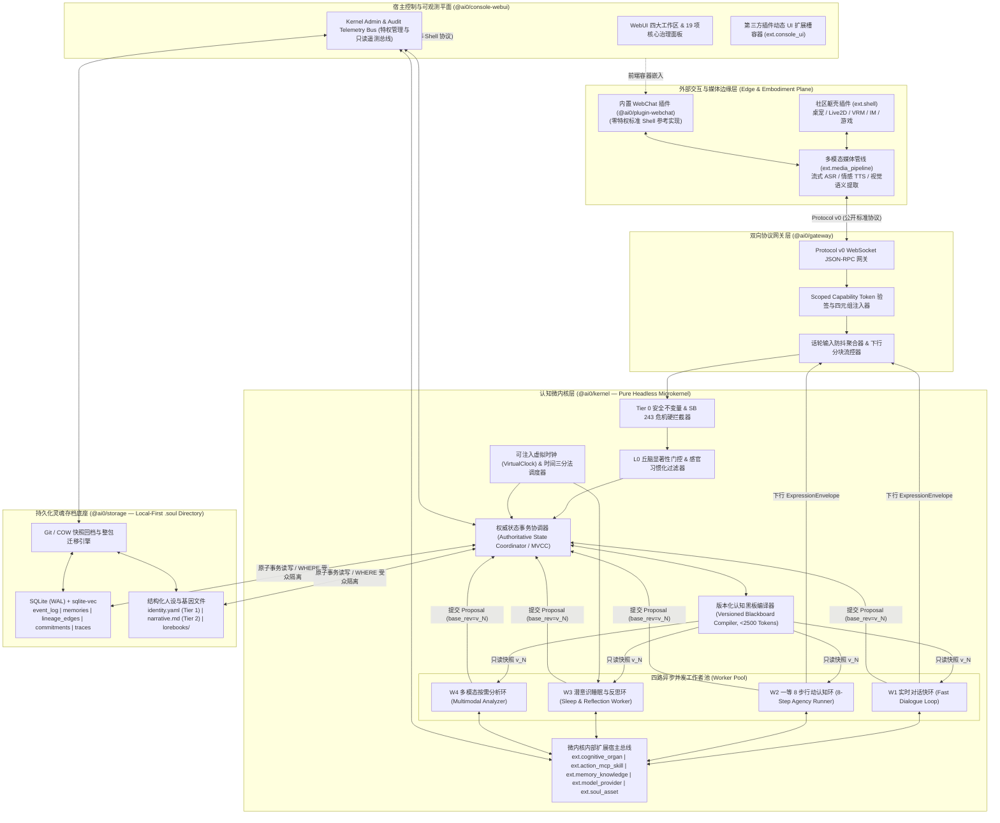

# 01. 系统总体架构与 Monorepo 工程拓扑规范

> 本文档是 `ai0` 从“愿景研究（`docs/vision/`）”派生出的第一篇系统工程架构规范。它定义了 `ai0` 的微内核分层架构、数据面（Data/Cognitive Plane）与控制面（Control/Telemetry Plane）的物理隔离原则、TypeScript 全栈 Monorepo 包结构，以及防止“内置插件走内部后门”的编译期依赖反转约束。

---

## 一、系统总体架构哲学：确定性微内核 + 八大扩展总线

`ai0` 采用 **微内核（Microkernel）架构**。微内核本身只固化那些**“错了不可逆、离线也要成立、涉及安全与隐私底线、以及负责并发事务裁决”**的确定性逻辑；而把一切与外在形态、多模态信号加工、认知脑区扩展、外部工具、知识源及控制台视图相关的能力，全部抽象为**八大标准化扩展总线（The 8 Extension Buses）**。



---

## 二、数据面（Cognitive Data Plane）与控制面（Control & Telemetry Plane）的严格分离

为了同时满足**“内置 WebChat 零内部后门”**与**“WebUI 控制台 100% 白盒可观测、全主权治理”**，系统在网络端口与认证令牌上物理划分为两个独立平面：

| 维度 | 1. 公开具身协议面 (Public Shell Protocol Plane) | 2. 宿主控制与遥测面 (Privileged Control & Telemetry Plane) |
| :--- | :--- | :--- |
| **通信端点** | `ws://host:port/protocol/v0/shell` | `http(s)://host:port/api/admin/v1/*` & `ws://host:port/api/admin/v1/telemetry` |
| **接入对象** | 所有外部社区躯壳（桌宠、Live2D、IM 插件、游戏插件）以及**内置 `@ai0/plugin-webchat`** | 仅限 **`@ai0/console-webui`（WebUI 控制台宿主）** 与本地 CLI 管理工具 |
| **认证凭据** | `Scoped Capability Token`（按躯壳绑定固定的 `venue_type`、允许的 `Audience` 范围与 `Actuators` 权限） | `Owner Master Session Token`（仅限数字生命所有者本机或强认证登录持有） |
| **可见数据边界** | **零脑内隐私暴露**：只能发送上行感知事件、接收下行表达信封（`speak` / `explicit_silence` / `invoke_actuator`）、回传播放/执行回执。**绝对拿不到**脑内召回的记忆 ID、权限裁决明细、未说出口的思考或其它躯壳的私聊内容。 | **100% 全景白盒与主权控制**：实时订阅 8 步可验证决策轨迹（`VerifiableTurnTrace`）、读写三层人格与记忆血缘树、调整虚拟时钟、开关消融模块、审批权限与执行灵魂回档。 |

---

## 三、TypeScript 全栈 Monorepo 目录与包拓扑结构

`ai0` 采用 `pnpm workspaces` + `Turborepo` 构建单仓多包（Monorepo）架构，确保协议 Schema、内核、存储引擎、内置参考插件与 WebUI 控制台之间的高内聚与强类型共享：

```text
c:\rin\coder\reina0721\ai0\
├── package.json
├── pnpm-workspace.yaml
├── turbo.json
├── tsconfig.base.json
│
├── docs/
│   ├── vision/                          # 问题域：5 篇愿景研究与认知/伦理公理
│   └── architecture/                    # 解法域：6 篇全量系统工程架构设计规范
│
├── packages/
│   ├── protocol/                        # [@ai0/protocol] 零依赖协议契约包
│   │   ├── src/
│   │   │   ├── core-v0/                 # 冻结核心五原语 Zod Schema & TypeScript 类型
│   │   │   ├── extensions/              # 官方标准扩展命名空间 (ext.affect.v1, ext.rhythm.v1, ext.embodied.v1)
│   │   │   └── plugin-manifests/        # 八大扩展维度的插件 Manifest Schema 定义
│   │
│   ├── storage/                         # [@ai0/storage] Local-First .soul 存储与血缘引擎
│   │   ├── src/
│   │   │   ├── sqlite/                  # SQLite (WAL) + sqlite-vec 迁移与 DAO 层
│   │   │   ├── event-log/               # 不可变事件追加、墓碑写入与载荷物理擦除
│   │   │   ├── lineage-dag/             # 记忆血缘有向无环图查询、级联擦除与局部失效重算
│   │   │   ├── audience-guard/          # 数据库检索层强制 WHERE audience_scope 硬过滤器
│   │   │   └── snapshot-git/            # .soul 目录快照、三种回档语义引擎与 tar.zst 整包导入导出
│   │
│   ├── kernel/                          # [@ai0/kernel] 纯无头数字生命认知微内核
│   │   ├── src/
│   │   │   ├── clock/                   # VirtualClock 虚拟时钟、冬眠识别与可求逆阈值唤醒定时器
│   │   │   ├── coordinator/             # AuthoritativeStateCoordinator (MVCC 版本裁决 + 睡眠写入防火墙)
│   │   │   ├── safety-l0/               # Tier 0 安全不变量、SB 243 危机硬拦截器、3小时提醒器
│   │   │   ├── gate/                    # L0 丘脑显著性门控、感官习惯化衰减与输入防抖聚合
│   │   │   ├── blackboard/              # <2500 Token 认知状态黑板编译器与社交面具阻尼器
│   │   │   ├── organs/                  # 内置认知器官 (身份自我/多层次记忆/情绪内稳态/关系与用户模型/承诺)
│   │   │   ├── workers/                 # 四路并发 Worker (W1 快对话环 / W2 8步行动环 / W3 睡眠环 / W4 多模态环)
│   │   │   ├── extension-bus/           # 八大扩展总线宿主、生命周期 Hook 调度与三维权限矩阵引擎
│   │   │   ├── router/                  # 五脑区异构模型路由器与双轨精力 Token 预算降级器
│   │   │   └── replay-eval/             # .scenario.yaml 脚本化场景回放与声线漂移评估引擎
│   │
│   ├── gateway/                         # [@ai0/gateway] 双平面网络网关 (Fastify + ws)
│   │   ├── src/
│   │   │   ├── shell-ws-server.ts       # 公开 Protocol v0 WebSocket 服务端 (面向所有 Shell)
│   │   │   └── admin-api-server.ts      # 宿主特权 REST + Telemetry WebSocket 服务端 (面向 WebUI 控制台)
│   │
│   ├── plugin-webchat/                  # [@ai0/plugin-webchat] 内置零特权标准 WebChat Shell 插件
│   │   ├── src/
│   │   │   ├── client/                  # 纯标准协议 WebSocket 客户端 (发送感知 / 接收表达 / 上报打断字数回执)
│   │   │   └── ui/                      # 可独立运行或嵌入控制台的 WebChat React 视图组件
│   │
│   └── sdk/                             # [@ai0/sdk] 面向社区开发者的插件开发套件
│       └── src/                         # 快速编写 Shell / MediaPipeline / CognitiveOrgan / ConsoleUI 插件的基类
│
├── apps/
│   ├── daemon/                          # [@ai0/daemon] 内核与网关启动守护进程 / CLI 入口
│   └── console/                         # [@ai0/console-webui] 现代化 WebUI 控制台前端 (React / Next.js)
│       └── src/
│           ├── workspaces/              # 四大工作区与 19 个核心功能面板
│           └── extension-slots/         # 第三方插件动态 UI 扩展槽渲染器
│
└── souls/                               # 默认本地灵魂存档挂载目录 (.soul 实例集)
    └── default.soul/
```

---

## 四、编译期架构依赖铁律（Dependency Inversion & Anti-Backdoor Rules）

为了在代码层 **100% 强制执行** 我们在愿景中立下的边界规矩，Monorepo 通过 ESLint `eslint-plugin-boundaries` 与 TypeScript Project References 施加以下编译期硬约束：

1. **`@ai0/protocol` 零依赖铁律**：
   * 仅依赖 `zod`，严禁引用任何 Node.js 专有原生模块或内核包，确保可在浏览器、移动端、边缘设备或任何外部脚本中无缝运行。
2. **`@ai0/plugin-webchat` 零后门铁律（Zero-Backdoor Enforcement）**：
   * `@ai0/plugin-webchat` 的 `package.json` **只允许依赖 `@ai0/protocol` 与 `@ai0/sdk`**。
   * **编译期禁止** `@ai0/plugin-webchat` 出现任何 `import ... from '@ai0/kernel'` 或 `import ... from '@ai0/storage'`。一旦有人试图在内置 WebChat 中绕过标准 WebSocket 协议直接调内核函数，CI 与本地编译立即报错阻断！
3. **`@ai0/kernel` 无头（Headless）纯洁性铁律**：
   * `@ai0/kernel` 严禁依赖任何前端 UI 框架（React/DOM）或特定外部平台 SDK（如 Discord.js / Live2D Cubism SDK），确保认知微内核在任何服务器、桌面或嵌入式容器中均可独立无头运行。
4. **`@ai0/storage` 唯一写入口铁律**：
   * 在 `@ai0/kernel` 内部，除 `AuthoritativeStateCoordinator`（权威状态事务协调器）之外，任何并发 Worker（`W1`~`W4`）或认知器官插件均只持有 `ReadOnlyStorageView` 接口引用，在类型系统层面彻底封死绕过协调器直写数据库的可能性。
