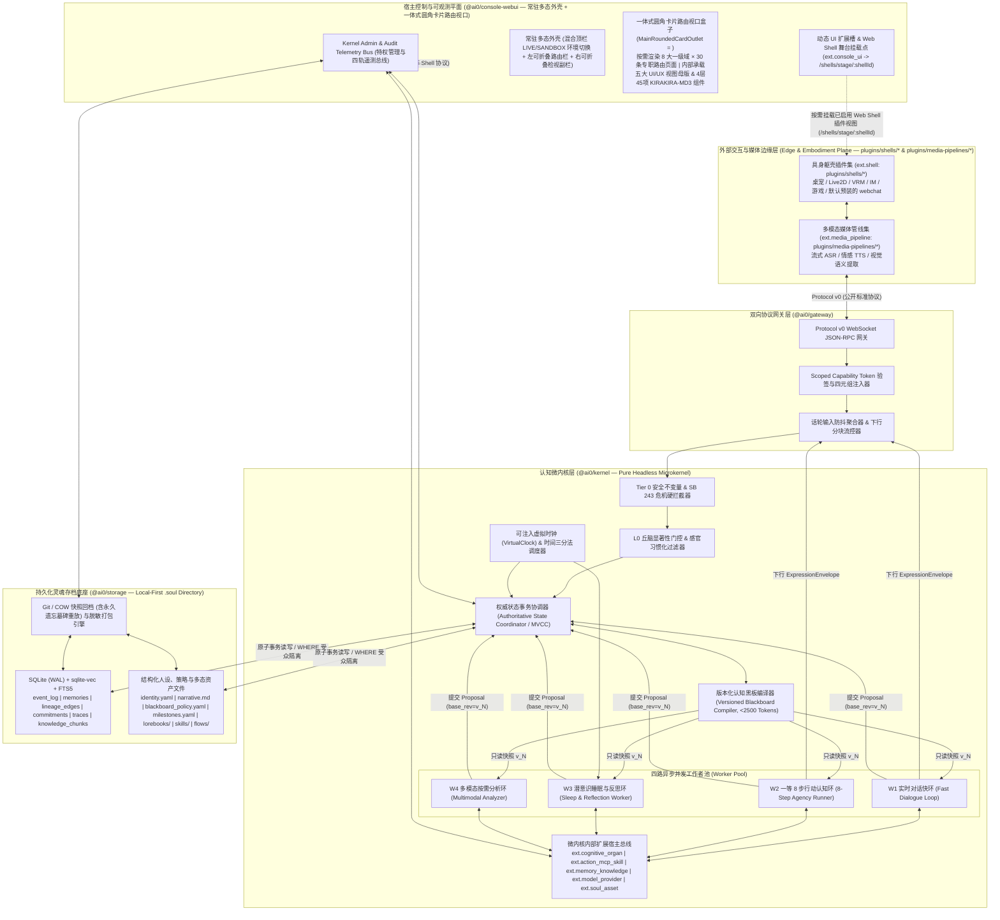

# 01. 系统总体架构与 Monorepo 目标工程拓扑规范

> **项目阶段**：架构研究与工程规格设计阶段（解法域工程规格）
>
> 本文档是从“愿景研究（`docs/vision/`）”派生出的第一篇系统工程架构规范。它定义了微内核分层架构、数据面（Data/Cognitive Plane）与控制面（Control/Telemetry Plane）的物理隔离原则、TypeScript 全栈 Monorepo 目标包拓扑规格，以及防止“内置插件走内部后门”的编译期依赖反转约束。

---

## 一、系统总体架构哲学：确定性微内核 + 八大扩展总线

本系统采用 **微内核（Microkernel）架构**。微内核本身只固化那些**“错了不可逆、离线也要成立、涉及安全与隐私底线、以及负责并发事务裁决”**的确定性逻辑；而把一切与外在形态、多模态信号加工、认知脑区扩展、外部工具、知识源及控制台视图相关的能力，全部抽象为**八大标准化扩展总线（The 8 Extension Buses）**。



---

## 二、数据面（Cognitive Data Plane）与控制面（Control & Telemetry Plane）的严格分离

为了同时满足**“内置 WebChat 零内部后门”**与**“WebUI 控制台 100% 白盒可观测、全主权治理”**，系统在网络端口与认证令牌上物理划分为两个独立平面：

| 维度 | 1. 公开具身协议面 (Public Shell Protocol Plane) | 2. 宿主控制与遥测面 (Privileged Control & Telemetry Plane) |
| :--- | :--- | :--- |
| **通信端点** | `ws://host:port/protocol/v0/shell` | `http(s)://host:port/api/admin/v1/*` & `ws://host:port/api/admin/v1/telemetry` |
| **接入对象** | 所有具身躯壳插件（`plugins/shells/*`，含外部桌宠、Live2D、IM、游戏插件及默认预装的 `plugins/shells/webchat`） | 仅限 **`@ai0/console-webui`（WebUI 控制台宿主）** 与本地 CLI 管理工具 |
| **认证凭据** | `Scoped Capability Token`（按躯壳绑定固定的 `venue_type`、允许的 `Audience` 范围与 `Actuators` 权限） | `Owner Master Session Token`（仅限数字生命所有者本机或强认证登录持有） |
| **可见数据边界** | **零脑内隐私暴露**：只能发送上行感知事件、接收下行表达信封（`speak` / `explicit_silence` / `invoke_actuator`）、回传播放/执行回执。**绝对拿不到**脑内召回的记忆 ID、权限裁决明细、未说出口的思考或其它躯壳的私聊内容。 | **100% 全景白盒与主权控制**：实时订阅 8 步可验证决策轨迹（`VerifiableTurnTrace`）、读写三层人格与记忆血缘树、调整虚拟时钟、开关消融模块、审批权限与执行灵魂回档。 |

---

## 三、TypeScript 全栈 Monorepo 目标目录与包拓扑规格

面向编码实现阶段，目标工程采用 `pnpm workspaces` + `Turborepo` 构建单仓多包（Monorepo）架构，确保协议 Schema、内核、存储引擎、内置参考插件与 WebUI 控制台之间的高内聚与强类型共享（当前仓库处于规格设计阶段，以下为目标实现拓扑规格）：

```text
<repo-root>/
├── package.json
├── pnpm-workspace.yaml
├── turbo.json
├── tsconfig.base.json
│
├── docs/
│   ├── vision/                          # 问题域：5 篇愿景研究与认知/伦理公理
│   └── architecture/                    # 解法域：6 篇全量系统工程架构设计规范
│
├── packages/
│   ├── protocol/                        # [@ai0/protocol] 零依赖双平面协议与契约唯一真相源包 (Exclusive Machine SSOT)
│   │   ├── src/
│   │   │   ├── core-v0/                 # 通道 A (公开具身协议面)：冻结核心五原语 Zod Schema & TypeScript 类型 (含 expression_vocabulary)
│   │   │   ├── extensions/              # 官方标准扩展命名空间 (ext.perception.v1, ext.affect.v1, ext.rhythm.v1, ext.embodied.v1, ext.media.sideband.v1)
│   │   │   ├── plugin-manifests/        # 八大功能总线 × 五阶多态扩展载体 (ai0.extension.json / SKILL.md / .flow.yaml) Schema 定义
│   │   │   └── control-plane/           # 通道 B (特权控制与遥测面)：VerifiableTurnTrace / BlackboardPolicy / Milestones / 四轨遥测帧与 Admin API Zod 契约
│   │
│   ├── storage/                         # [@ai0/storage] Local-First .soul 存储与血缘引擎
│   │   ├── src/
│   │   │   ├── sqlite/                  # SQLite (WAL) + sqlite-vec 迁移与 DAO 层
│   │   │   ├── event-log/               # 不可变事件追加、墓碑写入与载荷物理擦除
│   │   │   ├── lineage-dag/             # 记忆血缘有向无环图查询、级联擦除与局部失效重算
│   │   │   ├── audience-guard/          # 数据库检索层强制 WHERE audience_scope 硬过滤器
│   │   │   └── snapshot-git/            # .soul 目录快照、三种回档语义引擎与 tar.zst 整包导入导出
│   │
│   ├── kernel/                          # [@ai0/kernel] 纯无头数字生命认知微内核
│   │   ├── src/
│   │   │   ├── clock/                   # VirtualClock 虚拟时钟、冬眠识别与可求逆阈值唤醒定时器
│   │   │   ├── coordinator/             # AuthoritativeStateCoordinator (MVCC 版本裁决 + 睡眠写入防火墙)
│   │   │   ├── safety-l0/               # Tier 0 安全不变量、SB 243 危机硬拦截器、3小时提醒器
│   │   │   ├── gate/                    # L0 丘脑显著性门控、感官习惯化衰减与输入防抖聚合
│   │   │   ├── blackboard/              # <2500 Token 认知状态黑板编译器与社交面具阻尼器
│   │   │   ├── organs/                  # 内置认知器官 (身份自我/多层次记忆/情绪内稳态/关系与用户模型/承诺)
│   │   │   ├── workers/                 # 四路并发 Worker (W1 快对话环 / W2 8步行动环 / W3 睡眠环 / W4 多模态环)
│   │   │   ├── extension-bus/           # 八大扩展总线宿主、生命周期 Hook 调度与三维权限矩阵引擎
│   │   │   ├── router/                  # 五脑区异构模型路由器与双轨精力 Token 预算降级器
│   │   │   └── replay-eval/             # .scenario.yaml 脚本化场景回放与声线漂移评估引擎
│   │
│   ├── gateway/                         # [@ai0/gateway] 双平面网络网关 (Fastify + ws)
│   │   ├── src/
│   │   │   ├── shell-ws-server.ts       # 公开 Protocol v0 WebSocket 服务端 (面向所有 Shell)
│   │   │   └── admin-api-server.ts      # 宿主特权 REST + Telemetry WebSocket 服务端 (面向 WebUI 控制台)
│   │
│   └── sdk/                             # [@ai0/sdk] 面向社区开发者的五阶多态扩展开发套件
│       └── src/                         # 快速编写 Shell / MediaPipeline / CognitiveOrgan / Skill / ConsoleUI 插件的基类与打包器
│
├── apps/                                # 【宿主与控制面应用层】
│   ├── daemon/                          # [@ai0/daemon] 内核与网关启动守护进程 / CLI 入口
│   └── console/                         # [@ai0/console-webui] 现代化多态 WebUI 控制台操作系统 (React / Next.js)
│       └── src/
│           ├── app-shell/               # 常驻多态外壳 (混合顶栏 LIVE/SANDBOX 环境切换 / 左三态可折叠路由轨 / 右三态检视副栏 / 主权围栏)
│           ├── router/                  # 8 大一级导航域 × 30 条专职二级子路由嵌套路由树、懒加载与 DirtyRouteGuard 守卫
│           ├── design-system/           # 四层 45 项 KIRAKIRA-MD3 二次个性风格封装组件库 (含 MainRoundedCardOutlet 一体式圆角卡片路由视口盒子)
│           ├── archetypes/              # <main> 圆角卡片盒子内部的五大 UI/UX 视图结构母版 (挂载舞台 / 态势终端 / 主从配置 / 拓扑画布 / 多态工作坊)
│           ├── domains/                 # 1:1 零阉割投射后端全量机制的 10 大业务域模块 (具身 Shells 中枢 / 五阶扩展工作坊 / 可食用角色蒸馏炉 / 黑板积木编排器等)
│           └── extension-slots/         # 第三方插件动态 UI 扩展槽与 Web Shell 舞台挂载宿主 (ext.console_ui Schema & 无凭据沙盒 Iframe)
│
├── plugins/                             # 【统一多态扩展与插件生态总目录 — 严禁任何插件混入顶层 packages/ 搞单插件独占!】
│   ├── shells/                          # 总线 1 (ext.shell)：具身运行环境插件集
│   │   └── webchat/                     #   └─ 默认预装的网页对话躯壳插件 (仅是 plugins/shells/ 下的普通一员，按需挂载于 /shells/stage/builtin.webchat)
│   ├── media-pipelines/                 # 总线 2 (ext.media_pipeline)：流式 ASR / 情感 TTS / 视觉语义提取插件集
│   ├── cognitive-organs/                # 总线 3 (ext.cognitive_organ)：大脑认知器官插件集
│   │   └── dream-journal/               #   └─ 官方参考器官：睡眠期梦境与悄悄话日记器官插件
│   ├── skills-and-mcp/                  # 总线 4 (ext.action_mcp_skill)：SKILL.md 自然语言技能手册与 MCP 连接器集
│   │   └── daily-companion-review/      #   └─ 官方参考技能：SKILL.md 陪伴复盘技能包
│   ├── knowledge-connectors/            # 总线 5 (ext.memory_knowledge)：外部活体知识连接器插件集 (Obsidian / Wiki 等)
│   ├── model-providers/                 # 总线 6 (ext.model_provider)：模型推理后端与角色 LoRA 适配器插件集
│   └── soul-assets/                     # 总线 7 (ext.soul_asset)：.soul-template / Lorebooks / 里程碑与 .scenario.yaml 资产集
│
└── souls/                               # 默认本地灵魂存档挂载目录 (.soul 实例集)
    └── default.soul/
```

---

## 四、编译期架构依赖铁律（Dependency Inversion & Anti-Backdoor Rules）

为了在代码层 **100% 强制执行** 我们在愿景中立下的边界规矩，Monorepo 通过 ESLint `eslint-plugin-boundaries` 与 TypeScript Project References 施加以下编译期硬约束：

1. **`@ai0/protocol` 零依赖铁律**：
   * 仅依赖 `zod`，严禁引用任何 Node.js 专有原生模块或内核包，确保可在浏览器、移动端、边缘设备或任何外部脚本中无缝运行。
2. **`plugins/**` 全目录通用插件隔离与零内核后门铁律（Universal `plugins/**` Zero-Backdoor Enforcement）**：
   * **物理目录隔离**：顶层 `packages/` 目录仅限五大微内核底座包（`protocol`, `storage`, `kernel`, `gateway`, `sdk`），所有插件（无论官方预装如 `plugins/shells/webchat` 还是社区扩展）一律归入 `plugins/**` 目录，严禁任何单一插件在 `packages/` 顶层享有独占特权席位。
   * **依赖反转硬约束**：`plugins/**` 下的任何插件包只允许依赖 `@ai0/protocol` 与 `@ai0/sdk`；**编译期禁止** `plugins/**` 下出现任何 `import ... from '@ai0/kernel'` 或 `import ... from '@ai0/storage'`。其中 `plugins/shells/**` 下的所有具身躯壳插件必须 100% 走公开标准 WebSocket 协议，一旦试图绕过标准协议直接调内核函数，CI 与本地编译立即报错阻断！
3. **`@ai0/kernel` 无头（Headless）纯洁性铁律**：
   * `@ai0/kernel` 严禁依赖任何前端 UI 框架（React/DOM）或特定外部平台 SDK（如 Discord.js / Live2D Cubism SDK），确保认知微内核在任何服务器、桌面或嵌入式容器中均可独立无头运行。
4. **`@ai0/storage` 唯一写入口铁律**：
   * 在 `@ai0/kernel` 内部，除 `AuthoritativeStateCoordinator`（权威状态事务协调器）之外，任何并发 Worker（`W1`~`W4`）或认知器官插件均只持有 `ReadOnlyStorageView` 接口引用，在类型系统层面彻底封死绕过协调器直写数据库的可能性。

---

## 五、Vibecoding 与 AI Coding Agent 施工防跑偏铁律（Code-First SSOT & Anti-Drift Guardrails）

为防止在代码实施阶段（或使用 AI Coding Agent 辅助开发时）陷入“双轨真相源分裂（Split-Brain SSOT）”或“形式主义静态检查内耗（Goodhart's Law Compliance Theater）”，本仓库强制确立以下三条工程施工铁律：

1. **单一机器契约真相源铁律（`@ai0/protocol` Zod-in-Code as Exclusive Machine SSOT）**：
   * 进入编码阶段后，`packages/protocol/src/**/*.ts` 中基于 `zod` 定义的 Schema 是全仓**唯一**的机器可读协议与契约真相源（既在编译期通过 `z.infer<typeof ...>` 导出 TypeScript 强类型，又在运行时提供网关校验，并在构建期通过 `zod-to-json-schema` 单向导出给非 TypeScript 社区插件）。
   * **严禁**在仓库根目录或 `packages/protocol` 之外手工维护平行的静态 `.schema.json` 文件集、静态符号 CSV/JSON 登记表或脱离运行时的 PowerShell/Regex 文本检查脚本，从根源杜绝“改了代码却与静态 Schema 文件脱节”的双轨内耗。
2. **反静态假原型污染铁律（Real Dual-Plane Component Architecture over Static DOM Prototypes）**：
   * `@ai0/console-webui` 与 `plugins/shells/**` 下的 Web 躯壳插件开发必须直接基于双平面通信契约（公开 Shell WebSocket vs. 特权 Admin Telemetry Bus）构建模块化组件，严禁在仓库中堆砌命令式拼接 DOM 的巨型单文件静态 HTML 假原型，防止前端 Agent 照抄静态假状态而破坏数据面与控制面的物理隔离。
3. **真实闭环优先与零阉割铁律（Real Runtime Loop & Zero Regression on Axioms）**：
   * 推进 **Vertical Slice v0** 时，必须严格按 `P0 -> P6` 派生顺序在真实 SQLite (WAL) 与 `AuthoritativeStateCoordinator` 上跑通端到端数据流；严禁用 Prompt 叮嘱代替 SQL `WHERE audience_scope` 硬隔离，严禁用 `Clamp(v + Δ)` 硬截断代替 $\tanh$ 阿贝尔群可交换冲量合成，严禁为了省事阉割五原语回执或血缘 DAG 拓扑重算。
