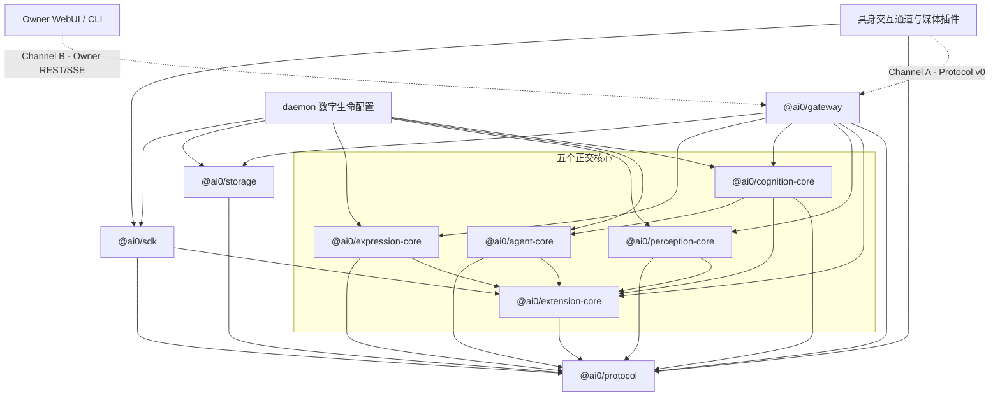

# 01. 系统总体架构与 Monorepo 目标工程拓扑规范

> 仓库有十个公共包。运行闭环、内环执行、能力绑定、观察、状态和表达分别有责任所有者。应用宿主由 daemon 薄装配。

## 一、五核架构与三级渐进派生

Stage 0–6 通过单步问答、设备交互与策略消融划分职责。Stage 7 从发布给插件作者的 SDK 和各核公开入口运行替换实验。图中实线从依赖方指向依赖项，虚线表示网络通道。



## 二、九包职责

- **`@ai0/protocol`** 为 Zod 机器契约唯一真相源，零内部依赖。覆盖 `core-v0/`、`extensions/`、`plugin-manifests/`、`character-card-v3/` 和 `control-plane/`。控制面定义 L0～L5 Deploy-to-Live 就绪契约及 `VerifiableTurnTrace`。
- **`@ai0/extension-core`** 是扩展机制核心。以 `defineFacetPoint`（含开放 `custom.<namespace>.<name>` 命名空间）、`defineServiceContract` 与 `defineHookPoint` 定义切面、服务与钩子契约；`ExtensionCoreHost` 执行包级权限、`rev` 热重载、`onDidChange` 生命周期通知及 `faulted_isolated` 熔断，并通过 `createScopedView`（`ScopedExtensionView`）提供 `Global -> Session -> W1/W2 -> Subagent` 递归单调收窄的注入作用域配线架。详见[05 多切面扩展规范](05-eight-dimension-extension-system.md)。
- **`@ai0/agent-core`** 是通用 LLM 与工具 `Turn / Round` 内环执行引擎（Inner Execution Harness）。以 `system_invariant`、`developer_frame`、`untrusted_observation`、`user` 四车道分离指令权威与数据，支持多步工具调度、同轮动态外部污点（`resultTaint`）升级熔断、终局结构化输出收敛及 `goalVerification` 核验守卫。领域边界为零陪伴、情绪、记忆与 Avatar 知识。
- **`@ai0/agent-runtime`** 是无头通用智能体双环运行时（Outer Subject Loop）。零重复抽象地组合 `@ai0/extension-core`、`@ai0/agent-core` 以及可选挂载的 `@ai0/perception-core`、`@ai0/cognition-core`、`@ai0/expression-core`，打通动态槽位黑板编译到四车道提示词装配的双层上下文汇流，内置可按契约替换的子层能力（`update_plan`、`delegate_subagent`、`dispatch_background_goal`、`recall/propose_memory`），提供 `"direct_inline"` 与 `"dual_speed_w1_w2"` 两种路由模式，并可通过 `pnpm agent` CLI 脱离 WebUI 与 HTTP 网关独立运行。
- **`@ai0/perception-core`** 拥有上行 `EmbodimentAffordanceRegistry` 与 `UniversalObservationFrame` 六元组元语法。`ScopedContextRegistry` 使用 `freshnessTtlMs` 和 `blind | disconnected | stale` 锁约束感知推断。`TurnLifecycleGate` 处理 `activity | interim | commit | retract`。`PerceptionFilterPipeline` 无切面时直通。挂载策略 Time Gradient Habituation 与 `ReflexGate` 以 `llmTokens: 0` 抑制例行信号并累计 `suppressedRoutineCount`。`ChronoceptiveSignalSynthesizer` 从经过时间扣除冬眠区间。
- **`@ai0/cognition-core`** 采用 `./kernel`（`VirtualClock`、`ContinuousStateMetaEngine`、`StateDomainArbiter`、`BrainRegionRouter`、`ProfiledInferenceClient`）与 `./subsystems`（五域 `AuthoritativeStateCoordinator`、`EpistemicMemoryFirewall`、`CommonGround` 状态机、`CapabilityPolicyGate`、`BlackboardCompiler`、`MetabolicRegionRouter`、UMO 路由及 W2/W3 循环）双层设计。七个有状态包（五核 + `storage` + `gateway`）统一导出 `.`、`./kernel`、`./subsystems` 子路径，由 Invariant 9 锁定单向依赖。伴侣专属情绪与设定集策略全部外置为 `plugins/` 可选插件，`apps/daemon` 仅保留薄宿主接线。
- **`@ai0/expression-core`** 的 `CommunicativeIntentEnvelope` 独立于人形，支持 `communicate | explicit_silence | actuate | request_observation`。`RealizerVocabularyNegotiator` 在缺少符合隐私约束的交互通道时置为 `held_pending_compliant_channel`。有界 `InteractionOpportunityPool` 管理表达机会。四态真值链为 `generated_unpresented → physically_presented → actuation_verified → interlocutor_grounded`。`GroundingReceiptTracker` 跟踪 `silenced` 与 `done` 两个中断边界，并恢复 `unsaid_remainder`。
- **`@ai0/storage`** 负责 Local-First `.soul` 的 SQLite WAL、FTS5 与向量存储，以 `continuous_states_json` 保存检查点。持久化 `souls/host/` 基础设施与 Vault，负责 CCv3 导入、越权指令清理、未知 `extensions.<namespace>` 无损保留及 `.soul` 唤醒。Stage 1 用 SQL `WHERE visibility_scope …` 强制过滤。五表载荷执行拓扑级联 Hard Forget，通过 `redaction_ledger.json` 跨快照重放。V1 的兼容视图和预置灵魂数均为零。
- **`@ai0/gateway`** 以 `ChannelProtocolGateway` 提供 Channel A Protocol v0 处理，以 `PrivilegedAdminServer` 提供 Channel B Owner Admin REST/SSE、`/healthz` 和 `/readyz`。
- **`@ai0/sdk`** 是 `plugins/**` 的零后门多态扩展 SDK。提供 `defineExtensionPackage` 和跨核 `FacetPoint`。官方与社区扩展共用运行时清单发现、装载与权限裁决路径。

## 三、双平面接口与部署就绪

| 边界 | Channel A · 公开具身协议 | Channel B · Owner 管理与遥测 |
| :--- | :--- | :--- |
| 传输 | `/protocol/v0/channel` · 五原语契约，部署桥提供 HTTP/SSE | `/api/admin/v1/*` · REST 与 SSE |
| 凭据 | `Scoped Capability Token`，强制校验交互通道、场所、受众与执行器权限 | Owner 管理会话 |
| 数据 | 注入可信来源四元组，端到端保留结构化 `UniversalObservationFrame`。普通字符串仅作为帧内内容字段。向合规交互通道发送表达意图并接收回执。 | 宿主认领、Provider 配置、角色卡管理与唤醒、交互通道绑定、`VerifiableTurnTrace` 与存档治理。 |

`/healthz` 表示进程存活。`/readyz` 报告 Deploy-to-Live 阶段，仅 L5 表示 LIVE 就绪。

```text
L0_UNCLAIMED
  → L1_CLAIMED_NO_PROVIDER
  → L2_PROVIDER_READY_NO_SOUL
  → L3_SOUL_AWAKENED_CONFIG_NEEDED
  → L4_SOUL_AWAKENED_NO_CHANNEL
  → L5_LIVE_READY
```

## 四、Monorepo 目标目录

采用 `pnpm workspaces` 与 `Turborepo`。

```text
<repo-root>/
├── package.json
├── pnpm-workspace.yaml
├── turbo.json
├── tsconfig.base.json
├── docs/
│   ├── vision/                         # 5 篇愿景研究
│   └── architecture/                   # 8 篇工程规格（01–08）
├── labs/
│   ├── README.md
│   ├── stage0-paper-traces/
│   ├── stage1-agent-core/
│   ├── stage2-airi-dissection/
│   ├── stage3-perception-expression/
│   ├── stage4-universal-derivation/
│   ├── stage5-composite-channel-facets/
│   ├── stage6-mechanism-policy-ablation/
│   └── stage7-public-contracts/
├── packages/
│   ├── protocol/
│   ├── extension-core/
│   ├── agent-core/
│   ├── perception-core/
│   ├── cognition-core/
│   ├── expression-core/
│   ├── storage/
│   ├── gateway/
│   └── sdk/
├── apps/
│   ├── daemon/                         # 薄宿主接线运行时
│   └── console/
├── plugins/
├── scripts/
│   └── verify-architecture-boundaries.mjs
└── souls/
    ├── host/                           # Vault、Provider Pool、初始为空的角色卡注册表
    └── <soul_id>.soul/                  # 从 CCv3 卡在运行时唤醒
```

**Zero-Preset** · 宿主角色卡注册表与灵魂存档列表均从空集合开始。磁盘契约见 [02. 灵魂存档规范](02-storage-and-soul-archive-schema.md)。

## 五、编译期依赖边界

`scripts/verify-architecture-boundaries.mjs` 对包声明及源码导入执行以下直接内部依赖允许清单。跨目录相对路径与别名同样受约束。

| 依赖方 | 允许的直接内部依赖 |
| :--- | :--- |
| `@ai0/protocol` | 无。Zod 提供跨平台 Schema 校验。 |
| `@ai0/extension-core`、`@ai0/storage` | `@ai0/protocol` |
| `@ai0/agent-core`、`@ai0/perception-core`、`@ai0/expression-core`、`@ai0/sdk` | `@ai0/protocol`、`@ai0/extension-core` |
| `@ai0/cognition-core` | `@ai0/protocol`、`@ai0/extension-core`、`@ai0/agent-core` |
| `@ai0/agent-runtime` | `@ai0/protocol`、`@ai0/extension-core`、`@ai0/agent-core`、`@ai0/perception-core`、`@ai0/cognition-core`、`@ai0/expression-core` |
| `@ai0/gateway` | `@ai0/protocol`、`@ai0/extension-core`、`@ai0/perception-core`、`@ai0/cognition-core`、`@ai0/expression-core`、`@ai0/storage` |
| `plugins/**` | `@ai0/protocol`、`@ai0/sdk` |

`packages/*` 和 `apps/*` 禁止依赖或导入 `@ai0/plugin-*` 或 `plugins/**`。插件依靠运行时清单发现与权限裁决，插件页面由控制台动态挂载。Worker 与认知器官持有只读存储视图，权威写入由协调器通过提案提交。

`packages/protocol/src/**/*.ts` 的 Zod Schema 服务于 TypeScript 类型推导、运行时校验与单向 JSON Schema 生成。端到端验证使用真实 SQLite WAL、协调器事务及双平面接口，覆盖结构化观察、SQL 受众隔离、表达回执、血缘重算与场景回放。
