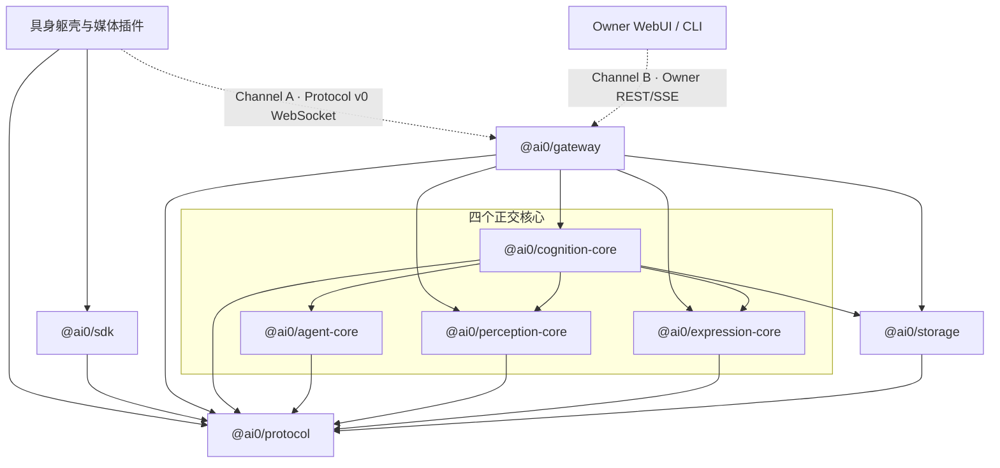

# 01. 系统总体架构与 Monorepo 目标工程拓扑规范

> **Clean-Slate V1** · 始终保持第一版，零历史沉积、零预设默认角色卡、三级渐进派生、四核正交分立。

## 一、四核架构与三级渐进派生

三级派生依次验证通用话轮、感知与表达边界、完整认知与宿主运行。实验从纸面轨迹出发，经过通用执行验证、AIRI 解剖与感知表达验证，收敛到通用派生。图中实线从依赖方指向依赖项，虚线表示网络通道。



## 二、八包职责

- **`@ai0/protocol`** 为 Zod 机器契约唯一真相源，零内部依赖。覆盖 `core-v0/`、`extensions/`、`plugin-manifests/`、`character-card-v3/` 和 `control-plane/`。控制面定义 L0～L5 Deploy-to-Live 就绪契约及 `VerifiableTurnTrace`。
- **`@ai0/agent-core`** 是通用 LLM 与工具 `Turn / Round` 执行引擎。以 `system_invariant`、`developer_frame`、`untrusted_observation` 三层分离指令权威与数据。支持多步并发工具调度、`maxSteps` 到限结算和 `goalVerification` 缺少证据时的 `unverified` 守卫。HTTP 408、429 和 5xx 瞬态故障仅在副作用发生前重试。上游传输支持 `opencode_go` 的 `deepseek-v4.1-flash`、OpenAI-compatible、Anthropic、DeepSeek 与 Ollama。领域边界为零陪伴、情绪、记忆与 Avatar 知识。
- **`@ai0/perception-core`** 拥有上行 `EmbodimentAffordanceRegistry` 与 `UniversalObservationFrame` 六元组元语法。`ScopedContextRegistry` 使用 `freshnessTtlMs` 和 `blind | disconnected | stale` 锁约束感知推断。`TurnLifecycleGate` 处理 `activity | interim | commit | retract`。时间梯度习惯化与 `ReflexGate` 以 `llmTokens: 0` 抑制例行信号并累计 `suppressedRoutineCount`。`ChronoceptiveSignalSynthesizer` 从经过时间扣除冬眠区间。
- **`@ai0/cognition-core`** 的 `VirtualClock` 在 LIVE 锁定 1x，在 `SANDBOX:<fork_id>` 支持时间变速并记录冬眠区间。声明式 `ContinuousStateMetaEngine` 以描述符与潜状态驱动演化，SQL 心理标量列数为零。五域 `AuthoritativeStateCoordinator` 执行 MVCC 裁决。Tier 0 SB 243 安全守卫、四级 `EpistemicMemoryFirewall`（含玩笑语用防火墙与 `CommonGround` 双方共同确认状态机）及低于 2500 token 的声明式 `BlackboardCompiler`（含 70% `Social Mask Damper`）约束认知输入。包含 W1 对话、W2 行动、W3 睡眠整理、W4 多模态分析四路并发 Worker、五脑区模型路由、`PolymorphicExtensionHost` 与 `.scenario.yaml` 回放评估器。
- **`@ai0/expression-core`** 的 `CommunicativeIntentEnvelope` 独立于人形，支持 `communicate | explicit_silence | actuate | request_observation`。`RealizerVocabularyNegotiator` 在缺少符合隐私约束的躯壳时置为 `held_pending_compliant_shell`。有界 `InteractionOpportunityPool` 管理表达机会。四态真值链为 `generated_unpresented → physically_presented → actuation_verified → interlocutor_grounded`。`GroundingReceiptTracker` 跟踪 `silenced` 与 `done` 两个中断边界，并恢复 `unsaid_remainder`。
- **`@ai0/storage`** 负责 Local-First `.soul` 的 SQLite WAL、FTS5 与向量存储，以 `continuous_states_json` 保存检查点。持久化 `souls/host/` 基础设施与 Vault，负责 CCv3 导入、越权指令清理、未知 `extensions.<namespace>` 无损保留及 `.soul` 唤醒。Stage 1 用 SQL `WHERE visibility_scope …` 强制过滤。五表载荷执行拓扑级联 Hard Forget，通过 `redaction_ledger.json` 跨快照重放。V1 的兼容视图和预置灵魂数均为零。
- **`@ai0/gateway`** 提供 Channel A Protocol v0 WebSocket、Channel B Owner Admin REST/SSE、`/healthz` 和 `/readyz`。
- **`@ai0/sdk`** 是 `plugins/**` 的零后门多态扩展 SDK。官方与社区扩展共用运行时清单发现、装载与权限裁决路径。

## 三、双平面接口与部署就绪

| 边界 | Channel A · 公开具身协议 | Channel B · Owner 管理与遥测 |
| :--- | :--- | :--- |
| 传输 | `/protocol/v0/shell` · Protocol v0 WebSocket | `/api/admin/v1/*` · REST 与 SSE |
| 凭据 | `Scoped Capability Token`，强制校验躯壳、场所、受众与执行器权限 | Owner 管理会话 |
| 数据 | 注入可信来源四元组，端到端保留结构化 `UniversalObservationFrame`。普通字符串仅作为帧内内容字段。向合规躯壳发送表达意图并接收回执。 | 宿主认领、Provider 配置、角色卡管理与唤醒、躯壳绑定、`VerifiableTurnTrace` 与存档治理。 |

`/healthz` 表示进程存活。`/readyz` 报告 Deploy-to-Live 阶段，仅 L5 表示 LIVE 就绪。

```text
L0_UNCLAIMED
  → L1_CLAIMED_NO_PROVIDER
  → L2_PROVIDER_READY_NO_SOUL
  → L3_SOUL_AWAKENED_CONFIG_NEEDED
  → L4_SOUL_AWAKENED_NO_SHELL
  → L5_LIVE_READY
```

## 四、Monorepo 目标目录

采用 `pnpm workspaces` 与 `Turborepo`。

```text
<repo-root>/
├── package.json
├── pnpm-workspace.yaml
├── turbo.json
├── tsconfig.base.json
├── docs/
│   ├── vision/                         # 5 篇愿景研究
│   └── architecture/                   # 8 篇工程规格（01–08）
├── labs/
│   ├── README.md
│   ├── stage0-paper-traces/
│   ├── stage1-agent-core/
│   ├── stage2-airi-dissection/
│   ├── stage3-perception-expression/
│   └── stage4-universal-derivation/
├── packages/
│   ├── protocol/
│   ├── agent-core/
│   ├── perception-core/
│   ├── cognition-core/
│   ├── expression-core/
│   ├── storage/
│   ├── gateway/
│   └── sdk/
├── apps/
│   ├── daemon/
│   └── console/
├── plugins/
├── scripts/
│   └── verify-architecture-boundaries.mjs
└── souls/
    ├── host/                           # Vault、Provider Pool、初始为空的角色卡注册表
    └── <soul_id>.soul/                  # 从 CCv3 卡在运行时唤醒
```

**Zero-Preset** · 宿主角色卡注册表与灵魂存档列表均从空集合开始。磁盘契约见 [02. 灵魂存档规范](02-storage-and-soul-archive-schema.md)。

## 五、编译期依赖边界

`verify-architecture-boundaries.mjs` 对包声明及源码导入执行以下直接内部依赖允许清单。跨目录相对路径与别名同样受约束。

| 依赖方 | 允许的直接内部依赖 |
| :--- | :--- |
| `@ai0/protocol` | 无。Zod 提供跨平台 Schema 校验。 |
| `@ai0/agent-core` | `@ai0/protocol` |
| `@ai0/perception-core`、`@ai0/expression-core`、`@ai0/storage`、`@ai0/sdk` | `@ai0/protocol` |
| `@ai0/cognition-core` | `@ai0/protocol`、`@ai0/agent-core`、`@ai0/perception-core`、`@ai0/expression-core`、`@ai0/storage` |
| `@ai0/gateway` | `@ai0/protocol`、`@ai0/perception-core`、`@ai0/cognition-core`、`@ai0/expression-core`、`@ai0/storage` |
| `plugins/**` | `@ai0/protocol`、`@ai0/sdk` |

`packages/*` 和 `apps/*` 禁止依赖或导入 `@ai0/plugin-*` 或 `plugins/**`。插件依靠运行时清单发现与权限裁决，插件页面由控制台动态挂载。Worker 与认知器官持有只读存储视图，权威写入由协调器通过提案提交。

`packages/protocol/src/**/*.ts` 的 Zod Schema 服务于 TypeScript 类型推导、运行时校验与单向 JSON Schema 生成。端到端验证使用真实 SQLite WAL、协调器事务及双平面接口，覆盖结构化观察、SQL 受众隔离、表达回执、血缘重算与场景回放。
