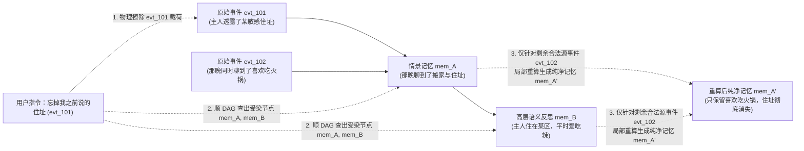

# 02. `.soul` 灵魂存档规范、SQLite 数据库 Schema 与血缘 DAG 算法架构

> **项目阶段**：架构研究与工程规格设计阶段（解法域工程规格）
>
> 本文档定义系统的持久化存储底座（`@ai0/storage`）。遵循**“灵魂存档彻底独立于任何躯壳”、“事件日志为唯一真相源，记忆为带血缘的可重建投影”**以及**“检索层代码按受众硬性隔离隐私”**三大公理，给出 `.soul` 单目录嵌入式存储结构、完整 SQLite DDL 表设计，以及局部血缘失效重算与真遗忘擦除算法。

---

## 一、Local-First `.soul` 灵魂存档目录规范

Clean-Slate V1 将磁盘实体分为四层。宿主基础设施与静态角色卡注册表各自持久化在 `souls/host/`，活体实例与其检索投影位于各自的 `.soul` 目录。

1. **宿主机基础设施** · `owner_claim.json` 保存 Owner 认证状态和 `deployment_mode`。`vault.enc` 加密保存 API 密钥与插件密钥。`infrastructure.json` 保存 Host Provider Pool 及 `consciousness`、`vision`、`speech` 三类 Global Module Defaults。
2. **静态角色卡注册表** · `cards/<card_id>.ccv3.json` 和配套资源保存用户导入或创建的 CCv3 卡。导入执行越权指令清理，未知 `extensions.<namespace>` 无损保留。注册表初始为空。
3. **独立活体灵魂存档** · 从 CCv3 卡唤醒后创建 `souls/<soul_id>.soul/`，记录来源、实例配置、事件与状态。`module_overrides` 以 `Inherit | Override` 表示随宿主默认值解析或使用实例配置。连续状态描述符由角色卡或已启用器官初始化。Vault 中的秘密通过引用解析。
4. **可重建检索投影** · 每个实例独立持有 FTS5 与向量索引，由同一实例的权威数据重建，始终服从实例的 SQL 受众边界。

**Zero-Preset** · 发行版的灵魂存档列表初始为空，移除的历史种子见 [07 清零账本](07-implementation-adrs-and-deviation-ledger.md)。

```text
souls/
├── host/
│   ├── owner_claim.json
│   ├── vault.enc
│   ├── infrastructure.json
│   └── cards/
│       ├── <card_id>.ccv3.json
│       └── assets/
└── <soul_id>.soul/
    ├── manifest.json                  # soul_id、schema_version、origin_card_id、module_overrides
    ├── identity.yaml                   # 人格核心、声线与行为策略
    ├── narrative.md                    # 可演化自我叙事，带 visibility_scope
    ├── voice_exemplars.jsonl
    ├── blackboard_policy.yaml
    ├── milestones_and_rituals.yaml
    ├── state_descriptors.yaml          # 声明式连续状态描述符
    ├── lorebooks/
    ├── skills/                        # 可选，挂载用户 SKILL.md 技能包
    ├── flows/
    ├── knowledge/
    │   └── documents/
    ├── config/
    │   └── extensions_state.json      # 启用扩展、权限覆写与 Vault 引用
    ├── state/
    │   ├── soul_core.sqlite           # SQLite WAL、FTS5 与向量索引
    │   └── redaction_ledger.json       # 独立于快照分支的永久遗忘账本
    ├── attachments/
    └── .git/                          # 实例快照历史
```

---

## 二、SQLite 核心数据库完整 DDL 架构 (`soul_core.sqlite`)

Clean-Slate V1 包含 **7 张权威表**，另设 `memory_lineage_edges` 关联边表与 FTS5／向量索引。边表记录权威记忆之间的派生与更替关系。兼容视图数为零，移除的历史视图见 [07 清零账本](07-implementation-adrs-and-deviation-ledger.md)。

### 2.1 表 1：不可变原始事件日志表 (`event_log` — Single Source of Truth)

`event_log` 是不可变事件 SSOT，记录来源躯壳、主体（含信任级别）、场所、受众四元组。已提交感知的 `payload_json` 保留完整结构化 `UniversalObservationFrame`，摘要单独保存。Hard Forget 按下文的墓碑事务擦除原载荷。


```sql
CREATE TABLE event_log (
    event_seq           INTEGER PRIMARY KEY AUTOINCREMENT, -- 全局严格递增物理序列号
    event_id            TEXT NOT NULL UNIQUE,              -- ULID (如 evt_01J9Z...)
    wall_ts_ms          INTEGER NOT NULL,                  -- 真实物理世界 UTC 毫秒时间戳
    virtual_ts_ms       INTEGER NOT NULL,                  -- 认知核 VirtualClock 虚拟毫秒时间戳
    
    -- 四元组溯源信封 (The Provenance Quadruple)
    source_shell_id     TEXT NOT NULL,                     -- 来源躯壳实例 ID (或 'cognition.internal')
    principal_id        TEXT NOT NULL,                     -- 归一化主体 ID ('owner' | 'friend:<id>' | 'stranger:<uid>' | 'system')
    principal_trust     TEXT NOT NULL CHECK (principal_trust IN ('owner_verified', 'bound_friend', 'stranger', 'environment_sensor', 'tool_output')),
    venue_type          TEXT NOT NULL CHECK (venue_type IN ('private_1on1', 'group_chat', 'public_livestream', 'local_ambient', 'internal_background')),
    audience_scope      TEXT NOT NULL,                     -- 在场受众作用域 ('only_owner' | 'group:<id>' | 'public_all')
    
    -- 事件分类与载荷
    event_category      TEXT NOT NULL CHECK (event_category IN (
                            'perception_committed',        -- 上行已确认感知事件
                            'expression_delivered',        -- 下行已确认送达/被打断表达回执
                            'action_episode_completed',    -- 8步行动任务完成事件
                            'sleep_consolidation_run',     -- 真实执行过的后台睡眠整理事件
                            'curiosity_exploration_run',   -- 真实执行过的后台好奇心探索事件
                            'config_or_ablation_changed',  -- 认知模块开关或路由配置变更事件
                            'memory_redacted_tombstone',   -- 真遗忘擦除墓碑事件
                            'soul_rollback_bridge'         -- 灵魂回档断层弥合元事件
                        )),
    modality            TEXT NOT NULL,                     -- 'text' | 'audio_transcript' | 'visual_cue' | 'contact_interaction' | 'system_chronoception' | 'custom.*'
    summary_text        TEXT NOT NULL,                     -- 供快速检索的文本摘要 (执行真遗忘后物理覆写为 '[REDACTED_BY_OWNER]')
    payload_json        TEXT NOT NULL,                     -- 完整结构化 JSON 载荷，感知事件保留 UniversalObservationFrame (执行真遗忘后物理覆写为 '{}')
    
    -- 因果与消融审计元数据
    state_rev_after     INTEGER NOT NULL,                  -- 该事件处理后的权威状态版本号 v_N
    active_modules_mask INTEGER NOT NULL,                  -- 当时开启的认知模块位图 (用于消融实验因果复现)
    redacted_at_ts_ms   INTEGER DEFAULT NULL,              -- 若被执行“真遗忘”，记录擦除时间戳
    redacted_by_event   TEXT DEFAULT NULL                  -- 指向对应的墓碑事件 ID
);

CREATE INDEX idx_event_log_virtual_ts ON event_log(virtual_ts_ms);
CREATE INDEX idx_event_log_audience ON event_log(audience_scope, virtual_ts_ms);
CREATE INDEX idx_event_log_category ON event_log(event_category, virtual_ts_ms);
```

### 2.2 表 2：多层次主观记忆投影表 (`memories`) 与血缘边表 (`memory_lineage_edges`)

`EpistemicMemoryFirewall` 对记忆投影强制区分 `observed_firsthand`、`reported_hearsay`、`inferred_hypothesis`、`imagined_narrative`。语用防火墙禁止 `playful_banter` 和 `roleplay_fiction` 进入 `semantic_fact`。推断须设置过期时间。记录时间由 `created_virtual_ts` 与 `created_at_rev` 标识，有效时间由 `valid_from_virtual_ts` 与 `valid_until_virtual_ts` 标识，更替以 `supersedes` 边记录。`CommonGround` 在实际呈现后进入 `proposed_presented`，收到对方明确接纳的证据后进入 `mutually_grounded`，争议或弃用时进入 `disputed_retired`。


```sql
CREATE TABLE memories (
    memory_id           TEXT PRIMARY KEY,                  -- ULID (如 mem_01J9Z...)
    memory_tier         TEXT NOT NULL CHECK (memory_tier IN (
                            'episodic_experience',         -- 带时间与情绪权重的共同经历摘要
                            'semantic_fact',               -- 沉淀下来的客观事实或用户偏好
                            'relational_tacit',            -- 相处默契、内部梗或共同黑话
                            'kb_crystallized_gist',        -- 从热插拔外部知识库沉淀下来的百字常识卡
                            'topic_taboo_seal'             -- 负向避雷封印 (“别再提这件事”)
                        )),
    
    -- 认知溯源 (Epistemic Provenance — 严禁混淆事实与猜测)
    epistemic_type      TEXT NOT NULL CHECK (epistemic_type IN (
                            'observed_firsthand',          -- 亲历或主人亲口确认
                            'reported_hearsay',            -- 第三方或外部传闻 (不可写入核心主人画像)
                            'inferred_hypothesis',         -- 潜台词或情绪揣测 (强制带过期时间，禁止升格为事实)
                            'imagined_narrative'           -- 角色内白日梦/创意构想
                        )),
    attributed_principal TEXT NOT NULL,                    -- 该信息归属的主体
    
    -- 隐私隔离墙硬过滤字段 (Database-Level Privacy Scope Guard)
    visibility_scope    TEXT NOT NULL,                     -- 'only_owner' | 'group:<id>' | 'public_all'
    taint_level         TEXT NOT NULL CHECK (taint_level IN ('trusted_owner', 'semi_trusted_friend', 'untrusted_external')),
    
    -- 记忆内容与艾宾浩斯动力学参数
    content_text        TEXT NOT NULL,                     -- 记忆正文 (若为 topic_taboo_seal 则存避雷规则描述)
    emotional_valence   REAL NOT NULL DEFAULT 0.0,         -- 形成记忆时的情绪效价 [-1.0, 1.0]
    emotional_arousal   REAL NOT NULL DEFAULT 0.0,         -- 形成记忆时的情绪唤醒度 [0.0, 1.0]
    base_importance     REAL NOT NULL DEFAULT 0.5,         -- 基础重要度权重 [0.0, 1.0]
    stability_half_life REAL NOT NULL DEFAULT 168.0,       -- 艾宾浩斯遗忘半衰期 (虚拟小时数，随每次召回巩固递增)
    recall_count        INTEGER NOT NULL DEFAULT 0,        -- 累计被召回次数
    
    -- 时间、双时态演进与共同默契采纳生命周期
    created_virtual_ts      INTEGER NOT NULL,
    last_recalled_ts        INTEGER NOT NULL,
    valid_from_virtual_ts   INTEGER NOT NULL,                  -- 双时态：该事实/偏好开始生效的虚拟时间戳
    valid_until_virtual_ts  INTEGER DEFAULT NULL,              -- 双时态：若被新事实取代 (supersedes)，记录旧事实封口退居历史态的时间戳
    expires_virtual_ts      INTEGER DEFAULT NULL,              -- inferred_hypothesis 强制设置过期时间
    grounding_status        TEXT NOT NULL DEFAULT 'not_applicable' CHECK (grounding_status IN (
                                'not_applicable',              -- 非 relational_tacit 记忆默认此值
                                'proposed_presented',          -- 已单方面说出该内部梗/称呼，尚未获对方接梗确认
                                'mutually_grounded',           -- 已观测到对方正向接梗/回用，正式成为双方共同默契
                                'disputed_retired'             -- 对方冷场或明确拒绝，已弃用不再复读
                            )),
    invalidated_at_ts       INTEGER DEFAULT NULL,              -- 若上游血缘被真遗忘删除或重算，标记为失效
    created_at_rev          INTEGER NOT NULL                   -- 写入时的协调器状态版本号
);

-- 记忆血缘与认知更替有向无环图边表 (Lineage & Epistemic Revision DAG Edges)
-- 记录每条记忆源自哪些原始事件/父记忆 (derived_from)、取代/反驳了哪条旧记忆 (supersedes / contradicts)，或由哪个知识库切片浓缩沉淀而来 (crystallized_from)
CREATE TABLE memory_lineage_edges (
    child_memory_id     TEXT NOT NULL REFERENCES memories(memory_id) ON DELETE CASCADE,
    parent_type         TEXT NOT NULL CHECK (parent_type IN ('event', 'memory', 'knowledge_chunk')),
    parent_id           TEXT NOT NULL,                     -- 指向 event_log.event_id、memories.memory_id 或 knowledge_chunks.chunk_id
    relation_type       TEXT NOT NULL DEFAULT 'derived_from' CHECK (relation_type IN (
                            'derived_from',                -- 正向血缘派生 (用于真遗忘级联擦除与微重算)
                            'supersedes',                  -- 双时态事实更替 (新偏好/纠错后的新事实取代旧事实)
                            'contradicts',                 -- 待睡眠整理消解的证据冲突边
                            'crystallized_from'            -- 由内建混合 RAG 或外部知识库切片浓缩生成的百字常识卡 (kb_crystallized_gist) 血缘边
                        )),
    PRIMARY KEY (child_memory_id, parent_type, parent_id)
);

CREATE INDEX idx_memories_Retrieval ON memories(visibility_scope, invalidated_at_ts, memory_tier);
CREATE INDEX idx_lineage_parent ON memory_lineage_edges(parent_type, parent_id);
```

*(注：向量索引表 `memories_vec` 使用 `sqlite-vec` 虚拟表绑定 `memory_id`，并在检索时与 `memories` 表做内连接，确保 `WHERE visibility_scope IN (...) AND invalidated_at_ts IS NULL` 在 SQL 引擎底层先于返回结果生效。)*

### 2.3 表 3：承诺与前瞻记忆状态机表 (`prospective_commitments`)

```sql
CREATE TABLE prospective_commitments (
    commitment_id       TEXT PRIMARY KEY,
    commitment_kind     TEXT NOT NULL CHECK (commitment_kind IN (
                            'agent_promise',               -- 她答应主人的事 (违约需触发角色内真诚道歉)
                            'user_upcoming_event',         -- 主人未来的重要事项 (事后需主动关心结果)
                            'curiosity_agenda'             -- 她自己产生的好奇心探索线索
                        )),
    visibility_scope    TEXT NOT NULL,                     -- 'only_owner' | 'group:<id>' | 'public_all'
    taint_level         TEXT NOT NULL DEFAULT 'trusted_owner' CHECK (taint_level IN ('trusted_owner', 'semi_trusted_friend', 'untrusted_external')), -- 若由 W3 外部好奇心冲浪生成则强制锁死为 'untrusted_external'，唤醒时物理禁止自动连带触发副作用工具调用!
    description         TEXT NOT NULL,
    trigger_type        TEXT NOT NULL CHECK (trigger_type IN ('at_virtual_ts', 'on_next_interaction_after_ts', 'on_idle_window')),
    trigger_virtual_ts  INTEGER NOT NULL,
    deadline_virtual_ts INTEGER DEFAULT NULL,
    status              TEXT NOT NULL CHECK (status IN ('pending', 'due', 'fulfilled', 'missed', 'cancelled')),
    source_event_id     TEXT NOT NULL REFERENCES event_log(event_id),
    resolved_event_id   TEXT DEFAULT NULL
);

CREATE INDEX idx_commitments_status_ts ON prospective_commitments(status, trigger_virtual_ts);
```

### 2.4 表 4：权威认知状态与内稳态检查点表 (`cognitive_state_checkpoints`)

`continuous_states_json` 持久化 `ContinuousStateMetaEngine` 描述符与潜状态，按 `state_id` 索引。每项包含 `{ topology, baseline, rate, wakeup_thresholds, latent_displacement, impulse_at_ms, value }`，其中 `topology` 为 `bipolar_tanh | unipolar_sigmoid`。`state_attributions_json` 为 `{ state_id, reason, visibility_scope, caused_by_event_id }` 对象数组。公开场所的 Social Masking 在黑板编译时剥离 `only_owner` 归因。

`working_memory_json` 保存近期话轮、`unsaid_remainder` 与四态表达账本 `generated_unpresented → physically_presented → actuation_verified → interlocutor_grounded`。中断回执分别记录 `silenced` 与 `done` 边界。`hibernation_intervals_json` 保存冬眠区间，供时感信号扣除。`next_wakeup_ts_ms` 保存反解得到的下一阈值唤醒虚拟时间戳。


```sql
CREATE TABLE cognitive_state_checkpoints (
    state_rev           INTEGER PRIMARY KEY,               -- 单调递增的权威状态版本号 v_N
    virtual_ts_ms       INTEGER NOT NULL,
    caused_by_event_id  TEXT NOT NULL,
    
    continuous_states_json TEXT NOT NULL,
    state_attributions_json TEXT NOT NULL DEFAULT '[]',
    relationship_json   TEXT NOT NULL,
    user_model_json     TEXT NOT NULL,
    working_memory_json TEXT NOT NULL,
    hibernation_intervals_json TEXT NOT NULL DEFAULT '[]',
    next_wakeup_ts_ms   INTEGER DEFAULT NULL               -- 反解出的下一阈值唤醒虚拟时间戳
);
```

### 2.5 表 5：8 步可验证系统决策审计轨迹表 (`turn_decision_traces`)

```sql
CREATE TABLE turn_decision_traces (
    trace_id            TEXT PRIMARY KEY,
    turn_event_id       TEXT NOT NULL REFERENCES event_log(event_id),
    virtual_ts_ms       INTEGER NOT NULL,
    state_rev_before    INTEGER NOT NULL,
    state_rev_after     INTEGER NOT NULL,
    
    -- 8 步确定性审计记录 (JSON 结构化存储，供 WebUI 白盒面板与回归回放断言)
    step1_perception_json   TEXT NOT NULL,                 -- 输入信封与四元组
    step2_gate_safety_json  TEXT NOT NULL,                 -- L0 危机检查、显著性得分、防抖合并计数、识别意图
    step3_memory_recall_json TEXT NOT NULL,                -- 受众过滤条件、召回的 memory_id 列表及各项分值明细
    step4_homeostasis_json  TEXT NOT NULL,                 -- 裁决前稳态向量 -> 代码裁决后的状态 Diff
    step5_strategy_proposal_json TEXT NOT NULL,            -- 选用策略、model_reported_rationale (非权威)、theatrical_subtext (带 spoiler_level)
    step6_tool_auth_json    TEXT NOT NULL,                 -- 选择的 MCP/Skill/Shell Actuator 及三维权限引擎裁决结果
    step7_emitted_intent_json TEXT NOT NULL,               -- 下发的 CommunicativeIntentEnvelope / 行动指令
    step8_delivery_receipt_json TEXT DEFAULT NULL          -- 异步回填的 DeliveryReceipt (含呈现、执行、共同确认与 silenced / done 边界)
);
```

### 2.6 表 6：内建开箱即用混合 RAG 知识库切片与 FTS5 稀疏索引表 (`knowledge_chunks`)

每个实例的 `soul_core.sqlite` 保存知识切片及定位信息。`metadata_json` 记录标题、行段或 PDF 页码，原始文档位于实例的 `knowledge/documents/`。全文索引使用 FTS5，向量索引按 `chunk_id` 关联切片。切片固定标记为 `untrusted_external`，引用完整送达后才更新引用计数。

```sql
CREATE TABLE knowledge_chunks (
    chunk_id            TEXT PRIMARY KEY,                  -- ULID
    collection_id       TEXT NOT NULL,                     -- 所属知识集 ID (如 'kb.local.project_docs' 或 'kb.anime.lore')
    document_name       TEXT NOT NULL,                     -- 原始文档名 (PDF / Markdown / DOCX / 代码文件)
    chunk_index         INTEGER NOT NULL,
    content_text        TEXT NOT NULL,
    metadata_json       TEXT NOT NULL DEFAULT '{}',        -- 页码、章节标题或代码符号路径
    taint_level         TEXT NOT NULL DEFAULT 'untrusted_external' CHECK (taint_level = 'untrusted_external'),
    citation_count      INTEGER NOT NULL DEFAULT 0,        -- 在真实对话中被高权重引用的累计次数 (卸载时用于筛选提炼 Gist 常识卡)
    last_cited_ts_ms    INTEGER DEFAULT NULL,
    created_at_ts_ms    INTEGER NOT NULL
);

-- SQLite FTS5 BM25 稀疏检索虚拟表 (与模型向量余弦检索共同构成 Hybrid RAG + Reranker 管线)
CREATE VIRTUAL TABLE knowledge_chunks_fts USING fts5(
    chunk_id UNINDEXED,
    collection_id UNINDEXED,
    content_text,
    tokenize = 'unicode61'
);
```

### 2.7 表 7：关系羁绊里程碑与时间仪式达成账本表 (`soul_milestones_ledger`)

为使 `.soul/milestones_and_rituals.yaml` 中定义的正向成长规则与前端 `/memory/relationship` 页面的**共同经历里程碑画廊**形成持久化闭环（归属协调器 `D5_IDENTITY_NARRATIVE` 状态域管辖），数据库维护已达成里程碑与时间仪式的不可变解锁账本：

```sql
CREATE TABLE soul_milestones_ledger (
    milestone_id        TEXT PRIMARY KEY,                  -- 对应 milestones_and_rituals.yaml 中的规则 ID (如 'ms.companion_30_days')
    title               TEXT NOT NULL,                     -- 里程碑标题 (如 '相伴满月纪念' / '共同攻克第 10 个行动任务')
    category            TEXT NOT NULL CHECK (category IN ('temporal_anniversary', 'trust_breakthrough', 'joint_agency_achievement', 'story_event')),
    unlocked_virtual_ts INTEGER NOT NULL,                  -- 达成时的 VirtualClock 虚拟毫秒时间戳
    trigger_event_id    TEXT NOT NULL REFERENCES event_log(event_id), -- 触发该里程碑的源事件 ID (供画廊点击溯源)
    unlocked_rewards_json TEXT NOT NULL DEFAULT '{}',      -- 正向成长解锁载荷 (如解锁的新专属称呼、新增黄金声线样本 ID 或纪念日前瞻约定 ID)
    state_rev_unlocked  INTEGER NOT NULL                   -- 达成时的权威状态版本号 v_N
);
```

---

## 三、核心存储算法：血缘 DAG 级联真遗忘、局部失效重算与混合检索

### 3.1 混合记忆检索与数据库级受众硬隔离公式

当认知快环（`W1`）或行动环（`W2`）发起记忆检索时，`@ai0/storage` 强制执行以下两阶段查询：

1. **第一阶段：SQL 层受众作用域与有效性硬拦截（Deterministic Scope Guard）**
   * 若当前 `Audience == 'only_owner'` 且 `Principal == 'owner_verified'`：按允许值数量生成 SQL 占位符并逐项绑定 `only_owner`、`public_all` 和获授权的群组作用域，执行 `WHERE visibility_scope IN (…) AND invalidated_at_ts IS NULL`；
   * 若当前 `Audience == 'group:<gid>'`：**硬编码 SQL `WHERE visibility_scope IN ('group:<gid>', 'public_all') AND invalidated_at_ts IS NULL`**；
   * 若当前 `Audience == 'public_all'`（如公开直播间）：**硬编码 SQL `WHERE visibility_scope = 'public_all' AND invalidated_at_ts IS NULL`**。
   * **架构效果**：私密记忆在 SQLite 查询游标阶段就被物理排除，绝不进入内存，更绝不进入 LLM Prompt。
2. **第二阶段：带艾宾浩斯遗忘曲线与近期复用冷却的混合打分公式**
   对于通过第一阶段硬过滤的候选记忆 $m_i$，其在当前虚拟时间 $t$ 的综合召回得分 $R(m_i, t)$ 为：
   $$R(m_i, t) = \Big(w_{\text{sem}} \cdot \text{CosSim}(\mathbf{q}, \mathbf{v}_i) + w_{\text{imp}} \cdot I_{\text{base}}(m_i) \cdot (1 + \alpha \cdot |V_{\text{emo}}(m_i)|)\Big) \cdot 2^{-\frac{t - t_{\text{last}}(m_i)}{H(m_i)}} \cdot C_{\text{cooldown}}(m_i)$$
   * 其中 $H(m_i) = H_0 \cdot (1 + \beta \cdot \ln(1 + \text{recall\_count}_i))$ 为随每次成功回忆而延长的艾宾浩斯记忆稳定半衰期；
   * $C_{\text{cooldown}}(m_i) \in (0, 1]$ 为近期复用惩罚因子（防止在同一场对话中机械重复提及同一条记忆）。

### 3.2 五表 Hard Forget 级联与话题封印



1. **执行 `Hard Forget(target_event_ids | target_memory_ids)` —— 全受管副本擦除与跨回档永久墓碑账本**：
   * **Step 1（溯源定位）**：若用户指定删除某条记忆 $M$，通过 `memory_lineage_edges` 反向向上遍历，找到其根源事件集合 $\{E_{\text{target}}\}$；
   * **Step 2（物理载荷擦除与墓碑追加）**：在单一事务中，将 `event_log` 中 $\{E_{\text{target}}\}$ 的 `summary_text` 覆写为 `'[REDACTED_BY_OWNER]'`、`payload_json` 覆写为 `'{}'`，并追加一条 `memory_redacted_tombstone` 事件；
   * **Step 3（正向血缘级联失效与按 DAG 拓扑序自底向上局部微重算）**：从 $\{E_{\text{target}}\}$ 出发沿 `memory_lineage_edges (relation_type = 'derived_from')` 正向 BFS 遍历所有下游衍生记忆节点 $\{M_{\text{tainted}}\}$，并对受染子图按 **DAG 拓扑层级自底向上（Topological Level-Order Sort，确保父记忆节点永远先于依赖它的子记忆节点处理）** 依次执行：
     * 若某衍生记忆 $M_k$ 的所有上游合法源事件/父记忆均被擦除 $\rightarrow$ 直接从 `memories` 与 `memories_vec` 中**物理硬删除**；
     * 若某衍生记忆 $M_k$ 还依赖同一场对话中的其他合法未擦除源事件（如上图中的 `evt_102`）或未失效父记忆 $\rightarrow$ 将旧 $M_k$ 物理删除，并按拓扑层级顺序触发一次**仅以剩余未擦除源事件/已更新父记忆为输入的局部微重算（Topological Targeted Micro-Reprojection）**，彻底解决“全量重放算力破产”、“父子节点重算因果倒置”与“衍生反思残留”三大难题！
   * **Step 4（全受管副本同步脱敏擦除 —— 杜绝审计轨迹与检查点残留）**：
     同一事务覆盖五张载荷表。Step 2～3 处理 `event_log` 与 `memories`，本步处理以下三张表。受影响的血缘边和索引随记忆同步更新：
     * **`turn_decision_traces`（决策轨迹表）**：将所有 `turn_event_id IN {E_target}` 或在 `step3_memory_recall_json` 中召回了 `{M_tainted}` 的轨迹记录中对应的输入摘要、召回正文与输出文本物理覆写为 `'[REDACTED_BY_FORGET]'`；
     * **`cognitive_state_checkpoints`（状态检查点表）**：清理历史检查点的 `working_memory_json`（包括表达账本及 `unsaid_remainder`）与 `state_attributions_json`。移除关联 `{E_target}` 或 `{M_tainted}` 的工作记忆片段和受染归因条目，保留结构化 JSON 及未受影响的数据；
     * **`prospective_commitments`（前瞻承诺表）**：物理删除 `source_event_id IN {E_target}` 的未决承诺；
     * **磁盘空闲页物理清零**：数据库连接强制开启 `PRAGMA secure_delete = ON` 并执行增量页清理，防止已删明文残留在 SQLite 空闲磁盘页中。
   * **Step 5（写入跨时间线永久墓碑账本 `state/redaction_ledger.json` —— 防止旧存档回档复活）**：
     * 将本次遗忘的 `{ target_event_ids, target_memory_ids, redacted_at_wall_ts }` 追加写入独立于快照分支的 `state/redaction_ledger.json`。
     * **恢复旧快照时的强制重放契约（Mandatory Tombstone Replay on Snapshot Restore）**：每当用户从更早的 `.soul` 快照或 Git Commit 恢复历史存档时，存储恢复引擎在挂载旧快照数据库后、对外恢复服务前，**自动遍历 `redaction_ledger.json` 并对旧快照中存在的目标事件与衍生血缘重新执行 Step 2~4 的全套擦除**。这保证了**“一旦真遗忘生效，即使回档到遗忘前的旧快照，检索层与管理后台也永远无法重新取出已删原文”**。
2. **执行 `Topic Seal(topic_description)`（“别再提这件事”）**：
   * 同样清理具体痛苦细节记忆，但额外在 `memories` 表插入一条 `memory_tier = 'topic_taboo_seal'` 的高优先级负向约束向量。当后续检索或生成触碰该向量阈值时，代码直接注入避雷绕行指令。
