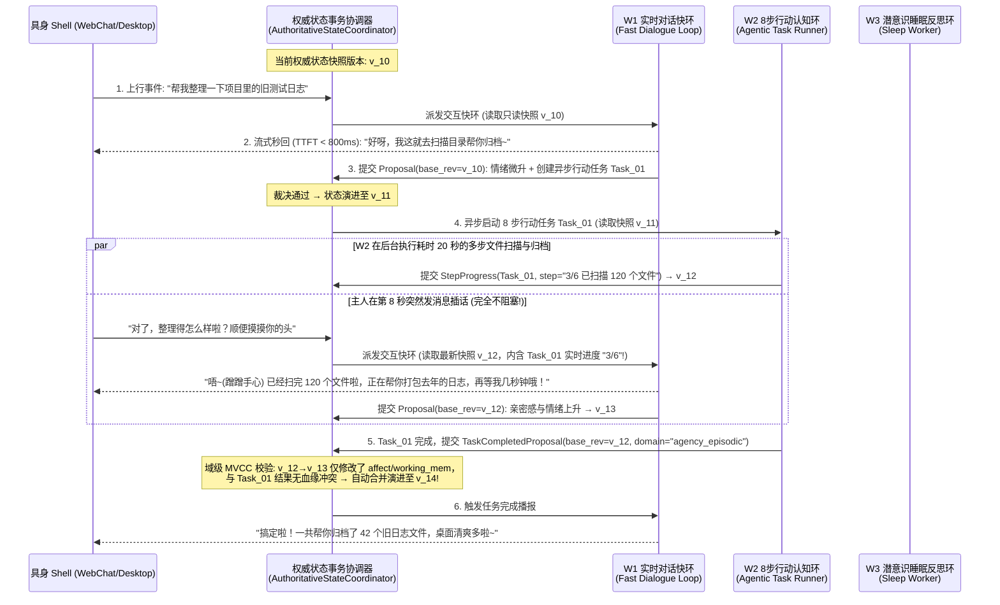
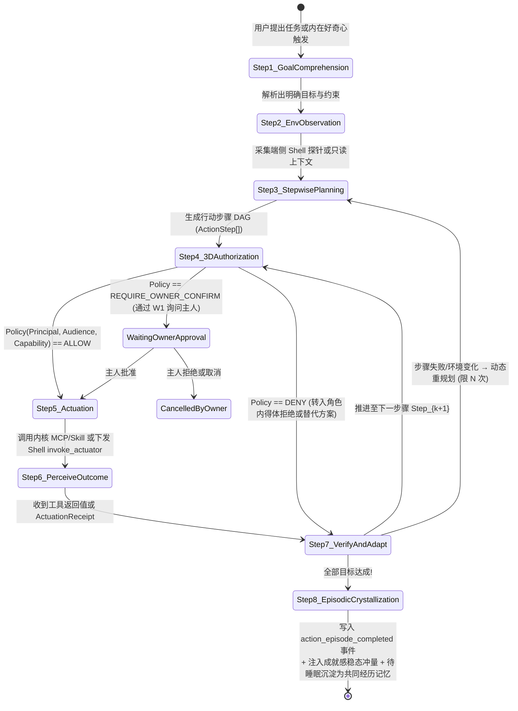

# 03. 运行时并发协调器、时间三分法引擎与一等行动认知状态机架构

> 本文档定义 `@ai0/kernel` 的核心运行时状态机。它解决了**“如何既保持单一认知主体的人格与记忆一致性，又不让长耗时工具任务或睡眠整理阻塞实时对话、且彻底消灭并发状态脏覆盖（Write Skew / Lost Update）”**的核心工程挑战。

---

## 一、并发协调架构：一主体、一协调器、四路并发工作者

`ai0` 摒弃了“单线程串行死锁”与“多实例无共享分身”两种极端模式，采用 **单一认知主体（Unified Subject） + 权威状态事务协调器（Authoritative State Coordinator with Domain-Scoped MVCC） + 四路异步并发工作者（4 Concurrent Workers）** 架构。

---

## 二、权威状态事务协调器（`AuthoritativeStateCoordinator`）与域级 MVCC 裁决规范

所有并发工作者（`W1`~`W4`）以及所有认知器官扩展（`ext.cognitive_organ`）均**零数据库直写权限**。它们只能接收只读快照 `ReadOnlyCognitiveSnapshot(rev = v_N)`，并向协调器提交结构化变更提案 `StateMutationProposal`。

### 2.1 状态域划分（State Domains）与乐观并发冲突矩阵

为了避免前台每次聊天递增 `state_rev` 导致后台运行了 15 秒的睡眠整理或长任务全部因为版本号过期而作废，协调器将认知状态划分为 **5 个正交状态域（Orthogonal State Domains）**，每个域独立维护子版本号 `domain_rev`：

| 状态域标识 (`StateDomain`) | 包含的核心状态 | 并发冲突与合并裁决规则（MVCC Resolution Rule） |
| :--- | :--- | :--- |
| **`D1_WORKING_TURN`** | 当前话轮上下文窗口、被打断未说完的腹稿（`unsaid_remainder`）、当前注意力焦点 `active_focus_shell_id` | **强排他最新优先（Last-Turn-Wins with Barge-in Cancel）**：仅允许前台 `W1` 与播放回执修改；若新话轮打断旧话轮，旧 `W1` 提案直接通过 `CancellationToken` 作废。 |
| **`D2_HOMEOSTASIS_AFFECT`** | 瞬时情绪、持久心境、双轨精力、社交渴望与好奇心驱动力 | **可交换增量叠加（Commutative Impulse Accumulation）**：由于情绪与稳态提案提交的是**定性冲量（Impulse $\Delta$）**而非绝对值覆写，协调器在当前最新解析时间状态 $\mathbf{S}(t)$ 上叠加阻尼冲量并做上下界 Clamping，**永不发生丢失更新（Zero Lost Update）**！ |
| **`D3_MEMORY_PROJECTION`** | `memories` 表、`memory_lineage_edges` 血缘图 | **基于源事件血缘的乐观校验（Lineage-Scoped OCC）**：后台 `W3`（睡眠整理）提交新记忆提案时，协调器检查其引用的 `source_event_ids[]` 在 `W3` 运行期间是否被主人在前台执行了 `Hard Forget`（真遗忘擦除）。若源事件完好无损，则直接安全合入；若源事件已被擦除，则拒绝该条记忆提案！ |
| **`D4_COMMITMENTS_TASKS`** | 前瞻承诺状态机、正在运行的 8 步行动任务状态树 | **按对象 ID 细粒度乐观锁（Entity-Level Revision Lock）**：只要前台没有取消该 `task_id` / `commitment_id`，后台 `W2` 的步骤进度更新直接合入。 |
| **`D5_IDENTITY_NARRATIVE`** | `identity.yaml` (Tier 1) 与 `narrative.md` (Tier 2) | **双轨分级演化与审批门控（Dual-Track Narrative Evolution & Approval Queue）**： • **Tier 1（`identity.yaml` 核心身份与长期价值观）**：100% 强制挂起至控制台 `PendingApproval` 队列，必须由主人显式批准方可合入； • **Tier 2（`narrative.md` 可演化自我叙事）**：由协调器统一按冲突等级分流——① **常规日常演进（`routine_append`）**（新增日常经历形成的内部梗、近期话题兴趣或默契，且无价值观冲突）自动生效并写入版本审计记录（支持在控制台一键回退）；② **高影响/冲突变更（`high_impact_shift`）**（涉及改写或删除既有自我叙事观点、对主人关系定性发生极性反转、或与 Tier 1 存在边缘张力）自动升级进入控制台 `PendingApproval` 队列并展示升级理由，待主人批准后生效。 |

### 2.2 协调器内置的三大确定性防火墙

在任何 `StateMutationProposal` 落入 `@ai0/storage` 事务之前，协调器串联执行三道代码级硬校验：
1. **血缘污染传播与睡眠写入防火墙（Sleep Write Firewall）**：校验提案引用的 `source_event_ids` 是否真实存在；只要任一源事件的 `principal_trust != 'owner_verified'`，强制将该记忆的 `taint_level` 锁死为 `'untrusted_external'`，禁止其修改核心主人画像或关系信任度。
2. **反操控与心结边界裁决器（Anti-Manipulation Clipper）**：裁剪单轮情绪/关系跳变幅度上限；强制为任何新产生的“心结（Tension）”绑定 $\le 48$ 小时的衰减半衰期。
3. **8 步可验证决策审计落库（Audit Trace Recorder）**：将裁决前后的完整参数写入 `turn_decision_traces` 表，同时推送至控制台特权遥测总线。

---

## 三、`VirtualClock` 与时间状态三分法引擎架构

### 3.1 全局时间注入铁律、正式实例与实验沙盒隔离（Live vs. Sandbox Target Isolation）与冬眠识别

* **禁止裸调系统时钟**：`@ai0/kernel` 内所有模块一律通过注入的 `IVirtualClock` 接口获取时间，严禁直接调用 `Date.now()`。
* **正式陪伴实例（`live`）与实验副本（`sandbox:<fork_id>`）的时钟与操作硬隔离**：
  * 在 **`instance_mode == "live"`（正式陪伴个体）** 上：`VirtualClock` 锁定为 `1x` 物理时钟同步模式，**协调器在代码层硬性拒绝 `advanceClock()`（时间拨快）、`injectSyntheticPerception()`（虚假感官注入）与 `setOrganAblation(false)`（核心脑区消融）调用**，防止实验操作使正式个体的真实承诺提前过期违约或污染真实记忆。
  * 在 **`instance_mode == "sandbox_fork"`（从指定快照秒级派生的隔离实验副本）** 上：完全解锁 `VirtualClock.advanceBy()`、感官模拟注入、认知模块消融与剧本回放，且沙盒实例的一切出站表达与工具调用均被重定向至 `MockSandboxSink`。
* **区分“运行静默（Active Unattended）”与“关机冬眠（Kernel Hibernation）”**：
  内核守护进程运行时，每 $60$ 秒向存储层轻量更新一次 `last_alive_heartbeat_ts`。当系统关机重启或导入 `.soul` 存档时：
  $$\Delta t_{\text{gap}} = t_{\text{boot}} - t_{\text{last\_alive}}$$
  若 $\Delta t_{\text{gap}} > 5\text{ minutes}$，该区间被自动记入 `HibernationIntervals`（关机冬眠期）。在计算“被主人冷落时长”与“社交饥渴积分”时，冬眠期被自动扣除，仅转化为醒来时的温和伸懒腰体感。

### 3.2 时间演进三分法与可求逆阈值唤醒公式

1. **第一层：确定性时间状态（0 Token 纯数学解析函数）**
   给定上次状态检查点 $(t_0, \mathbf{S}_0)$，任意虚拟时刻 $t > t_0$（扣除冬眠期后有效流逝 $\Delta t = t - t_0$）的状态由闭式解直接给出：
   * **瞬时情绪向心境基线指数回归**：
     $$v_{\text{instant}}(t) = v_{\text{mood}}(t_0) + \big(v_{\text{instant}}(t_0) - v_{\text{mood}}(t_0)\big) \cdot e^{-\lambda_{\text{emo}} \Delta t}$$
   * **社交思念/无聊度驱动力单调饱和积分**：
     $$D_{\text{longing}}(t) = D_{\max} - \big(D_{\max} - D_{\text{longing}}(t_0)\big) \cdot e^{-\lambda_{\text{drive}} \Delta t}$$
   * **反解精确唤醒时刻 $t_{\text{next}}$（零轮询后台定时）**：
     令 $D_{\text{longing}}(t) = \theta_{\text{proactive}}$，直接求逆解出驱动力跨越主动搭话阈值的精确时刻：
     $$\Delta t_{\text{cross}} = -\frac{1}{\lambda_{\text{drive}}} \ln\left(\frac{D_{\max} - \theta_{\text{proactive}}}{D_{\max} - D_{\text{longing}}(t_0)}\right) \implies t_{\text{drive\_wake}} = t_0 + \Delta t_{\text{cross}}$$
     取 $t_{\text{next}} = \min(t_{\text{drive\_wake}},\; t_{\text{sleep\_dirty\_window}},\; t_{\text{next\_commitment\_due}})$，向 `VirtualClock` 注册唯一一个单次唤醒定时器。
2. **第二层：事件驱动认知（新事件实时触发 `W1` / `W2`）**。
3. **第三层：阈值触发的真实异步主动反思（定时器在 $t_{\text{next}}$ 唤醒 `W3` 真实执行后台推理并落库 `sleep_consolidation_run` / `curiosity_exploration_run` 事件）**。
   * **叙事诚实性代码守卫**：认知黑板编译器查询 $[t_{\text{last\_user\_interaction}}, t_{\text{now}}]$ 区间内的 `event_log`，仅将**真实落库的第三层后台事件**编译进“离线期间你做过的事”槽位；若该集合为空，则显式注入 `[离线期间：未执行后台思考，仅静默休息]`。

---

## 四、一等行动认知环（8-Step Agency Lifecycle）状态机架构

在 `W2 (Agentic Task & Tool Runner)` 中，数字生命的多步行动能力被建模为如下持久化状态机：

* **与实时陪伴快环（`W1`）的无缝协同**：
  * `W2` 每推进一个状态节点，都会向协调器更新 `active_tasks[task_id].current_step_summary`。
  * `W1` 的认知黑板始终包含当前活跃任务的100字实时进度摘要。因此，在 `W2` 执行耗时任务期间，主人不仅能随时和她闲聊，还能随时在对话里说“算了先别整理那个文件夹了”，由 `W1` 直接发出 `CancelTaskSignal` 优雅中止 `W2`。
