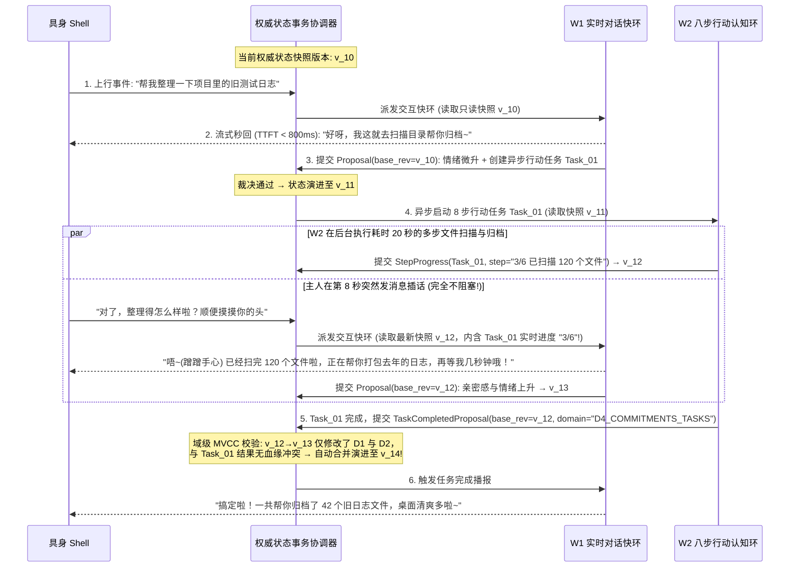
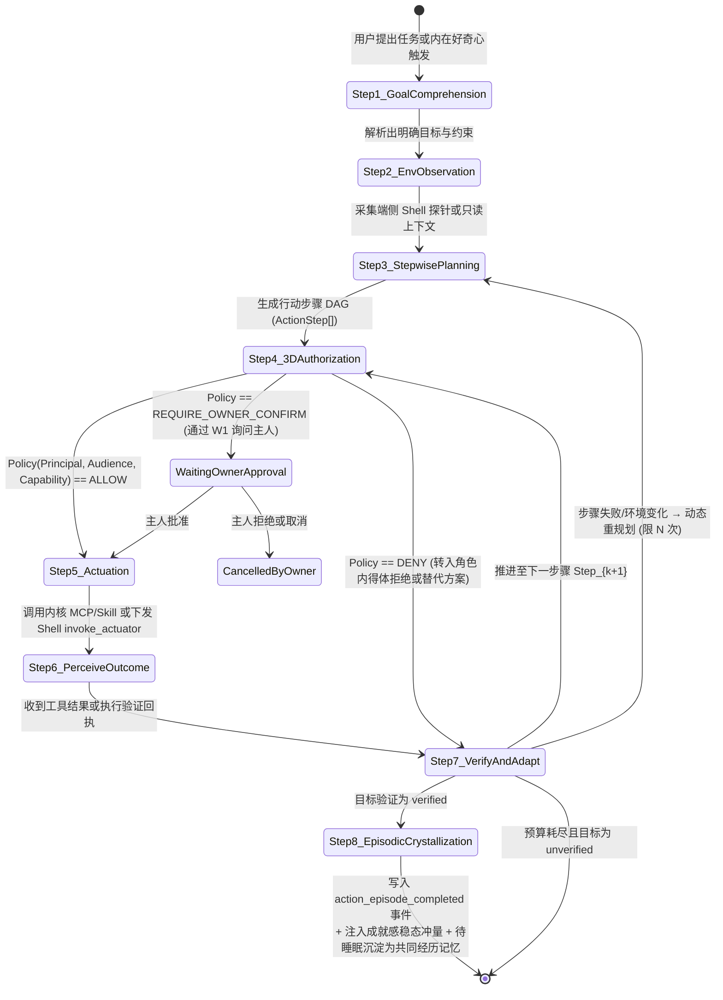

# 03. 运行时并发协调器、时间三分法引擎与一等行动认知状态机架构

> **项目阶段**：架构研究与工程规格设计阶段（解法域工程规格）
>
> 本文档定义 `@ai0/cognition-core` 的核心运行时状态机。它解决了**“如何既保持单一认知主体的人格与记忆一致性，又不让长耗时工具任务或睡眠整理阻塞实时对话、且彻底消灭并发状态脏覆盖（Write Skew / Lost Update）”**的核心工程挑战。

---

## 一、并发协调架构：一主体、一协调器、四路并发工作者

本架构摒弃了“单线程串行死锁”与“多实例无共享分身”两种极端模式，采用 **单一认知主体（Unified Subject） + 权威状态事务协调器（Authoritative State Coordinator with Domain-Scoped MVCC） + 四路异步并发工作者（4 Concurrent Workers）** 架构。

### 1.1 Clean-Slate V1 四核职责

| 核 | 运行契约 |
| :--- | :--- |
| **`@ai0/agent-core`** | 通用机械 `Turn / Round` 执行引擎，负责流式模型轮次、多步工具调用、轮次预算与传输。陪伴、情绪、记忆与化身均在引擎边界之外。 |
| **`@ai0/perception-core`** | 接纳并解释结构化观测，维护来源级能力、可用性与新鲜度，输出 `UniversalObservationFrame` 和 `system_chronoception`。 |
| **`@ai0/cognition-core`** | 持有单一认知主体、五域 MVCC `AuthoritativeStateCoordinator` 与 `BlackboardCompiler`。`W1` 负责实时对话，`W2` 运行八步行动认知环，`W3` 执行睡眠巩固、有界好奇心探索与里程碑检定，`W4` 异步分析多模态输入并提交带来源的提案。 |
| **`@ai0/expression-core`** | 将认知意图协商为合规端侧表达，管理交付、打断与共同默契所需的回执证据。 |

`agent-core` 将 `AuthorityRole` 投影到独立的 `system_invariant`、`developer_frame` 与 `untrusted_observation` 通道。角色由宿主入口赋予，观测载荷及其中自称的角色始终保留为不可信数据，模型适配器也必须保持隔离。每个 `Round` 流式读取模型输出并按权限执行工具链。到达 `maxSteps` 时仍须结算最后一个允许的轮次及其已授权结果，并结束当前 `Turn`。`goalVerification: "verified" | "unverified" | "not_applicable"` 中，有验证目标且证据满足才可标记 `verified`，证据不足为 `unverified`，无验证目标才使用 `not_applicable`。瞬态 HTTP 408、429、5xx 仅可在首次文本增量与首次工具副作用均未发生时重试，任一发生即关闭重试窗口。上游传输支持 `opencode_go`（`deepseek-v4.1-flash`）、OpenAI-compatible、Anthropic、DeepSeek 与 Ollama。

### 1.2 宿主 Provider Pool 与角色话轮解析

宿主用 `(cardId, hostModuleDefaults)` 为每个话轮分别解析 `consciousness`、`vision` 和 `speech` 的模型或语音配置。`Inherit`（含未设置或空值）取对应宿主默认值，`Override` 使用角色卡显式配置并在宿主 Provider Pool 中验证。解析结果冻结为当轮快照并传给对应核，无须改写全局运行时存储。无效覆盖返回配置错误。

---

## 二、权威状态事务协调器（`AuthoritativeStateCoordinator`）与域级 MVCC 裁决规范

所有并发工作者（`W1`~`W4`）以及所有认知器官扩展（`ext.cognitive_organ`）均**零数据库直写权限**。它们只能接收只读快照 `ReadOnlyCognitiveSnapshot(rev = v_N)`，并向协调器提交结构化变更提案 `StateMutationProposal`。

### 2.1 状态域划分（State Domains）与乐观并发冲突矩阵

为了避免前台每次聊天递增 `state_rev` 导致后台运行了 15 秒的睡眠整理或长任务全部因为版本号过期而作废，协调器将认知状态划分为 **5 个正交状态域（Orthogonal State Domains）**，每个域独立维护子版本号 `domain_rev`：

| 状态域标识 (`StateDomain`) | 包含的核心状态 | 并发冲突与合并裁决规则（MVCC Resolution Rule） |
| :--- | :--- | :--- |
| **`D1_WORKING_TURN`** | 当前话轮上下文窗口、被打断未说完的腹稿（`unsaid_remainder`）、当前注意力焦点 `active_focus_shell_id`、有界发言机会池（`pending_opportunities[]`）、按来源刷新的瞬态感官覆盖桶（`sensory_coverage_buckets`） | **强排他最新优先与机会气口仲裁（Last-Turn-Wins with Barge-in Cancel & Opportunity Expiration）**：仅允许前台 `W1`、感官门控（含经校验的 `W4` 提案）与播放回执修改；若新话轮打断旧话轮，旧 `W1` 提案直接通过 `CancellationToken` 作废；池中过期的 `InteractionOpportunity` 或因急事/话题切换失效的旧包袱在提交前自动标记为 `expired / withdrawn`。 |
| **`D2_HOMEOSTASIS_AFFECT`** | `ContinuousStateMetaEngine` 注册状态与 `continuous_states_json` 检查点 | 按状态 ID 合并带唯一 ID 和有效时刻的潜空间冲量，使用第 3 节的解析演化规则。 |
| **`D3_MEMORY_PROJECTION`** | `memories` 表、`memory_lineage_edges` 血缘与更替图 | **基于源事件血缘与双时态更替的乐观校验（Lineage & Bitemporal OCC）**：后台 `W3`（睡眠整理）提交新记忆或双时态更替（`supersedes`）提案时，协调器检查其引用的 `source_event_ids[]` 在 `W3` 运行期间是否被主人在前台执行了 `Hard Forget`（真遗忘擦除）。若源事件完好无损，则直接安全合入；若源事件已被擦除，则拒绝该条记忆提案！ |
| **`D4_COMMITMENTS_TASKS`** | 前瞻承诺状态机、正在运行的 8 步行动任务状态树 | **按对象 ID 细粒度乐观锁（Entity-Level Revision Lock）**：只要前台没有取消该 `task_id` / `commitment_id`，后台 `W2` 的步骤进度更新直接合入。 |
| **`D5_IDENTITY_NARRATIVE`** | `identity.yaml` (Tier 1)、`narrative.md` (Tier 2) 与 `soul_milestones_ledger`（已解锁关系里程碑与仪式账本） | **双轨分级演化与审批门控（Dual-Track Narrative Evolution & Approval Queue）**： • **Tier 1（`identity.yaml` 核心身份与长期价值观）**：100% 强制挂起至控制台 `PendingApproval` 队列，必须由主人显式批准方可合入； • **Tier 2（`narrative.md` 可演化自我叙事）与里程碑解锁（`soul_milestones_ledger`）**：由协调器统一按冲突等级分流——① **常规日常演进与正向里程碑达成（`routine_append / milestone_unlocked`）**（新增日常经历形成的内部梗、近期话题兴趣、达成正向关系里程碑，且无价值观冲突）自动生效并写入版本审计记录（支持在控制台一键回退）；② **高影响/冲突变更（`high_impact_shift`）**（涉及改写或删除既有自我叙事观点、对主人关系定性发生极性反转、或与 Tier 1 存在边缘张力）自动升级进入控制台 `PendingApproval` 队列并展示升级理由，待主人批准后生效。 |

### 2.2 协调器内置的四大确定性防火墙

在任何 `StateMutationProposal` 落入 `@ai0/storage` 事务之前，协调器串联执行四道代码级硬校验：
1. **`EpistemicMemoryFirewall`**：
   * 校验提案引用的 `source_event_ids` 是否真实存在；只要任一源事件的 `principal_trust != 'owner_verified'`，强制将该记忆的 `taint_level` 锁死为 `'untrusted_external'`，禁止其修改核心主人画像或关系信任度；
   * **四级认识论溯源**按证据区分直接观测（`observed_firsthand`）、他方陈述、推理所得与虚构内容，保留证据事件 ID，禁止通过摘要或重复陈述提升等级。
   * **语用拦截**：`interaction_frame` 为 `playful_banter` 或 `roleplay_fiction` 的事件禁止进入 `semantic_fact`，可以保留为有来源的情景记忆。
   * **`CommonGround`**：`relational_tacit` 经实际呈现后进入 `proposed_presented`。后续正向接梗或回用的用户事件可支持 `mutually_grounded`，明确异议或撤回进入 `disputed_retired`。呈现与采纳分别验证。
2. **无人值守环（`W3`）零写副作用物理沙盒与受染好奇心议程二阶隔离防火墙（Unattended Loop Zero-Write-Side-Effect & Tainted Agenda Guard）**：
   * **后台零写副作用物理剥夺**：`W3`（睡眠整理与好奇心外部世界冲浪）在运行时仅被注入只读沙盒读取器（Read-Only Whitelisted RSS/Web Fetcher & Local RAG Reader），在代码句柄层**物理剥夺一切外部网络 POST/Webhook、文件系统写操作与端侧 `Actuator` 调用权限**，彻底杜绝外部网页间接 Prompt 注入导致后台静默数据外带（Data Exfiltration）；
   * **受染好奇心议程禁调工具铁律**：凡由 `W3` 阅读外部不可信源生成的 `curiosity_agenda` 前瞻承诺，强制在 `prospective_commitments` 表打上 `taint_level = 'untrusted_external'`；当主人下次上线触发该好奇心话题分享时，三维权限引擎在代码层**强制锁死该话轮禁止自动连带触发任何具有副作用的 `W2` 行动工具调用**（必须由主人另起显式指令授权），彻底斩断“后台读了毒网页 $\rightarrow$ 等主人上线自动偷文件外发”的二阶攻击链！
3. **反操控与心结边界裁决器（Anti-Manipulation Clipper）**：按角色卡或认知器官声明的策略裁剪单轮冲量幅度；强制为任何新产生的“心结（Tension）”绑定 $\le 48$ 小时的衰减半衰期，拦截任何“未上线惩罚/错过纪念日扣分”提案。
4. **8 步可验证决策审计落库（Audit Trace Recorder）**：将裁决前后的完整参数写入 `turn_decision_traces` 表，同时推送至控制台特权遥测总线。

### 2.3 声明式可插拔认知黑板槽位积木编译器（Declarative Slot-Based Blackboard Compiler — `blackboard_policy.yaml`）

为彻底打破硬编码上下文拼装的黑盒局限、赋予研究者与高阶玩家调配注意力结构的自由，`@ai0/cognition-core` 采用声明式槽位积木架构：
1. **标准黑板槽位（Standard & Custom Blackboard Slots）**：
   * `slot.tier0_safety_invariants`（**强制置顶锁死，物理不可关闭或缩减**）；
   * `slot.tier1_core_dna`（核心性格、存在论契约、声线签名与 Few-Shot 黄金样本锚点）；
   * `slot.tier2_narrative_self`（按当前 `Audience` 硬过滤后的自我叙事段落）；
   * `slot.embodiment_and_sensory_buckets`（当前附身 `Shell` 的三平面能力、动态注册的 `expression_vocabulary` 表现力词典、以及 `live_foveal / ambient_peripheral` 视神经感官覆盖桶）；
   * `slot.homeostasis_and_vitality`（显著偏离基线的情绪/心境体感与双轨精力状态；按 `state_attributions_json` 的 `visibility_scope` 删除当前受众无权看到的归因、证据引用及其衍生文本；当 `Audience != only_owner` 时，**`Social Mask Damper`** 再将可公开的情绪偏离基线幅值衰减 $70\%$（保留 $30\%$），仅作用于编译视图）；
   * `slot.recalled_memories_and_rag`（显著性竞争上岗的 Top-$K$ 长期记忆与内建混合 RAG 切片）；
   * `slot.prospective_commitments_and_tasks`（到期承诺、活跃 `W2` 8 步行动任务 100 字进度、被打断未说完的腹稿 `unsaid_remainder` 与候选发言机会 `InteractionOpportunity`）；
   * `slot.lorebook_triggered`（按关键词/递归激活的动态世界观词条）；
   * `slot.custom_organs.*`（由第三方 `ext.cognitive_organ` 插件通过 `contributeToBlackboard` 注入的自定义认知槽位）。
2. **多场景语境预设（Context Presets）**：
   支持在 `blackboard_policy.yaml` 与控制台 `/dashboard/blackboard` 页面中动态切换或自定义不同场景的槽位预算配比（如 `日常陪伴标准预设 ≤2200 Tokens`、`深度灵魂长谈预设 ≤3600 Tokens`、`游戏并肩作战超低延迟预设 ≤1200 Tokens`）。

---

## 三、`VirtualClock` 与时间状态三分法引擎架构

### 3.1 `VirtualClock` 与扣除冬眠的时间感知

认知时间统一由注入的 `IVirtualClock` 提供。`LIVE` 锁定 `1x`，拒绝拨快、合成感官注入及实验性认知消融。`SANDBOX:<fork_id>` 使用隔离检查点，允许 `VirtualClock.advanceBy()`、感官模拟与回放，出站表达和工具调用流向 `MockSandboxSink`。

运行时每 60 秒记录 `last_alive_heartbeat_ts`，重启或导入存档时将超过 5 分钟的心跳缺口记为 `HibernationIntervals`。`@ai0/perception-core` 的 `ChronoceptiveSignalSynthesizer` 基于同一时钟计算 `system_chronoception`，从距上次互动的时长中扣除该区间与所有 `HibernationIntervals` 并集的交长，得到有效无人值守时长。重叠区间只扣一次。

### 3.2 声明式连续状态与时间演进三分法

1. **确定性演化**。角色卡或认知器官注册 `StateDescriptor`，字段为 `id`、`topology: "bipolar_tanh" | "unipolar_sigmoid"`、`baseline`、`halfLifeMs` 或 `decayRatePerSec`、`wakeupThresholds`。检查点 `continuous_states_json` 保存各注册状态的潜变量及其有效时刻。基线和阈值必须位于拓扑开区间。双极状态用 $f(x)=\operatorname{atanh}(x)$ 编码 $(-1,1)$，用 $\tanh$ 解码。单极状态用 $f(x)=\operatorname{logit}(x)$ 编码 $(0,1)$，用 $\sigma$ 解码。令 $b=f(\text{baseline})$，$d_0=f(x(t_0))-b$，秒为时间单位，$\lambda=\ln 2/(\text{halfLifeMs}/1000)$ 或 `decayRatePerSec`。闭式演化为
   $$x(t) = f^{-1}(b + d_0 e^{-\lambda(t - t_0)})$$
   同一有效时刻的冲量在潜空间按实数加法合成，构成可交换的 Abelian 群，解码后自然软饱和。协调器对 `W1/W2/W3` 的冲量按 ID 去重并原子合入；不同时刻按有效时间演化，迟到冲量按其有效时刻重算或传播到同一参考时刻，避免旧快照覆盖与丢失更新。认知器官可选择注册快慢耦合动力学并提供对应的演化与阈值求解规则。
   对独立状态的阈值 $h$，令 $q=f(h)-b$。仅在 $\lambda>0$、$d_0$ 与 $q$ 同号且 $0<|q|<|d_0|$ 时存在初始时刻之后的有限穿越：
   $$t_h = t_0 + \frac{\ln|d_0| - \ln|q|}{\lambda}, \qquad t_{\text{next}} = \min\{t_h \mid t_h > t_{\text{now}}\}$$
   将最早有效穿越与睡眠整理窗口、承诺到期时间一起仲裁，向 `VirtualClock` 注册一个单次定时器；没有未来候选则不设置。状态或计划变更后重算。
2. **事件驱动认知**。新事件触发 `W1`、`W2` 或 `W4`，各工作者读取只读快照并提交结构化提案。
3. **阈值唤醒与真实后台执行**。定时器可唤醒 `W3`，实际执行的后台整理与探索分别在 `event_log` 记录 `sleep_consolidation_run` 和 `curiosity_exploration_run`。
   * **子环 A：睡眠期记忆巩固、双时态更替与 Level-0 防反刍整理（Sleep Memory Consolidation）**：仅从 `Level-0` 未归档原始对话/行动事件提炼情景与语义记忆（禁止超过 2 代递归总结防语义坍缩复读机），处理 `supersedes` 双时态偏好更替与 `CommonGround` 共同默契晋升。
   * **子环 B：受控好奇心外部世界冲浪与日常谈资采集子代理（Bounded Curiosity Explorer & Topic Feeder）**：
     * 为了让数字生命拥有鲜活的“日常发现与自主探索感”而非只会反刍旧聊天记录，当角色卡或认知器官配置的探索阈值唤醒 W3 时，协调器在受控每日配额内调度好奇心冲浪子代理；
     * 子代理从用户在控制台授权的**安全兴趣源（RSS 资讯订阅、内建混合 RAG 知识库未读文档、或只读白名单 MCP 资讯工具）**中拉取 1~2 篇内容（输入源强制标记 `taint_level = 'untrusted_external'` 过写入防火墙）；
     * 以角色自身性格与兴趣视角生成一条**“今日小发现 / 读书随笔”**记忆，并在 `prospective_commitments` 表注册一条 `commitment_kind = 'curiosity_agenda'`（触发条件 `on_next_interaction_after_ts`），使她在主人下次上线时能自然聊起：“对了，你不在的时候我顺着昨天的线索看了一篇很有意思的文章……”
   * **子环 C：关系羁绊里程碑、纪念日时间仪式与正向剧情事件检定（Milestone & Temporal Ritual Evaluator）**：
     * `W3` 在每次睡眠周期或跨日唤醒时，扫描 `.soul/milestones_and_rituals.yaml` 定义的正向里程碑规则（如：相伴满 30/100/365 天、主人或角色生日、关系信任度首次突破 $0.8$、共同完成第 $N$ 个 `W2` 行动任务）；
     * 一旦达成，自动向协调器 `D5_IDENTITY_NARRATIVE` 提交正向成长提案（如解锁更亲密的专属称呼、生成纪念日专属问候约定或解锁新声线样本；**代码层强制拦截任何“未上线惩罚/错过纪念日冷暴力”等暗黑留存规则**）。
   * **Narrative Honesty Guard**：认知黑板编译器查询 $[t_{\text{last\_user\_interaction}}, t_{\text{now}}]$ 区间内的 `event_log`，仅将已落库的 `sleep_consolidation_run` 与 `curiosity_exploration_run` 编译进“离线期间你做过的事”槽位；若该集合为空，则显式注入 `[离线期间：未执行后台思考，仅静默休息]`。

---

## 四、一等行动认知环（8-Step Agency Lifecycle）状态机架构

在 `W2 (Agentic Task & Tool Runner)` 中，数字生命的多步行动能力被建模为如下持久化状态机：

* **与实时陪伴快环（`W1`）的无缝协同**：
  * `W2` 每推进一个状态节点，都会向协调器更新 `active_tasks[task_id].current_step_summary`。
  * `W1` 的认知黑板始终包含当前活跃任务的100字实时进度摘要。因此，在 `W2` 执行耗时任务期间，主人不仅能随时和她闲聊，还能随时在对话里说“算了先别整理那个文件夹了”，由 `W1` 直接发出 `CancelTaskSignal` 优雅中止 `W2`。
