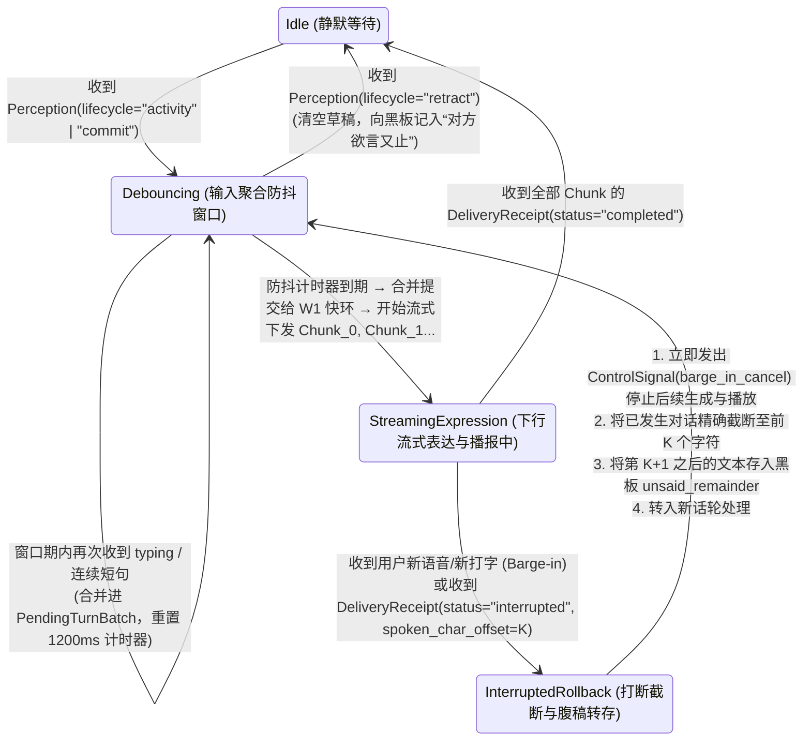

# 04. Protocol v0 最小冻结核心与双向网关架构规范

> **项目阶段**：架构研究与工程规格设计阶段（解法域工程规格）
>
> 本文档定义 `@ai0/protocol` 与 `@ai0/gateway` 的工程契约。它给出了 **5 年不破兼容的 Protocol v0 五原语完整 TypeScript / Zod Schema 规范**、官方标准扩展命名空间契约、`Scoped Capability Token` 防伪验签机制，以及上行输入防抖聚合与下行流式打断回执状态机。

---

## 一、Protocol v0 最小冻结核心：五原语完整 Schema 定义

传输层统一采用 **WebSocket 上的 JSON-RPC 2.0 双向消息帧**（端点：`ws://host:port/protocol/v0/shell`）。核心协议严格锁定为以下 **5 个原子原语（The 5 Atomic Primitives）**：

```typescript
// packages/protocol/src/core-v0/primitives.ts

export type ProtocolVersion = "0.1.0";
export type VenueType = "private_1on1" | "group_chat" | "public_livestream" | "local_ambient";
export type AudienceScope = "only_owner" | `group:${string}` | "public_all";

/**
 * 开放能力类型约定：知名核心枚举 + 带命名空间的开放扩展字符串
 * 确保社区作者新增自定义躯壳类型或新型传感器时，无需修改协议核心即可合法握手，由网关按未知能力降级规则透传。
 */
export type WellKnownShellKind = "webchat" | "desktop_avatar" | "im_bridge" | "game_embodied" | "hardware_iot" | "cli";
export type ShellKind = WellKnownShellKind | `custom.${string}`;

export type WellKnownSensorModality =
  | "text"
  | "audio_transcript"
  | "vad_activity"
  | "typing_activity"
  | "tactile"
  | "window_focus"
  | "game_state"
  | "visual_semantic";
export type SensorModality = WellKnownSensorModality | `custom.${string}`;

/**
 * 原语 1：HandshakeManifest (连接建立后由 Shell 发送给 Kernel 的能力与场合声明)
 */
export interface HandshakeManifest {
  protocol_version: ProtocolVersion;
  shell_id: string;                          // 如 "builtin.webchat.default" 或 "community.live2d.desktop"
  shell_kind: ShellKind;
  display_name: string;
  venue_type: VenueType;
  current_audience: {
    scope: AudienceScope;
    member_count: number;
    description?: string;                    // 如 "B站直播间 (当前在线 320 人)"
  };
  latency_budget_ms: number;                 // 实时语音 ~600ms，桌面聊天 ~1500ms，异步IM ~5000ms
  capabilities: {
    /** 平面 1：端侧可采集并上报的感知模态 (支持 WellKnownSensorModality 及 custom.* 开放扩展) */
    sensors: SensorModality[];
    /** 平面 2：支持解析渲染的下行扩展命名空间与动态具身表现力词典 */
    supported_extensions: string[];          // 如 ["ext.affect.v1", "ext.rhythm.v1", "ext.embodied.v1"]
    /**
     * 可选：动态具身表现力词典协商 (Dynamic Embodied Expression Vocabulary)
     * 允许 Live2D/VRM/桌宠 Shell 或关联的情感 TTS 管线在握手及 capabilities_updated 时动态注册当前可用表情、动作意图与声线情绪标签，
     * 由认知黑板按情境注入 System 1，既保持核心协议极简，又彻底释放高阶躯壳的演出可玩性。
     */
    expression_vocabulary?: {
      facial_expressions?: string[];         // 如 ["soft_smile", "pout_blush", "half_closed_eyes", "starry_excited"]
      gesture_intents?: string[];            // 如 ["tilt_head_curious", "rub_against_hand", "eat_strawberry", "play_guitar"]
      voice_emotion_tags?: string[];         // 如 ["shy_whisper", "tsundere_retort", "sleepy_yawn", "warm_comfort"]
    };
    /** 平面 3：端侧暴露的具身执行器契约 (供大脑 8 步行动认知环调用，支持运行期通过 capabilities_updated 动态热增删) */
    actuators: Array<{
      actuator_id: string;                   // 如 "desktop.take_authorized_snapshot" | "game.move_to"
      description: string;
      parameters_json_schema: Record<string, unknown>;
      requires_local_user_consent: boolean;
    }>;
  };
  auth_token: string;                        // 控制台签发的 Scoped Capability Token
}

/**
 * 原语 2：PerceptionEnvelope (Shell -> Kernel 上行标准化语义感知信封)
 */
export interface PerceptionEnvelope {
  event_id: string;                          // ULID
  timestamp: string;                         // ISO-8601 UTC
  actor: {
    platform_uid: string;                    // 平台侧原始用户 ID (网关将结合身份绑定表映射为内核 Principal)
    display_name: string;
  };
  /** 话轮生命周期：活动信号(防抖/闪避) | 流式增量草稿 | 正式提交 | 撤回(欲言又止) */
  lifecycle: "activity" | "interim" | "commit" | "retract";
  /** 开放感知模态：统一复用 SensorModality (支持 WellKnownSensorModality 及 custom.* 社区自定义模态) */
  modality: SensorModality;
  summary_text: string;                      // 任何极简核心均能理解的标准化语义文本描述
  confidence: number;                        // [0.0, 1.0] 边缘模型识别置信度 (文本输入恒为 1.0)
  sustained_ms?: number;                     // 持续时长 (用于过滤瞬时视觉抖动误报)
  persistence_hint: "permanent" | "ephemeral_blackboard"; // 连续生物特征默认仅进短期黑板，不落永久日志
  extensions: Record<string, unknown>;       // 命名空间扩展字典 (如 ext.perception.v1)
}

/**
 * 原语 3：ExpressionEnvelope (Kernel -> Shell 下行表达意图与具身动作调用信封)
 */
export interface ExpressionEnvelope {
  intent_id: string;                         // ULID
  correlation_event_id: string;              // 触发本次表达的源感知事件 ID (主动搭话则为唤醒事件 ID)
  chunk_seq: number;                         // 流式分段帧序号 (0, 1, 2...)
  is_final: boolean;                         // 是否为本话轮最后一帧
  /** 一等动作类型：开口说话 | 显式决定保持沉默 | 调用端侧具身执行器 */
  action_type: "speak" | "explicit_silence" | "invoke_actuator";
  /** 必选回退文本：任何极简纯文本 Shell 只需渲染该字段即可工作 */
  fallback_text: string;
  silence_reason?: "listening_wait_for_more" | "not_addressed_in_group" | "respecting_user_focus" | "emotional_pause";
  actuator_invocation?: {
    actuator_id: string;
    arguments: Record<string, unknown>;
  };
  extensions: Record<string, unknown>;       // 如 ext.affect.v1, ext.rhythm.v1, ext.embodied.v1
}

/**
 * 原语 4：DeliveryReceipt (Shell -> Kernel 上行播放、打断与具身动作执行回执)
 */
export interface DeliveryReceipt {
  intent_id: string;
  chunk_seq: number;
  status: "rendered" | "playing" | "completed" | "interrupted" | "degraded" | "failed";
  /** 被打断时精确到已实际播出的字符偏移量 (未播出的后半句将转入大脑 unsaid_remainder 腹稿!) */
  spoken_char_offset?: number;
  interrupted_by_event_id?: string;
  degraded_extensions?: string[];            // 躯壳因能力限制优雅降级忽略的扩展名列表
  actuator_outcome?: {
    success: boolean;
    result_summary: string;
    data?: Record<string, unknown>;
    error_code?: string;
  };
}

/**
 * 原语 5：ControlSignal (Bidirectional 双向流控、动态能力热更新、注意力焦点与系统合规信号)
 */
export interface ControlSignal {
  signal_type:
    | "barge_in_cancel"                      // 通知对方立即中止当前流式输出或音频播放
    | "audience_changed"                     // Shell 动态上报在场受众变更 (如有人加入房间)
    | "capabilities_updated"                 // Shell 运行期随场景变化动态热注册/注销 actuators 或 sensors (对齐并超越 neuro-sdk)
    | "focus_shifted"                        // Kernel 通知各 Shell 当前前台注意力焦点已切换至哪个 Shell
    | "sb243_break_reminder"                 // Kernel 下发连续交互满 3 小时休息提醒
    | "crisis_intervention_card";            // Kernel L0 危机拦截器下发的强制危机援助热线卡片
  target_intent_id?: string;
  active_focus_shell_id?: string;
  payload?: Record<string, unknown>;
}
```

---

## 二、官方标准扩展命名空间契约（Standard Extension Namespaces）

所有高阶感官覆盖与多模态表现力均装载于 `PerceptionEnvelope.extensions` 与 `ExpressionEnvelope.extensions` 中，内核与躯壳按 `supported_extensions` 消费或优雅忽略：

```typescript
// packages/protocol/src/extensions/standard-v1.ts

/** 0. 上行视神经感官覆盖桶与预测编码假设扩展 (ext.perception.v1) */
export interface ExtPerceptionV1 {
  /** 按 (shell_id, modality, source_key) 原地刷新的环境上下文桶标识 */
  source_key: string;                        // 如 "camera.main" | "desktop.active_window" | "game.combat_hud"
  /** 感官覆盖状态：中央凹聚焦 | 边缘背景感知 | 已过期陈旧 | 传感器已断开 */
  coverage: "live_foveal" | "ambient_peripheral" | "stale" | "disconnected";
  /** 观测时间跨度毫秒数 (静态单张图片恒为 0，物理禁止推断连续动作次数!) */
  frame_span_ms: number;
  /** 新鲜度 TTL：超过该毫秒数未收到新帧，黑板自动将该桶降级为 stale */
  freshness_ttl_ms: number;
  /** 预测编码：当边缘识别存在歧义时附带竞争感知假设，供后续特写/语境到来时触发微时间改口 */
  competing_hypotheses?: Array<{
    summary_text: string;
    confidence: number;
  }>;
}

/** 1. 情感与连续维度扩展 (ext.affect.v1) */
export interface ExtAffectV1 {
  label: string;                             // 如 "shy_affectionate", "sleepy", "teasing", "concerned"
  vad: {
    valence: number;                         // 愉悦度 [-1.0, 1.0]
    arousal: number;                         // 激活度 [0.0, 1.0]
    dominance: number;                       // 支配度 [0.0, 1.0]
  };
}

/** 2. 话轮节律与语音韵律扩展 (ext.rhythm.v1) */
export interface ExtRhythmV1 {
  pre_delay_ms: number;                      // 开口前思考停顿毫秒数
  typing_indicator_ms: number;               // 模拟“正在输入...”持续时长
  pause_after_ms: number;                    // 本分段说完后与下一分段之间的停顿间隔
  prosody?: {
    speed_rate: number;                      // 语速倍率 [0.5, 2.0]，默认 1.0 (犯困时如 0.85)
    pitch_shift: number;                     // 音高微调 [-1.0, 1.0]
    vocal_effort: "whisper" | "soft" | "normal" | "energetic";
  };
}

/** 3. 具身微表情、眼神与动画演出关键帧序列扩展 (ext.embodied.v1 — 含相对语音同步锚点与视线先行/余韵法则!) */
export interface EmbodiedKeyframe {
  /** 解决 TTS 合成延迟导致声画失步的相对同步锚点 */
  sync_anchor: "pre_speech" | "on_utterance_start" | `on_substring:${string}` | "on_utterance_end";
  gaze?: {
    target: "user_eyes" | "user_cursor" | "active_window" | "away_shy" | "down_sleepy";
    behavior: "locked" | "glancing" | "lazy_follow";
  };
  facial?: {
    expression: string;                      // 语义表情名，如 "soft_smile", "pout_blush", "half_closed_eyes"
    intensity: number;                       // [0.0, 1.0]
    blush_level?: number;                    // [0.0, 1.0]
  };
  gesture?: {
    category: "head_motion" | "hand_gesture" | "posture_shift";
    intent: string;                          // 语义动作意图，如 "tilt_head_curious", "rub_against_hand"
    fallback_intent: string;                 // 通用保底动作，如 "nod_gentle", "idle_sway"
  };
  /** 句末或动作结束后的微表情余韵保持毫秒数 (避免说完话瞬间立正归零的木偶恐怖谷) */
  linger_ms?: number;
}

export interface ExtEmbodiedV1 extends EmbodiedKeyframe {
  /**
   * 动画演出多锚点关键帧序列（可选，最多 3 帧）：
   * 遵循动画运动规律：pre_speech (开口前视线先行/吸气) -> on_substring (核心词微表情达峰) -> on_utterance_end (话音落下余韵残留)
   */
  keyframes?: EmbodiedKeyframe[];
}

/**
 * 4. 网关侧媒体管线流式合成音频、口型同步帧与字符时间戳对齐伴生扩展 (ext.media.sideband.v1)
 * 当轻量 Shell 委托网关侧 ext.media_pipeline (如 GPT-SoVITS / FishAudio) 代工合成语音时，随 ExpressionEnvelope 下发：
 */
export interface ExtMediaSidebandV1 {
  /** 流式音频伴生通道标识或二进制帧引用 URI */
  audio_stream_id: string;
  audio_format: "pcm_s16le_24k" | "opus_webm" | "mp3";
  total_duration_ms: number;
  /**
   * 字符级音频起始毫秒时间戳对齐表 (长度与 fallback_text 的 Unicode 字符长度严格一致)
   * char_offset_timestamps_ms[k] 表示第 k 个字符在音频流中开始发声的毫秒偏移量，供语音中途打断时精确反算 spoken_char_offset!
   */
  char_offset_timestamps_ms: number[];
  /** 口型同步序列 (Visemes)，供 Live2D/3D 躯壳驱动嘴部骨骼 */
  viseme_frames?: Array<{
    offset_ms: number;
    viseme: "sil" | "aa" | "E" | "I" | "O" | "U" | "PP" | "FF" | "TH" | "DD" | "kk" | "CH" | "SS" | "nn" | "RR";
    weight: number;
  }>;
}
```

---

## 三、连接发起方向与未知能力降级规范（Connection Topology & Unknown Capability Degradation）

为了确保社区插件作者只看本规范（及导出的 `@ai0/protocol` JSON Schema）就能在任何网络拓扑下接入，协议明确将**“底层传输连接发起方向（Connection Initiation Direction）”**与**“应用层五原语消息流向（Message Flow Direction）”**解耦：

1. **双向对等连接发起拓扑（Inbound & Outbound Connection Initiation）**：
   * **拓扑 A：Shell 主动连入 Kernel（Inbound WebSocket — 默认模式）**
     Shell 作为 WebSocket Client 连接 `ws://kernel-host:port/protocol/v0/shell`。连接建立后，Shell 立即发送第一帧 `HandshakeManifest`，Kernel 校验 `auth_token` 后返回 `HandshakeAck`，会话正式建立。
   * **拓扑 B：Kernel 主动拨号连出至远端 Shell（Outbound WebSocket — 反向桥接/云端 Webhook 躯壳模式）**
     当 Shell 运行在公网/远端守护进程且不便向本地内网 Kernel 发起入站连接时，使用者在控制台登记远端 Shell 的 `endpoint_url` 与 `Scoped Capability Token`。由 `@ai0/gateway` 作为 WebSocket Client 主动拨号连接远端 Shell 并出示令牌挑战帧，远端 Shell 响应 `HandshakeManifest` 后，双工会话建立。
   * **消息流向恒等性**：无论底层连接是由哪一方发起建立的，一旦握手完成，**五原语的消息流向 100% 恒定**（`PerceptionEnvelope` 与 `DeliveryReceipt` 永远由 Shell 发往 Kernel；`ExpressionEnvelope` 永远由 Kernel 发往 Shell；`ControlSignal` 双向对等发送）。

2. **未知能力与未知扩展的优雅降级规则（Graceful Degradation Contract）**：
   * **Kernel 遇到未知的 `shell_kind` 或 `custom.*` 传感器模态**：网关绝不报错或断开连接，而是将该未知模态依赖事件原样记录于 `PerceptionEnvelope.extensions` 中并读取其必选的 `summary_text` 作为语义保底，同时透传给订阅了该命名空间的自定义认知器官（`ext.cognitive_organ`）。
   * **Shell 遇到不认识的 `ExpressionEnvelope.extensions` 键**：Shell 直接忽略不认识的扩展命名空间，仅渲染自己声明支持的扩展层及核心 `fallback_text`，并在 `DeliveryReceipt.degraded_extensions` 中如实上报被忽略的扩展名列表。

---

## 四、网关层安全验签与话轮流控状态机（`@ai0/gateway`）

### 4.1 `Scoped Capability Token` 防伪造验签机制

为了防止恶意或存在漏洞的第三方 Shell 插件伪造主人身份或谎报私密场合，`@ai0/gateway` 在握手时强制校验由控制台签发的 HMAC-SHA256 / Ed25519 令牌载荷：
```json
{
  "token_id": "tok_01J9Z...",
  "allowed_shell_id_prefix": "community.bilibili.live",
  "enforced_venue_type": "public_livestream",
  "max_audience_privacy_ceiling": "public_all",
  "can_authenticate_owner_principal": false,
  "allowed_actuators": []
}
```
* **网关强制降级铁律**：若上述直播间令牌连接的插件企图在 `HandshakeManifest` 中声称 `venue_type: "private_1on1"` 或将某条弹幕标为主人私密指令，网关层直接按令牌的 `max_audience_privacy_ceiling` **强制覆写为 `public_all`**，从物理入口封死插件伪造特权通道的可能。

### 4.2 上行输入防抖聚合与下行打断回执状态机



### 4.3 语音流式播放中途打断时“音频播放毫秒数 $\rightarrow$ 单字级 `spoken_char_offset`”确定性反算规范

当 `Shell` 播放由网关侧 `ext.media_pipeline` 合成的 TTS 语音流并遭遇用户中途插话打断（Barge-in）时，端侧音频播放器仅持有实际已播放的音频毫秒时长 `played_audio_ms`（如 `1420ms`）。为确保内核 `unsaid_remainder`（被打断未说完的腹稿）在语音模式下与纯文本模式下达到完全相同的单字级截断精度，规定如下确定性反算公式：
1. 读取该分段 `ExpressionEnvelope.extensions["ext.media.sideband.v1"].char_offset_timestamps_ms` 单调递增数组 $T = [t_0, t_1, \dots, t_{N-1}]$；
2. 通过二分查找计算已实际发声完毕的字符偏移量 $K = \texttt{spoken\_char\_offset}$：
   $$K = \max \big\{ k \in \{0, 1, \dots, N\} \;\big|\; k = 0 \lor T[k-1] \le \texttt{played\_audio\_ms} \big\}$$
3. `Shell` 在 `DeliveryReceipt(status="interrupted", spoken_char_offset=K)` 中上报该精确值 $K$（或上报 `played_audio_ms` 由 `@ai0/gateway` 查表自动填入 $K$），内核即可零误差将前 $K$ 个字归档为已说出话轮，将第 $K+1 \sim N$ 个字转存进 `D1_WORKING_TURN.unsaid_remainder` 腹稿槽位。
