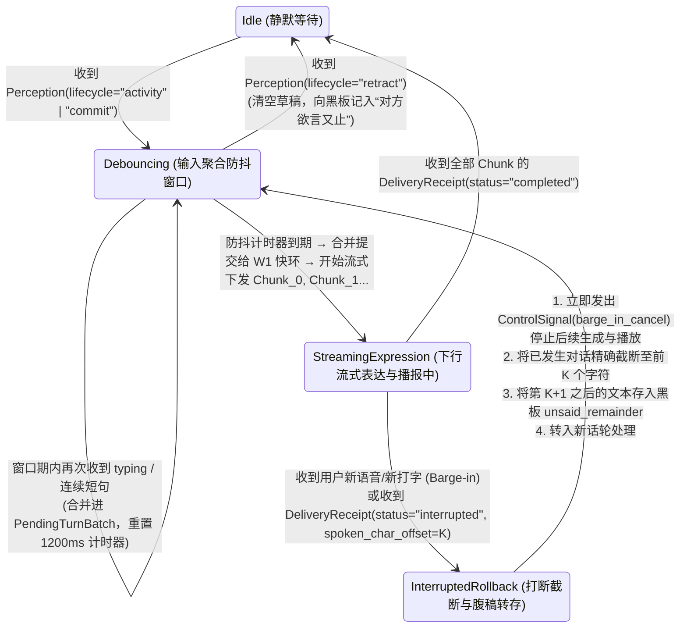

# 04. Protocol v0 最小冻结核心与双向网关架构规范

> 本文档定义 `@ai0/protocol` 与 `@ai0/gateway` 的工程契约。它给出了 **5 年不破兼容的 Protocol v0 五原语完整 TypeScript / Zod Schema 规范**、官方标准扩展命名空间契约、`Scoped Capability Token` 防伪验签机制，以及上行输入防抖聚合与下行流式打断回执状态机。

---

## 一、Protocol v0 最小冻结核心：五原语完整 Schema 定义

传输层统一采用 **WebSocket 上的 JSON-RPC 2.0 双向消息帧**（端点：`ws://host:port/protocol/v0/shell`）。核心协议严格锁定为以下 **5 个原子原语（The 5 Atomic Primitives）**：

```typescript
// packages/protocol/src/core-v0/primitives.ts

export type ProtocolVersion = "0.1.0";
export type VenueType = "private_1on1" | "group_chat" | "public_livestream" | "local_ambient";
export type AudienceScope = "only_owner" | `group:${string}` | "public_all";

/**
 * 原语 1：HandshakeManifest (Shell -> Kernel 连接握手与三平面具身能力声明)
 */
export interface HandshakeManifest {
  protocol_version: ProtocolVersion;
  shell_id: string;                          // 如 "builtin.webchat.default" 或 "community.live2d.desktop"
  shell_kind: "webchat" | "desktop_avatar" | "im_bridge" | "game_embodied" | "hardware_iot" | "cli";
  display_name: string;
  venue_type: VenueType;
  current_audience: {
    scope: AudienceScope;
    member_count: number;
    description?: string;                    // 如 "B站直播间 (当前在线 320 人)"
  };
  latency_budget_ms: number;                 // 实时语音 ~600ms，桌面聊天 ~1500ms，异步IM ~5000ms
  capabilities: {
    /** 平面 1：端侧可采集并上报的感知模态 */
    sensors: Array<"text" | "audio_transcript" | "vad_activity" | "typing_activity" | "tactile" | "window_focus" | "game_state" | "visual_semantic">;
    /** 平面 2：支持解析渲染的下行扩展命名空间 */
    supported_extensions: string[];          // 如 ["ext.affect.v1", "ext.rhythm.v1", "ext.embodied.v1"]
    /** 平面 3：端侧暴露的具身执行器契约 (供大脑 8 步行动认知环调用) */
    actuators: Array<{
      actuator_id: string;                   // 如 "desktop.take_authorized_snapshot" | "game.move_to"
      description: string;
      parameters_json_schema: Record<string, unknown>;
      requires_local_user_consent: boolean;
    }>;
  };
  auth_token: string;                        // 控制台签发的 Scoped Capability Token
}

/**
 * 原语 2：PerceptionEnvelope (Shell -> Kernel 上行标准化语义感知信封)
 */
export interface PerceptionEnvelope {
  event_id: string;                          // ULID
  timestamp: string;                         // ISO-8601 UTC
  actor: {
    platform_uid: string;                    // 平台侧原始用户 ID (网关将结合身份绑定表映射为内核 Principal)
    display_name: string;
  };
  /** 话轮生命周期：活动信号(防抖/闪避) | 流式增量草稿 | 正式提交 | 撤回(欲言又止) */
  lifecycle: "activity" | "interim" | "commit" | "retract";
  modality: "text" | "audio_transcript" | "tactile" | "visual_semantic" | "environment_state";
  summary_text: string;                      // 任何极简核心均能理解的标准化语义文本描述
  confidence: number;                        // [0.0, 1.0] 边缘模型识别置信度 (文本输入恒为 1.0)
  sustained_ms?: number;                     // 持续时长 (用于过滤瞬时视觉抖动误报)
  persistence_hint: "permanent" | "ephemeral_blackboard"; // 连续生物特征默认仅进短期黑板，不落永久日志
  extensions: Record<string, unknown>;       // 命名空间扩展字典
}

/**
 * 原语 3：ExpressionEnvelope (Kernel -> Shell 下行表达意图与具身动作调用信封)
 */
export interface ExpressionEnvelope {
  intent_id: string;                         // ULID
  correlation_event_id: string;              // 触发本次表达的源感知事件 ID (主动搭话则为唤醒事件 ID)
  chunk_seq: number;                         // 流式分段帧序号 (0, 1, 2...)
  is_final: boolean;                         // 是否为本话轮最后一帧
  /** 一等动作类型：开口说话 | 显式决定保持沉默 | 调用端侧具身执行器 */
  action_type: "speak" | "explicit_silence" | "invoke_actuator";
  /** 必选回退文本：任何极简纯文本 Shell 只需渲染该字段即可工作 */
  fallback_text: string;
  silence_reason?: "listening_wait_for_more" | "not_addressed_in_group" | "respecting_user_focus" | "emotional_pause";
  actuator_invocation?: {
    actuator_id: string;
    arguments: Record<string, unknown>;
  };
  extensions: Record<string, unknown>;       // 如 ext.affect.v1, ext.rhythm.v1, ext.embodied.v1
}

/**
 * 原语 4：DeliveryReceipt (Shell -> Kernel 上行播放、打断与具身动作执行回执)
 */
export interface DeliveryReceipt {
  intent_id: string;
  chunk_seq: number;
  status: "rendered" | "playing" | "completed" | "interrupted" | "degraded" | "failed";
  /** 被打断时精确到已实际播出的字符偏移量 (未播出的后半句将转入大脑 unsaid_remainder 腹稿!) */
  spoken_char_offset?: number;
  interrupted_by_event_id?: string;
  degraded_extensions?: string[];            // 躯壳因能力限制优雅降级忽略的扩展名列表
  actuator_outcome?: {
    success: boolean;
    result_summary: string;
    data?: Record<string, unknown>;
    error_code?: string;
  };
}

/**
 * 原语 5：ControlSignal (Bidirectional 双向流控、注意力焦点与系统合规信号)
 */
export interface ControlSignal {
  signal_type:
    | "barge_in_cancel"                      // 通知对方立即中止当前流式输出或音频播放
    | "audience_changed"                     // Shell 动态上报在场受众变更 (如有人加入房间)
    | "focus_shifted"                        // Kernel 通知各 Shell 当前前台注意力焦点已切换至哪个 Shell
    | "sb243_break_reminder"                 // Kernel 下发连续交互满 3 小时休息提醒
    | "crisis_intervention_card";            // Kernel L0 危机拦截器下发的强制危机援助热线卡片
  target_intent_id?: string;
  active_focus_shell_id?: string;
  payload?: Record<string, unknown>;
}
```

---

## 二、官方标准扩展命名空间契约（Standard Extension Namespaces）

所有高阶表现力均装载于 `ExpressionEnvelope.extensions` 中，躯壳按自身 `supported_extensions` 消费或优雅忽略：

```typescript
// packages/protocol/src/extensions/standard-v1.ts

/** 1. 情感与连续维度扩展 (ext.affect.v1) */
export interface ExtAffectV1 {
  label: string;                             // 如 "shy_affectionate", "sleepy", "teasing", "concerned"
  vad: {
    valence: number;                         // 愉悦度 [-1.0, 1.0]
    arousal: number;                         // 激活度 [0.0, 1.0]
    dominance: number;                       // 支配度 [0.0, 1.0]
  };
}

/** 2. 话轮节律与语音韵律扩展 (ext.rhythm.v1) */
export interface ExtRhythmV1 {
  pre_delay_ms: number;                      // 开口前思考停顿毫秒数
  typing_indicator_ms: number;               // 模拟“正在输入...”持续时长
  pause_after_ms: number;                    // 本分段说完后与下一分段之间的停顿间隔
  prosody?: {
    speed_rate: number;                      // 语速倍率 [0.5, 2.0]，默认 1.0 (犯困时如 0.85)
    pitch_shift: number;                     // 音高微调 [-1.0, 1.0]
    vocal_effort: "whisper" | "soft" | "normal" | "energetic";
  };
}

/** 3. 具身微表情、眼神与动作意图扩展 (ext.embodied.v1 — 含相对语音同步锚点防声画失步!) */
export interface ExtEmbodiedV1 {
  /** 解决 TTS 合成延迟导致声画失步的相对同步锚点 */
  sync_anchor: "pre_speech" | "on_utterance_start" | `on_substring:${string}` | "on_utterance_end";
  gaze?: {
    target: "user_eyes" | "user_cursor" | "active_window" | "away_shy" | "down_sleepy";
    behavior: "locked" | "glancing" | "lazy_follow";
  };
  facial?: {
    expression: string;                      // 语义表情名，如 "soft_smile", "pout_blush", "half_closed_eyes"
    intensity: number;                       // [0.0, 1.0]
    blush_level?: number;                    // [0.0, 1.0]
  };
  gesture?: {
    category: "head_motion" | "hand_gesture" | "posture_shift";
    intent: string;                          // 语义动作意图，如 "tilt_head_curious", "rub_against_hand"
    fallback_intent: string;                 // 通用保底动作，如 "nod_gentle", "idle_sway"
  };
}
```

---

## 三、网关层安全验签与话轮流控状态机（`@ai0/gateway`）

### 3.1 `Scoped Capability Token` 防伪造验签机制

为了防止恶意或存在漏洞的第三方 Shell 插件伪造主人身份或谎报私密场合，`@ai0/gateway` 在握手时强制校验由控制台签发的 HMAC-SHA256 / Ed25519 令牌载荷：
```json
{
  "token_id": "tok_01J9Z...",
  "allowed_shell_id_prefix": "community.bilibili.live",
  "enforced_venue_type": "public_livestream",
  "max_audience_privacy_ceiling": "public_all",
  "can_authenticate_owner_principal": false,
  "allowed_actuators": []
}
```
* **网关强制降级铁律**：若上述直播间令牌连接的插件企图在 `HandshakeManifest` 中声称 `venue_type: "private_1on1"` 或将某条弹幕标为主人私密指令，网关层直接按令牌的 `max_audience_privacy_ceiling` **强制覆写为 `public_all`**，从物理入口封死插件伪造特权通道的可能。

### 3.2 上行输入防抖聚合与下行打断回执状态机


