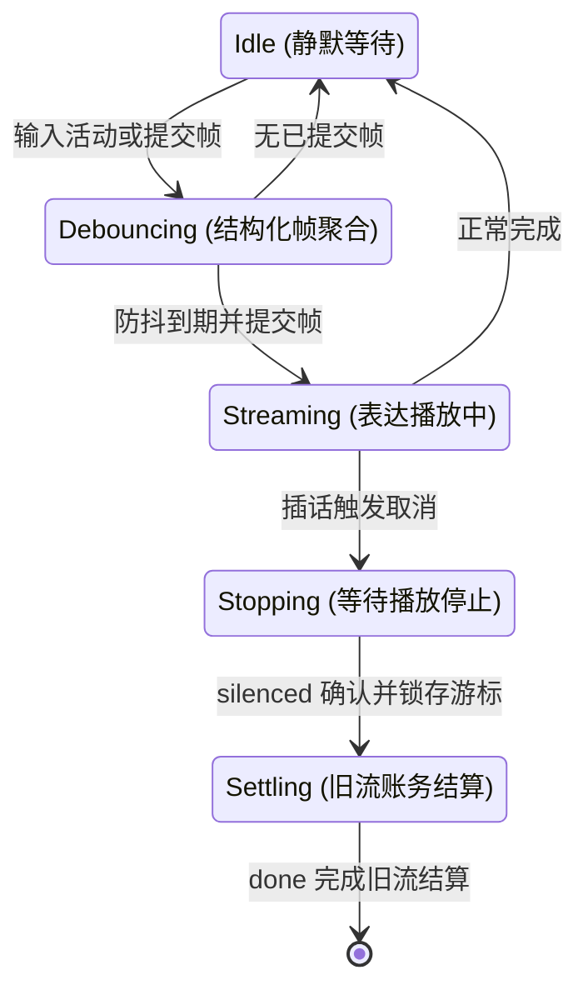

# 04. Clean-Slate V1：Protocol v0 原语与双向网关规范

> **项目阶段**：架构研究与工程规格设计阶段（解法域工程规格）
>
> 本文档定义 `@ai0/protocol` 与 `@ai0/gateway` 的工程契约。它给出了 **Clean-Slate V1 的 Protocol v0 五原语 TypeScript 契约**、官方标准扩展命名空间契约、`Scoped Capability Token` 防伪验签机制，以及上行输入防抖聚合与下行流式打断回执状态机。

---

## 一、Protocol v0 最小冻结核心：五原语完整 Schema 定义

协议的 WebSocket 绑定采用 **JSON-RPC 2.0 双向帧**，规范路径为 `/protocol/v0/channel`。当前 daemon 在同一命名空间提供 HTTP/SSE 部署桥。核心协议严格锁定为以下 **5 个原子原语（The 5 Atomic Primitives）**：

```ts
export const EmbodimentSurfaceDescriptorSchema = z.object({
  surface_id: z.string().min(1),
  supported_tokens: z.array(RealizerAffordanceDescriptorSchema).default([])
}).nullable().optional();
export type EmbodimentSurfaceDescriptor = z.infer<typeof EmbodimentSurfaceDescriptorSchema>;

export const HandshakeManifestSchema = z.object({
  protocol_version: ProtocolVersionSchema,
  channel_id: z.string(),
  channel_kind: ChannelKindSchema,
  display_name: z.string(),
  venue_type: VenueTypeSchema,
  current_audience: z.object({
    scope: AudienceScopeSchema,
    member_count: z.number(),
    description: z.string().optional()
  }),
  latency_budget_ms: z.number(),
  capabilities: z.object({
    supports_card_assets: z.boolean().optional(),
    embodiment_anchors: z.array(z.string()).optional(),
    body_anchors: z.array(BodyAnchorDescriptorSchema).optional(),
    sensor_affordances: z.array(SensorAffordanceDescriptorSchema).optional(),
    embodiment_surface: EmbodimentSurfaceDescriptorSchema,
    sensors: z.array(SensorModalitySchema),
    supported_extensions: z.array(z.string()),
    expression_vocabulary: ExpressionVocabularySchema.optional(),
    actuators: z.array(ActuatorDeclarationSchema)
  }),
  auth_token: z.string()
});
export type HandshakeManifest = z.infer<typeof HandshakeManifestSchema>;

export const InteractionChannelSchema = HandshakeManifestSchema.omit({ auth_token: true });
export type InteractionChannel = z.infer<typeof InteractionChannelSchema>;

export const HandshakeAckSchema = z.object({
  session_id: z.string(),
  accepted_version: ProtocolVersionSchema,
  enforced_venue_type: VenueTypeSchema,
  max_audience_privacy_ceiling: AudienceScopeSchema,
  entity_nature: z.literal("artificial_intelligence_digital_life"),
  server_virtual_ts_ms: z.number()
});
export type HandshakeAck = z.infer<typeof HandshakeAckSchema>;

export const PerceptionEnvelopeSchema = z.object({
  event_id: z.string(),
  timestamp: z.string(),
  actor: z.object({
    platform_uid: z.string(),
    display_name: z.string()
  }),
  lifecycle: z.enum(["activity", "interim", "commit", "retract"]),
  modality: SensorModalitySchema,
  summary_text: z.string(),
  confidence: z.number().min(0).max(1),
  sustained_ms: z.number().optional(),
  frame: UniversalObservationFrameSchema.optional(),
  persistence_hint: z.enum(["permanent", "ephemeral_blackboard"]),
  extensions: z.record(z.unknown())
});
export type PerceptionEnvelope = z.infer<typeof PerceptionEnvelopeSchema>;

export const ExpressionEnvelopeSchema = z.object({
  intent_id: z.string(),
  correlation_event_id: z.string(),
  chunk_seq: z.number(),
  is_final: z.boolean(),
  action_type: z.enum(["speak", "explicit_silence", "invoke_actuator", "request_observation"]),
  attention_target: z.string().optional(),
  expressive_stance: z.record(z.unknown()).optional(),
  delivery_constraints: z.record(z.unknown()).optional(),
  observation_request: z.record(z.unknown()).optional(),
  fallback_text: z.string(),
  silence_reason: z
    .enum([
      "listening_wait_for_more",
      "not_addressed_in_group",
      "respecting_user_focus",
      "emotional_pause"
    ])
    .optional(),
  actuator_invocation: z
    .object({
      actuator_id: z.string(),
      arguments: z.record(z.unknown())
    })
    .optional(),
  extensions: z.record(z.unknown())
});
export type ExpressionEnvelope = z.infer<typeof ExpressionEnvelopeSchema>;

export const DeliveryReceiptSchema = z.object({
  intent_id: z.string(),
  chunk_seq: z.number(),
  status: z.enum([
    "rendered",
    "playing",
    "completed",
    "interrupted",
    "degraded",
    "failed"
  ]),
  grounding_stage: GroundingTruthStageSchema.optional(),
  interruption_boundary: z.enum(["silenced", "done"]).optional(),
  spoken_char_offset: z.number().int().nonnegative().optional(),
  played_audio_ms: z.number().optional(),
  interrupted_by_event_id: z.string().optional(),
  degraded_extensions: z.array(z.string()).optional(),
  actuator_outcome: z
    .object({
      success: z.boolean(),
      result_summary: z.string(),
      data: z.record(z.unknown()).optional(),
      error_code: z.string().optional()
    })
    .optional()
});
export type DeliveryReceipt = z.infer<typeof DeliveryReceiptSchema>;

export const ControlSignalSchema = z.object({
  signal_type: z.enum([
    "barge_in_cancel",
    "audience_changed",
    "capabilities_updated",
    "focus_shifted",
    "sb243_break_reminder",
    "crisis_intervention_card"
  ]),
  target_intent_id: z.string().optional(),
  active_focus_channel_id: z.string().optional(),
  payload: z.record(z.unknown()).optional()
});
export type ControlSignal = z.infer<typeof ControlSignalSchema>;

export const ProtocolRpcMethodSchema = z.enum([
  "ai0.handshake",
  "ai0.perception",
  "ai0.expression",
  "ai0.receipt",
  "ai0.control"
]);
export type ProtocolRpcMethod = z.infer<typeof ProtocolRpcMethodSchema>;
```

---

### 1.1 观测元语言与结构保真

`PerceptionEnvelope.frame` 可选。网关规范化后使用 `UniversalObservationFrame`，其六元组为 `channel`、`attribution`、`contextFrame`、`provenance`、`interpretation` 和 `chronology`。网关依会话核验 `channelId`、主体与有效受众，端侧自报身份不能授予权限。

`@ai0/gateway` 在验签、路由、防抖与交付 `@ai0/perception-core` 的全链路保留结构化帧。`DebounceBatch` 保存有序帧集合，禁止将观测扁平化为纯字符串。`custom.*` 与插件声明的开放模态字符串可保留原始扩展字段。

### 1.2 通道与具身表现切面的协商

`InteractionChannel` 是去掉 `auth_token` 的握手描述。连接由 `channel_id` 标识，具身能力由可空、可省略的 `capabilities.embodiment_surface` 表示。它包含 `surface_id` 与默认空数组的 `supported_tokens`。已知通道类型包含 `webchat`、`desktop_stage`、`im_bridge`、`game_embodied`、`hardware_iot` 和 `cli`，另接纳 `custom.*`。

WebChat v1 的静态头像使用 `embodiment_surface: null`。合规的普通交流意图仍通过 `fallback_text` 交付，具身关键帧仅在有表现切面且词表匹配时生成。纯非语言交付缺少匹配能力时保持待交付。

`@ai0/expression-core` 的 `RealizerVocabularyNegotiator` 校验有效受众、非语言静默约束、延迟预算及词典。无在线合规私密 InteractionChannel 时，将私密意图置为 `held_pending_compliant_channel`，内容及回退文本不得外发。受众或能力变化时重新校验，过期意图不下发。`explicit_silence` 不启动语音播放，`deliveryConstraints.requireNonVerbalQuiet` 要求安静的非语言表达，`request_observation` 仍须经过感知授权。

`embodiment_anchors` 支持握手声明与 `capabilities_updated` 热更新。`supports_card_assets` 为真时与卡片资产锚点合并去重。`anchor:<id>` 与 `target_anchor` 指向协商后的锚点。

---

## 二、官方标准扩展命名空间契约（Standard Extension Namespaces）

所有高阶感官覆盖与多模态表现力均装载于 `PerceptionEnvelope.extensions` 与 `ExpressionEnvelope.extensions` 中，内核与交互通道按 `supported_extensions` 消费或优雅忽略：

```typescript
// packages/protocol/src/extensions/standard-v1.ts

/** 0. 上行视神经感官覆盖桶与预测编码假设扩展 (ext.perception.v1) */
export interface ExtPerceptionV1 {
  /** 按 (channel_id, modality, source_key) 原地刷新的环境上下文桶标识 */
  source_key: string;                        // 如 "camera.main" | "desktop.active_window" | "game.combat_hud"
  /** 感官覆盖与授权状态 */
  coverage: "live_foveal" | "ambient_peripheral" | "on_demand" | "blind" | "stale" | "disconnected";
  /** 观测时间跨度毫秒数 (静态单张图片恒为 0，物理禁止推断连续动作次数!) */
  frame_span_ms: number;
  /** 新鲜度 TTL：超过该毫秒数未收到新帧，黑板自动将该桶降级为 stale */
  freshness_ttl_ms: number;
  /** 预测编码：当边缘识别存在歧义时附带竞争感知假设，供后续特写/语境到来时触发微时间改口 */
  competing_hypotheses?: Array<{
    summary_text: string;
    confidence: number;
  }>;
}

/** 1. 情感与连续维度扩展 (ext.affect.v1) */
export interface ExtAffectV1 {
  label: string;                             // 如 "shy_affectionate", "sleepy", "teasing", "concerned"
  vad: {
    valence: number;                         // 愉悦度 [-1.0, 1.0]
    arousal: number;                         // 激活度 [0.0, 1.0]
    dominance: number;                       // 支配度 [0.0, 1.0]
  };
}

/** 2. 话轮节律与语音韵律扩展 (ext.rhythm.v1) */
export interface ExtRhythmV1 {
  pre_delay_ms: number;                      // 开口前思考停顿毫秒数
  typing_indicator_ms: number;               // 模拟“正在输入...”持续时长
  pause_after_ms: number;                    // 本分段说完后与下一分段之间的停顿间隔
  prosody?: {
    speed_rate: number;                      // 语速倍率 [0.5, 2.0]，默认 1.0 (犯困时如 0.85)
    pitch_shift: number;                     // 音高微调 [-1.0, 1.0]
    vocal_effort: "whisper" | "soft" | "normal" | "energetic";
  };
}

/** 3. 领域中立的具身关键帧 (ext.embodied.v1) */
export type AttentionTarget =
  | "interlocutor" | "referenced_subject" | "ambient_environment"
  | "inward_withdrawn" | `anchor:${string}`;

export interface EmbodiedKeyframe {
  sync_anchor: "pre_speech" | "on_utterance_start" | `on_substring:${string}` | "on_utterance_end";
  attention?: {
    target: AttentionTarget;
    behavior: "locked" | "glancing" | "ambient_scan";
  };
  expression?: {
    tag: string;
    intensity: number; // [0.0, 1.0]
    fallback_tag?: string;
  };
  actuation_cue?: {
    semantic_action: string;
    target_anchor?: string;
    intensity?: "subtle" | "moderate" | "strong";
    fallback_action?: string;
  };
  linger_ms?: number;
}

export interface ExtEmbodiedV1 extends EmbodiedKeyframe {
  keyframes?: EmbodiedKeyframe[]; // 最多 3 帧，按相对同步锚点调度
}

/**
 * 4. 网关侧媒体管线流式合成音频、口型同步帧与字符时间戳对齐伴生扩展 (ext.media.sideband.v1)
 * 当轻量 InteractionChannel 委托网关侧 expression.media_transcoder (如 GPT-SoVITS / FishAudio) 代工合成语音时，随 ExpressionEnvelope 下发：
 */
export interface ExtMediaSidebandV1 {
  /** 流式音频伴生通道标识或二进制帧引用 URI */
  audio_stream_id: string;
  audio_format: "pcm_s16le_24k" | "opus_webm" | "mp3";
  total_duration_ms: number;
  /**
   * 字符级音频起始毫秒时间戳对齐表 (长度与 fallback_text 的 Unicode 字符长度严格一致)
   * char_offset_timestamps_ms[k] 表示第 k 个字符在音频流中开始发声的毫秒偏移量，供语音中途打断时精确反算 spoken_char_offset!
   */
  char_offset_timestamps_ms: number[];
  /** 口型同步序列 (Visemes)，供 Live2D/3D 交互通道驱动嘴部骨骼 */
  viseme_frames?: Array<{
    offset_ms: number;
    viseme: "sil" | "aa" | "E" | "I" | "O" | "U" | "PP" | "FF" | "TH" | "DD" | "kk" | "CH" | "SS" | "nn" | "RR";
    weight: number;
  }>;
}
```

---

### 2.1 感官覆盖与 `blind` 锁

`live_foveal` 表示当前焦点实时覆盖，`ambient_peripheral` 表示外围背景覆盖，`on_demand` 表示仅按授权请求采集，`stale` 表示帧超出 TTL，`disconnected` 表示连接中断。InteractionChannel 已连接但未授权传感器（如摄像头权限拒绝或撤销）时，`@ai0/perception-core` 的 `EmbodimentAffordanceRegistry` 与 `ScopedContextRegistry` 按 `(channel_id, modality, source_key)` 锁定为 `blind`，遮蔽旧载荷并向认知发出 `sensor_unavailable`。只有重新获准且收到新鲜授权帧才解除锁定。缓存及推断不得冒充该来源的当前感知。

### 2.2 具身词典

`RealizerVocabularyNegotiator` 动态匹配 `HandshakeManifest.capabilities.expression_vocabulary`。`expression.tag` 和 `fallback_tag` 匹配 `expression_tags`，`actuation_cue.semantic_action` 和 `fallback_action` 匹配 `semantic_actions`。候选与回退均不可用时省略该提示并回报降级。同步锚点与 `linger_ms` 描述呈现时序，动作提示本身不构成执行证据。

---

## 三、连接拓扑与能力降级

`ChannelProtocolGateway` 对入站与出站握手共享验证逻辑（`handleInboundHandshake`、`handleOutboundHandshake`）。WebSocket 客户端按规范向 `/protocol/v0/channel` 发送 `ai0.handshake` 请求换取 `HandshakeAck`。部署桥将 HTTP 握手委托给同一网关处理方法。出站握手入口供宿主桥接器使用，远程拨号、连接重试与登记由宿主管理。

| 原语 | JSON-RPC 方法 | 方向 |
| --- | --- | --- |
| 握手 | `ai0.handshake` | 交互通道请求，网关返回会话确认 |
| 观察 | `ai0.perception` | 通道 → 网关 |
| 表达 | `ai0.expression` | 网关 → 通道 |
| 回执 | `ai0.receipt` | 通道 → 网关 |
| 控制 | `ai0.control` | 双向，能力、受众、焦点与打断按宿主处理 |

### 3.1 daemon 的通道桥

| 部署入口 | 用途 |
| --- | --- |
| `POST /protocol/v0/channel/connections` | 用 Bearer 授权发起握手，返回 `HandshakeAck`。 |
| `PATCH /protocol/v0/channel/connections/:id` 与 `DELETE` | 更新能力或关闭会话。 |
| `POST /protocol/v0/channel/runs` | 发起话轮，SSE 流式送出运行过程。 |
| `GET /protocol/v0/channel/runs/:id` 与 `GET /protocol/v0/channel/runs/:id/trace` | 读取该通道运行与轨迹。 |
| `POST /protocol/v0/channel/runs/:id/stop` 与 `POST /protocol/v0/channel/runs/:id/receipt` | 打断和回执结算。 |
| `GET /protocol/v0/channel/history` 与 `POST /protocol/v0/channel/clear` | 读取和清理当前通道会话历史。 |

开放模态通过结构化观察传输。标准扩展由 `parseKnownExtensions` 解析，未知、不支持或不合法的扩展进入 `degraded_extensions`。回退文本仍受受众和静默限制。

## 四、网关层安全验签与话轮流控状态机（`@ai0/gateway`）

### 4.1 受限令牌与管理面隔离

`issueScopedCapabilityToken` 和 `verifyScopedCapabilityToken` 在网关以 HMAC-SHA256 对序列化 claims 签名和验签。运行时 `ScopedCapabilityClaims` 必需 `channel_id`、`max_audience_privacy_ceiling`、`allowed_modalities` 和 `expires_at_ts_ms`，可选 `principal_id`、`soul_id`、`target`、`plugin_id` 和 `generation`。连接时核对通道身份、受众与授权模态，关闭或撤销会话后停止接纳。协议包的 `ScopedCapabilityTokenSchema` 表达独立的声明式权限数据，线上签名 claims 以网关实现为准。

`PrivilegedAdminServer` 以 `/api/admin/v1` 为前缀校验 Owner 管理权限，管理目标与通道令牌分别授权。跨插件规则由 `OrchestrationRulesSchema` 校验，触发源为 `cross_plugin_triggers[].when.source_channel`，`proactive_routing_policy.never_broadcast_to_all_channels` 必须为 `true`。

### 4.2 输入防抖与双边界打断

`TurnDebounceAggregator` 提供通用批次机制。启用 `builtin.conversational-gate` 时按 1200 ms 策略窗口产生有序批次，缺少过滤切面时 `PerceptionFilterPipeline` 直通有效提交。活动或连续短句重置计时，`interim` 保留为草稿，`retract` 撤回相应草稿，到期后将已提交帧交给 `W1`。插话时，`barge_in_cancel` 停止旧生成并立即请求端侧停止播放。

`DeliveryReceipt.interruption_boundary` 区分两项确认。`silenced` 确认播放已立即停止并锁存游标，允许新话轮继续。`done` 确认旧流及控制账务已收口，完成取消、清理和回执结算。`GroundingReceiptTracker` 按意图、分段和边界幂等对账，迟到或重复回执不得改变已确认的播放截点。



### 4.3 四态真值链与未说出文本恢复

`GroundingReceiptTracker` 按证据推进 `generated_unpresented -> physically_presented -> actuation_verified -> interlocutor_grounded`。生成仅记录候选内容。实际显示或播放的 `DeliveryReceipt` 确认 `physically_presented` 及其范围。`actuation_verified` 需要对应执行结果和验证证据，无需执行器时该阶段不适用。`interlocutor_grounded` 需要可关联的后续用户采纳或确认事件。发送、播放或执行成功均不能充当用户采纳证据。

`silenced` 锁存当前分段实际播放的 `played_audio_ms`。对该段单调的 `char_offset_timestamps_ms` 执行二分上界查询，`spoken_char_offset` 等于起音时间小于或等于游标的 Unicode 码点数，零播放为 0。InteractionChannel 可上报该偏移，或由网关换算。跟踪器将确认的前缀记为已呈现，将当前分段从偏移开始的后缀和后续未播放分段存入 `D1_WORKING_TURN.unsaid_remainder`。缺少可靠游标时仅确认已有呈现证据的前缀，`done` 不扩大该范围。

### 4.4 部署至上线状态机与探针

`GET /healthz` 表示进程存活，进程可服务探针时返回 `200 OK`。`GET /readyz` 仅在 `L5_LIVE_READY` 返回 `200 OK`，其他阶段返回 `503 Service Unavailable`。JSON 响应包含 `stage` 与 `missing_prerequisites` 字符串数组。

| 阶段 | 进入下一阶段所需条件 |
| :--- | :--- |
| `L0_UNCLAIMED` | 认领宿主 |
| `L1_CLAIMED_NO_PROVIDER` | 配置并验证可用 Provider |
| `L2_PROVIDER_READY_NO_SOUL` | 唤醒角色 |
| `L3_SOUL_AWAKENED_CONFIG_NEEDED` | 完成角色运行配置 |
| `L4_SOUL_AWAKENED_NO_CHANNEL` | 至少一个合规 InteractionChannel 在线且通过握手验签 |
| `L5_LIVE_READY` | 全部前置条件满足，`missing_prerequisites` 为空 |

阶段由最早未满足条件决定，条件失效时重新计算。`@ai0/gateway` 每次接纳 Channel A 陪伴话轮时执行同一就绪门控，`L5_LIVE_READY` 之前拒绝话轮，并返回阶段与缺项。配置与握手控制流可继续完成上线条件。
