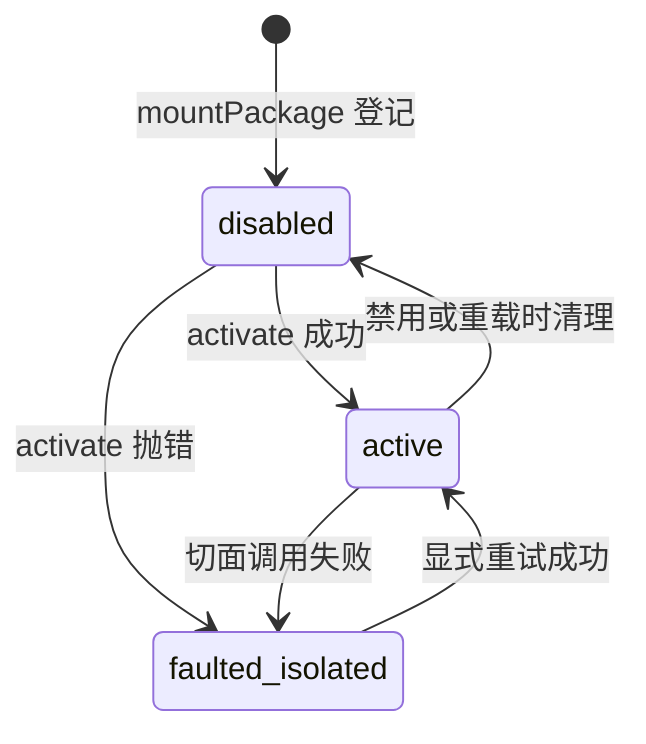

# 05. `@ai0/extension-core` 多切面扩展规范

## 一、部署包与能力切面

`ExtensionPackage` 是管理与部署单元，对应一个插件目录或发行 bundle。Owner 以 `extension_id` 安装、授权、启停、配置、热重载和隔离整包。`CapabilityFacet` 是与核心集成的能力切面，同一包通过 `facets: ExtensionFacetId[]` 声明所实现的多个接点。切面名格式为 `<owner>.<name>`。owner 限于 `channel`、`agent`、`perception`、`cognition`、`expression`、`console`、`extension`，name 可按 `[a-z][a-z0-9_]*` 扩展。清单中的名称表达声明，消费方按 `FacetPoint` 的 ID 和版本匹配活动贡献。

| 命名空间 | 已知接点 | 责任 |
| --- | --- | --- |
| `channel.*` | `channel.bridge` | 通道身份与协议路径。 |
| `agent.*` | `agent.tool_provider`、`agent.skill_manual`、`agent.model_adapter` | 工具、技能说明与模型调用适配。 |
| `perception.*` | `perception.ingress`、`perception.filter` | 注册通道观察能力与流水线过滤。 |
| `cognition.*` | `cognition.state_dynamics`、`cognition.attention_arbitrator`、`cognition.context_contributor`、`cognition.sleep_organ` | 描述符、焦点、黑板槽位与睡眠工作。 |
| `expression.*` | `expression.realizer`、`expression.media_transcoder`、`expression.intent_decorator` | 表达词表、媒体转码与意图修饰。 |
| `console.*` | `console.surface`、`console.ui_slot`、`console.config_schema` | 独立页面、插槽和表单字段。 |
| `extension.*` | `extension.asset_codec` | 资产接点命名，实际消费由宿主接点及载体适配决定。 |

“躯壳 (Shell)”将输入输出传输和化身表现绑定，导致纯文本桥也要承担设备与动作语义。交互通道 `InteractionChannel` 以 `channel_id` 标识双向端点，具身表现切面 `EmbodimentSurface` 由 `capabilities.embodiment_surface` 独立声明。WebChat v1 顶栏静态头像对应 `null`，Terminal 与 NapCat OneBot QQ 桥同样可收发文本。经授权的普通交流意图由 `RealizerVocabularyNegotiator` 协商为 `fallback_text`。未来 WebChat 顶栏动画或 `desktop_stage` 接入可在 `expression.realizer` 声明新 token，现有核心按词表绑定关键帧。静默、动作授权与受众检查贯穿两种交付。

## 二、清单与 SDK

`Ai0ExtensionManifestSchema` 是 `ai0.extension.json` 的机器契约，`manifest_version` 固定为 `"2.0.0"`。必需 `extension_id`、`display_name`、`version`、`author`、`carrier_kind`、非空 `facets` 及 `permissions`。可选 `description`、`homepage`、`tags`、`entry`、`console_contributions`。清单声明和运行时注册均可校验，许可由消费点执行。

### 2.1 组合通道 `builtin.webchat`

以下清单展示四个协同切面。桥接、上行能力、表达能力和网页入口共享一个包状态。

```json
{
  "manifest_version": "2.0.0",
  "extension_id": "builtin.webchat",
  "display_name": "WebChat",
  "version": "1.0.0",
  "author": "ai0",
  "carrier_kind": "native_code_plugin",
  "facets": [
    "channel.bridge",
    "perception.ingress",
    "expression.realizer",
    "console.surface"
  ],
  "permissions": {
    "read_blackboard_domains": [],
    "propose_mutation_domains": [],
    "max_audience_scope": "only_owner",
    "network_access": false
  }
}
```

以下示例使用 `@ai0/sdk` 的规范接点，并明确传入通道描述。部署方提供页面模块和实际传输。

```ts
import type { InteractionChannel } from "@ai0/protocol";
import {
  channelBridgeFacet, consoleSurfaceFacet, defineExtensionPackage,
  expressionRealizerFacet, perceptionIngressFacet
} from "@ai0/sdk";

const channel: InteractionChannel = {
  protocol_version: "0.1.0",
  channel_id: "builtin.webchat.default",
  channel_kind: "webchat",
  display_name: "WebChat",
  venue_type: "private_1on1",
  current_audience: { scope: "only_owner", member_count: 1 },
  latency_budget_ms: 3000,
  capabilities: {
    sensors: ["text"], supported_extensions: [], actuators: [],
    embodiment_surface: null
  }
};

export const webchat = defineExtensionPackage({
  manifest: {
    extension_id: "builtin.webchat", display_name: "WebChat",
    version: "1.0.0", author: "ai0", carrier_kind: "native_code_plugin",
    facets: ["channel.bridge", "perception.ingress", "expression.realizer", "console.surface"],
    permissions: {
      read_blackboard_domains: [], propose_mutation_domains: [],
      max_audience_scope: "only_owner", network_access: false
    }
  },
  activate(scope) {
    scope.contributeFacet(channelBridgeFacet, {
      channel_id: channel.channel_id, protocol_path: "/protocol/v0/channel"
    });
    scope.contributeFacet(perceptionIngressFacet, channel);
    scope.contributeFacet(expressionRealizerFacet, { channel });
    scope.contributeFacet(consoleSurfaceFacet, {
      pages: [{ path: "/webchat", title: "WebChat", channel_id: channel.channel_id,
        entry_module: "./dist/ui/stage.js" }]
    });
  }
});
```

### 2.2 认知器官 `community.organ.dream-journal`

示例以一个包注册黑板贡献、睡眠回调和两个控制台接点。读写域保持最小权限，睡眠回调只返回提案，由协调器裁决。

```json
{
  "manifest_version": "2.0.0",
  "extension_id": "community.organ.dream-journal",
  "display_name": "梦境日记",
  "version": "1.0.0",
  "author": "ai0",
  "carrier_kind": "native_code_plugin",
  "facets": [
    "cognition.context_contributor",
    "cognition.sleep_organ",
    "console.surface",
    "console.ui_slot"
  ],
  "permissions": {
    "read_blackboard_domains": [],
    "propose_mutation_domains": [],
    "max_audience_scope": "only_owner",
    "network_access": false
  }
}
```

```ts
import type { Ai0ExtensionManifest } from "@ai0/protocol";
import {
  cognitionContextContributorFacet, cognitionSleepOrganFacet,
  consoleSurfaceFacet, consoleUiSlotFacet, defineExtensionPackage
} from "@ai0/sdk";

export function defineDreamJournal({ manifest_version: _version, ...manifest }: Ai0ExtensionManifest) {
  return defineExtensionPackage({
    manifest,
    activate(scope) {
      scope.contributeFacet(cognitionContextContributorFacet, {
        contributeToBlackboard(_snapshot, maxTokens) {
          return maxTokens >= 16
            ? { slot_id: "slot.custom_organs.dream_journal", text: "Dream journal is available." }
            : null;
        }
      });
      scope.contributeFacet(cognitionSleepOrganFacet, {
        onSleepCycleWakeup() { return []; }
      });
      scope.contributeFacet(consoleSurfaceFacet, {
        pages: [{ path: "/dream-journal", title: "梦境日记", entry_module: "./dist/page.js" }]
      });
      scope.contributeFacet(consoleUiSlotFacet, {
        slots: [{ slot_target: "slot.memory.custom_tab", widget_type: "markdown_card_list", title: "梦境" }]
      });
    }
  });
}
```

`defineExtensionPackage` 自动补入版本字段并校验清单。`defineFacetPoint` 接受 `owner`、`name`、整数 `version` 和 `parse(raw)`，用解析器在注册边界保护实现契约。插件可依赖 `@ai0/protocol` 与 `@ai0/sdk`，由 `scripts/verify-architecture-boundaries.mjs` 检查。

### 2.3 五类载体与配置

| `carrier_kind` | 入口及用途 |
| --- | --- |
| `declarative_soul_asset` | CCv3 角色卡、世界书、灵魂模板、里程碑或 `.scenario.yaml`，经对应 Schema 与资产解析器读取。 |
| `markdown_skill_manual` | `SKILL.md` 由 `parseSkillMarkdownDocument` 解析 frontmatter 和正文，工具副作用仍过授权。 |
| `zero_code_protocol_bridge` | `ProtocolBridgeConfig` 以 `facets`、`transport`、`endpoint_or_command` 描述跨进程桥。 |
| `visual_cognitive_flow` | 声明式认知流与 `orchestration_rules.yaml`。触发先匹配信号，再提交受限动作。 |
| `native_code_plugin` | 原生模块通过 SDK 注册切面，可贡献控制台页面、配置表单与插槽。 |

技能文件的最小 frontmatter 示例可用于本地解析与工具权限审查。

```markdown
---
skill_id: lookup_catalog
display_name: 查阅目录
description: 读取目录项并引用原始来源
required_mcp_tools: [read_catalog]
capability_risk: read_only_safe
max_audience_scope: only_owner
in_character_demeanor: 说明证据与不确定性
crystallize_as_episodic_memory: false
---
先取得目录项，再检查返回的来源。只有结果可核验时才报告完成。
```

配置表单可通过 `console_contributions.config_fields` 与 `config_schema` 声明。持久扩展记录以 `extension_id` 保存 `carrier_kind`、`facets`、`enabled`、`status`、`config_values`、`permission_overrides` 与 `bound_vault_secrets`。密钥引用由宿主 Vault 管理，运行时 `rev` 由扩展宿主负责。

## 三、生命周期、授权与故障隔离

同一服务可通过模型工具、上下文、感知、认知或表达等多个入口使用。包作者声明候选切面及依赖，宿主按当前作用域、许可和代次绑定。下表列出实际调用方以及新增能力时需要遵守的边界。

| 作者扩展什么 | 调用方与约束 |
| --- | --- |
| 模型适配器 | `agentModelAdapterFacet` 声明工具及结构化输出能力。运行层提供每步已组装的请求，适配器将供应商事件转成公共事件。 |
| 模型工具 | `agentToolProviderFacet` 声明参数与结果校验、`capabilityRisk` / `resultTaint` 风险与污点元数据、调用函数及面向模型的投影（如 `builtin.workspace-tools` 同时暴露 `agent.tool_provider` 主动工作区工具与可选 `perception.source` 被动监听）。每步只暴露已获准且未被外部污点熔断的 schema，执行时复核本步骤绑定的代次与权限。 |
| 上下文 | `agentContextContributorFacet` 提供有来源与版本的片段。宿主授予指令权威并决定预算。组装器随每步生成记录，实际发送的模型可见字段由传输层按尝试记录。 |
| 插件间服务 | 作者用 `defineServiceContract` 拥有服务名、版本与输入输出校验。清单声明定义、提供、依赖及适用切面。依赖提供方卸载时撤销依赖它的入口，包内其他独立入口可继续运行。 |
| 解码与感知 | `extension.asset_codec` 以来源格式和目标格式选择解码器，目标所有者校验结果。Studio 卡片导入和管理接口消费相同的数字生命卡片目标。`perception.extractor` 按模态或扩展字段解读已接纳的帧，归一化器保存解读来源与代次并保留帧的可信身份。 |
| 状态和表达 | `cognition.proposal_policy` 审查获准域的提案，可拒绝或细化载荷；域更新函数仍拥有提交权。`expression.media_transcoder` 的可选游标函数将端点进度换算为已呈现文本的 Unicode 码点数，交付跟踪器消费生成时选定的代次。 |



- `ExtensionCoreHost` 在 `activate(scope, config)` 期间注册已声明的切面。关闭或隔离时撤销整包贡献、逆序释放资源；消费者以 `invokeFacet` 或 `invokeFacetAsync` 调用，失效代次的结果不进入当前链路。
- `configurePackage` 与 `hotReloadPackage` 比对 `expectedRev`，冲突时拒绝修改。匹配后更新配置、递增 revision，释放旧代后按启用状态重新激活。激活失败形成 `faulted_isolated`，可在卡片上展示错误。其余包可继续服务。
- `ExtensionComposition` 通过 Cordis Fiber 管理作用域内的贡献、依赖服务和资源清理。`mount(owner, activate)` 返回 `ready` 与 `dispose`。`ExtensionCoreHost` 的包状态与 Fiber 的依赖生命周期各自有明确所有者。
- `read_blackboard_domains` 和 `propose_mutation_domains` 约束宿主提供的读视图和提案入口，`max_audience_scope` 约束受众，`network_access` 供宿主管控网络能力。这些检查保护被中介的接口。运行任意第三方原生 JavaScript 需要独立的进程与网络隔离策略；域权限本身不提供进程沙箱。

## 四、机制与策略

| 内置策略包 | 切面与行为 |
| --- | --- |
| `plugins/perception-filters/conversational-gate`（`builtin.conversational-gate`） | `perception.filter` 合并 1200 ms 窗口内的聊天碎片，将撤稿映射为犹豫提示，并按显著性抑制重复背景刺激。 |
| `plugins/cognitive-organs/companion-homeostasis`（`builtin.companion-homeostasis`） | `cognition.state_dynamics` 提供 24 小时作息曲线、情感与社交驱力的耦合描述符。 |
| `plugins/cognitive-organs/attention-arbitrator`（`builtin.attention-arbitrator`） | `cognition.attention_arbitrator` 使用多通道焦点迟滞锁，具身动作词表允许时才请求 `gaze_lead`。 |
| `plugins/cognitive-organs/lorebook-contributor`（`builtin.lorebook-contributor`） | `cognition.context_contributor` 按关键词触发世界书，递归扩展引用并遵守去重与上下文预算。 |

无策略切面时感知过滤直通，连续状态描述符为空。Stage 6 的 headless Task Agent 以零策略等待运行，撤稿保持中性取消。工具执行、因果证据与授权仍进入各核机制。

`OrchestrationRules` 以 `cross_plugin_triggers[].when.source_channel` 和 `semantic_event` 匹配信号，由 `if_condition` 和 `then_actions` 描述受限联动。`proactive_routing_policy.never_broadcast_to_all_channels` 必须为 `true`，焦点变化通过 `ControlSignal.active_focus_channel_id` 表达。单次派发需重新校验通道、受众和能力。

```yaml
attention_focus_arbitration:
  focus_hysteresis_window_ms: 5000
  priority_order:
    - match: { channel_id: builtin.webchat.default }
      weight: 1
proactive_routing_policy:
  never_broadcast_to_all_channels: true
  preferred_target_selection: [builtin.webchat.default]
cross_plugin_triggers:
  - rule_id: webchat-focus
    when:
      source_channel: builtin.webchat.default
      semantic_event: user_addressed
    if_condition: audience_is_authorized
    then_actions:
      - action: propose_focus
        target_channel_id: builtin.webchat.default
```

条件与动作由宿主解释，示例键值只表达规则数据。排练使用隔离的 Sandbox 目标与合成输入。

## 五、创作者在线虚拟交互通道调试沙盒与一键脱敏资产打包引擎（Creator SDK DevTools & `.ai0pack` Bundler）

为了让社区创作者无需搭建繁琐的外围客户端环境就能在首版控制台中高效开发、调试并分享五阶多态扩展，系统内建两大创作者基础设施：

1. **内置虚拟交互通道与多模态感官模拟器（Mock InteractionChannel & Sensor Simulator — `/system/simulator`）**：
   * 创作者在开发一个新的 `SKILL.md` 技能、一条 `Lorebook` 词书、一个 `cognition.context_contributor` 脑区插件或一条跨插件 ECA 规则时，无需真的启动 Unity/Live2D 客户端或登录外部 IM；
   * 直接在控制台打开交互通道协议模拟器，可任意伪造握手参数（切换 `private_1on1 | group_chat | public_livestream`、切换 `owner_verified | stranger:troll`），一键发送模拟触觉（如连戳 3 下脑袋）、模拟视觉语义（如皱眉 + 竞争假设）、模拟中途流式打断（指定 `spoken_char_offset`）或模拟动态热更新 `Actuators`，并在右侧伴生检视栏中实时观测 8 步决策轨迹与插件 Hook 耗时。
2. **代码级强制脱敏的一键社区资产打包器（Privacy-Scrubbed Creator Asset Bundler）**：
   * 当用户在控制台调教出一套满意的角色人格、生物钟曲线、`Lorebook` 词库、里程碑规则、`SKILL.md` 技能或 `.flow.yaml` 编排蓝图，点击 **`[📦 一键脱敏打包导出社区分享包]`** 时：
   * 后端打包引擎在代码层**强制物理排除** `soul_core.sqlite`（所有个人对话 `event_log`、私密情景记忆、决策轨迹）、`redaction_ledger.json`、`attachments/` 个人照片以及 Secrets Vault 中的任何 API Key；
   * 仅将纯净的设定、声线锚点、词书、技能手册或流程蓝图封装为带 SHA-256 校验与版本元数据的标准 `.soul-template` / `.ai0-skill` / `.ai0-flow` 资产包，从物理根源杜绝“创作者分享角色卡却意外泄露自己私聊记录或密钥”的社区安全事故。
