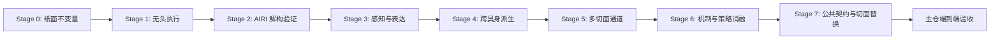
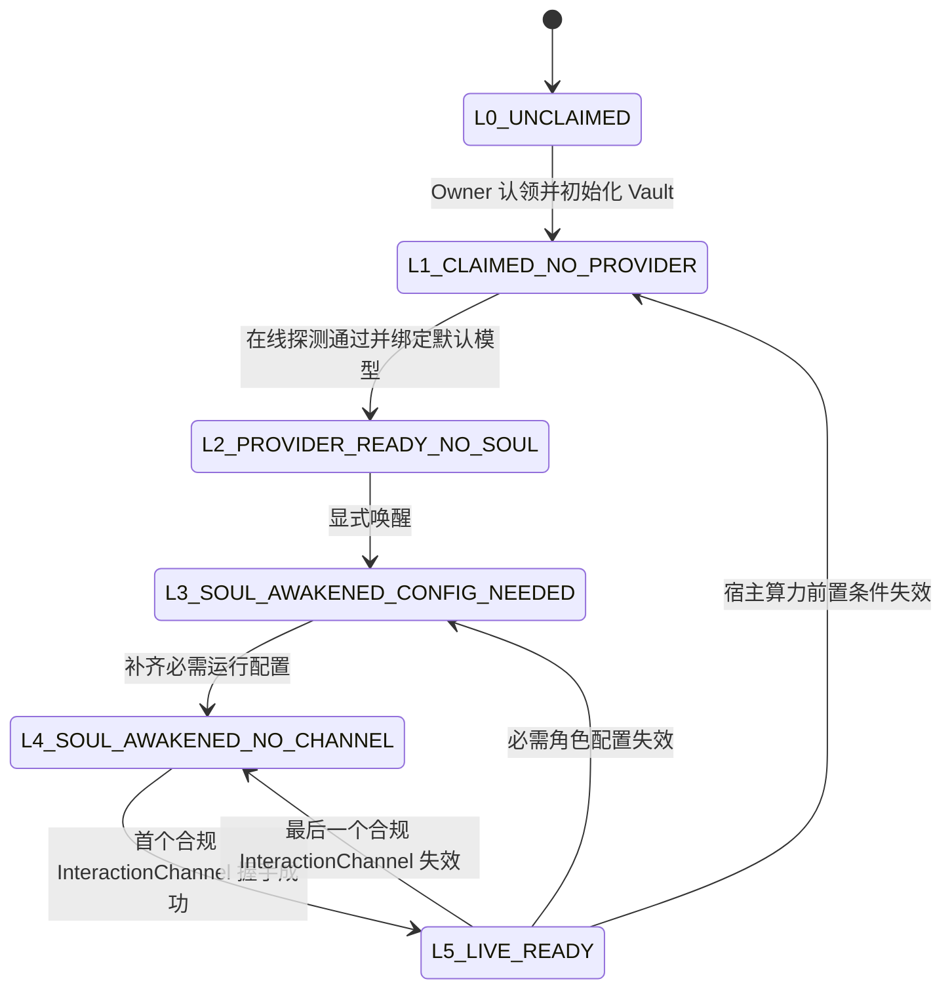

# 08. 渐进推演实验验证、零预设部署到上线验收闭环与交付门禁规范

## 1. Stage 0–7 实验与主仓验收

每阶交付输入夹具、可重放时间线、预期断言与失败轨迹。Stage 0 用正反例逐行推演，其余实验固定时钟与模型事件流，记录有序输出、状态、回执和副作用。主仓同时验收真实浏览器和真实 Provider。上游已冻结的契约继续运行原有回归，修订须从最早受影响阶段重新验证。

| 阶段与验证位置 | 刺激与可判定通过条件 |
| --- | --- |
| Stage 0 · `labs/stage0-paper-traces` | 分别给出只生成、已呈现、执行核实、对方确认轨迹，验证 `Generated != Presented != Actuated != UserGrounded`。用宿主、卡片、运行实例和挂载交互通道的增删用例验证四层所有权。空卷、认领、仅导卡、显式唤醒和卸载最后交互通道逐步核对生命周期。 |
| Stage 1 · `labs/stage1-agent-core` | 以约 145 行的纯执行核验证 `AuthorityRole` 隔离，观测中的指令不得升权。`Turn / Round` 并发工具逆序完成时按原顺序结算。`maxSteps` 到限且目标证据不足时返回 `goalVerification: unverified`。注入 408/429/5xx 检验首事件前且副作用前的有界重试，越过任一边界时工具只执行一次。 |
| Stage 2 · `labs/stage2-airi-dissection` | `ScopedContextRegistry` 在超过 `freshnessTtlMs`、断连或撤权时分别进入 `stale`、`disconnected`、`blind`，禁止读取旧载荷，跨 `AudienceScope` 查询无结果。`ReflexGate` 抑制重复例行信号，断言 `llmTokens: 0` 与 `suppressedRoutineCount` 增量。`CharacterCardResolver` 保留未知 `extensions.<namespace>` 的嵌套值，交错验证 `Inherit / Override` 与全局配置稳定性。 |
| Stage 3 · `labs/stage3-perception-expression` | 冻结 Stage 1。经 `EmbodimentAffordanceRegistry` 注册自定义模态并核对六元组。用 `TurnLifecycleGate` 回放 `activity / interim / commit / retract`，仅有效 commit 进入提交路径，撤回使目标输入失效。`ChronoceptiveSignalSynthesizer` 对重叠冬眠只扣一次。`CommunicativeIntentEnvelope` 经 `RealizerVocabularyNegotiator` 在找不到符合受众、静默或动作要求的通道时进入 `held_pending_compliant_channel`。`GroundingReceiptTracker` 收到 `silenced` 即停止播放，`done` 后按已交付水位回收未说内容（`unsaidRemainder`），重复回执只结算一次。 |
| Stage 4 · `labs/stage4-universal-derivation` | 冻结 Stages 1–3。对 `ContinuousStateMetaEngine` 置换同刻冲量并核对值域、复演和检查点还原。执行下表四条跨具身场景，覆盖 `EpistemicMemoryFirewall` 和 `cognition.*` 认知器官扩展包。 |
| Stage 5 · `labs/stage5-composite-channel-facets` | WebChat 文本和新增具身词表协商，NapCat 面向正确受众收发，重载淘汰旧注册，故障和半途激活按包清理。 |
| Stage 6 · `labs/stage6-mechanism-policy-ablation` | CLI 在输入的虚拟时间运行，策略等待 0 ms，工具接地可核验、状态为空、撤稿中性。陪伴配置验证 1200 ms 合并、作息与耦合、焦点迟滞和词表约束、递归世界书预算。热消融检查旧缓存不会补发。 |
| Stage 7 · `labs/stage7-public-contracts` | 从公开 SDK 与各核入口验证作者契约、替换模型提供方、无模型复用同一服务、撤权及空装配。 |
| 主仓 Clean-Slate V1 | 在空卷启动真实 daemon、网关、控制台和 `builtin.webchat`，完成第二节和全部发布门禁。以探针序列、实际传输回执、脱敏轨迹、数据库断言和导出包清单作为证据。 |

| Stage 4 场景 | 通过条件 |
| --- | --- |
| WebChat 摄像头与竞争假设 | 对同一已授权观测保留带来源和时效的竞争假设，实证到达前维持推断等级。撤权后变为 `blind`，旧帧退出当前上下文。 |
| 桌面猫耳三连拍与拖动窗口容器 | 同为触碰输入，按对象和能力区分猫耳三连拍与容器拖动。仅前者进入对应表达路径，后者留在布局层。 |
| 游戏自身与队友 HP、语用玩笑 | 以主体区分两套 HP；队友变化不得记为自身伤害。`playful_banter` 在即时互动和睡眠整理中均不得写成语义事实。 |
| 排练蓝卡、器官热替换与静默手环 | 用蓝卡触发授权后的 `cognition.*` 认知器官扩展包 热替换，保留主体与状态，仅新事件走替换后的路由。静默手环仅执行协商许可的非语言表达，验证动作回执及零语音输出。 |

## 2. 空目录部署到上线

图示为逐项补齐的验收路径。守护进程从最早缺项重算实际状态，允许跨级。前置条件恢复后重查现有实例、配置及在线握手。

| 状态 | 进入下一阶段的条件 | 验收与降级 |
| --- | --- | --- |
| `L0_UNCLAIMED` | Owner 认领、选择部署模式、初始化加密 Vault | 卡片与 Soul 数均为零，空卷无自动唤醒 |
| `L1_CLAIMED_NO_PROVIDER` | 至少一个 Provider 在线验证成功，为 `consciousness` 绑定可用默认模型 | 缺凭据、探测失败或无可用宿主默认模型时停留。若撤销后仍有符合条件的有效路由，重新按全量条件求值 |
| `L2_PROVIDER_READY_NO_SOUL` | Owner 创建或导入角色卡并显式唤醒实例 | 仅导入卡仍保持本阶段，移除活动实例后重算 |
| `L3_SOUL_AWAKENED_CONFIG_NEEDED` | 补齐必需扩展、Vault 引用和角色模型覆盖 | 必需角色覆盖失效时回本级。未授权可选感官保持 `"blind"` |
| `L4_SOUL_AWAKENED_NO_CHANNEL` | 至少一个在线 InteractionChannel 的身份、令牌、受众和能力握手合规 | 最后一个合规 InteractionChannel 卸载、断连或授权失效后回本级（此前条件仍成立时） |
| `L5_LIVE_READY` | 全部条件持续满足 | 接纳 LIVE 话轮，虚拟时钟锁定 1x。任一条件失效时收紧接纳 |

关停、异常退出与恢复需纳入测试。持久记录 `last_alive_heartbeat_ts`，按第 03 篇在重启或导入时将超过五分钟的心跳缺口记入 `HibernationIntervals`。恢复使用新握手重判在线状态，并在内生时感中扣除与互动间隔重叠的冬眠时窗。

| 探针 | HTTP 契约 | 调用方断言 |
| --- | --- | --- |
| `GET /healthz` | 进程能够服务探针时返回 `200 OK` | L0～L5 均可存活，供进程级探活 |
| `GET /readyz` | L0～L4 返回 `503 Service Unavailable`，JSON 含 `stage` 与 `missing_prerequisites` 字符串数组。L5 返回 `200 OK` 且缺项数组为空 | 控制台据此引导，数据面接纳使用同一判定，Owner 配置和 InteractionChannel 握手仍可推进上线 |

### 空 `/data` 自动化规程

1. 为每次运行分配独立空卷，启动发行镜像。轮询探针至有界截止，断言 `/healthz` 为 200、`/readyz` 为 503 / `L0_UNCLAIMED`，卡片和 Soul 枚举均为零。向 Channel A 提交话轮并断言门控拒绝。
2. 调用 `POST /api/admin/v1/host/claim` 完成 Owner 认领、部署模式选择及 Vault 初始化。断言 L1，刷新控制台与重启 daemon 后重查同一阶段。
3. 验收 Provider 矩阵包含 `opencode_go` 的 `deepseek-v4.1-flash`、OpenAI-compatible、Anthropic、DeepSeek、Ollama。各适配器用隔离配置验证有效在线探测及错误凭据或不可达端点的失败路径。选定一个探测通过的路由绑定 `consciousness` 后确认 L2，`vision`、`speech` 可按需配置。发布证据记录适配器、模型、时间与结果，隐藏凭据。
4. 导入含自定义 `extensions.<namespace>` 的 CCv3 卡，校验嵌套值无损及仅导卡仍为 L2。显式唤醒并查验 `origin_card_id` 和独立实例。用夹具保留一个必需配置缺口观察 L3，再补齐至 L4。注入未授权可选摄像头帧，断言 `"blind"`、旧载荷不可见且继续允许上线。
5. 绑定 `Principal`，签发限定受众和能力的 `Scoped Capability Token`，通过 `HandshakeManifest` 挂载 `builtin.webchat`。先用失效令牌断言握手失败且仍为 L4，再用合规令牌断言 200 / `L5_LIVE_READY`。刷新或重连浏览器重查 daemon 权威状态。
6. 执行真实模型话轮，核对 Provider 路由、结构化帧和呈现回执。播放中触发打断，验证 `silenced` 即停播，再用 `done` 核对交付水位及 `unsaid_remainder` 仅回收一次。导出并解包 CCv3、`.soul-template`，验证允许分享的自定义扩展可往返，私密聊天、记忆、轨迹、附件、遗忘账本和 Vault 凭据均未泄露。
7. 卸载最后一个合规 InteractionChannel 验证回 L4，重新挂载恢复 L5。撤销唯一有效 Provider 验证回 L1 并拒绝新话轮，恢复后重验所有前置条件。以受控时钟模拟超过五分钟的关停，恢复后断言冬眠入账、交叠只扣一次，在线条件按新会话求值。

## 3. CI 与发布门禁

| 门禁 | 执行范围与通过证据 |
| --- | --- |
| 编译期边界 | `pnpm verify:boundaries` 运行 `verify-architecture-boundaries.mjs`，覆盖九包依赖方向、`plugins/**` 依赖白名单及核心和应用禁止反向导入插件。验证控制台设计系统五层目录的约定边界。 |
| 类型、构建、测试 | 运行工作区 Typecheck、Build 及 `labs/**`、`packages/**`、`apps/**` 的单元和集成测试。保存失败模块、编译诊断、测试断言与复演输入，任一执行失败阻断发布。 |
| Fail-Closed 黄金剧本 | 执行 `.scenario.yaml` 正反例。私密检索验证 SQL `WHERE visibility_scope` 在候选产生前生效。睡眠写入阻断玩笑晋升与墓碑血缘的迟到提案。Hard Forget 注入可识别标记，检查 `event_log`、`memories`、`turn_decision_traces`、`cognitive_state_checkpoints`、`prospective_commitments` 及相关索引，断言纯衍生删除、混合记忆按拓扑序重算。从遗忘前快照恢复，确认先重放 `redaction_ledger.json` 再开放服务。 |
| 浏览器组合 | `pnpm verify:composition-browser` 用 Playwright 在真实浏览器验证 Owner 引导、模型路由、插件动态挂载、单活动路由、LIVE 与 `SANDBOX:<fork_id>` 写入隔离及刷新后的权威就绪状态。 |
| 发行镜像 | 对同一候选镜像运行第二节空卷 E2E，再执行生产备份恢复和跨宿主交付演练。保存镜像摘要、探针轨迹、在线探测结果、清除断言、浏览器报告和脱敏导出清单。缺失证据或跳过必需用例视为未通过。 |

## 4. 空卷 Docker 部署与自托管交付

1. 从通过门禁的镜像摘要启动守护进程，将新增命名卷或持久卷挂到容器 `/data`，使运行身份具备该目录的读写权限。部署参数从发行镜像取得，业务数据落在 `/data/souls/host/` 与 `/data/souls/<soul_id>.soul/`。前者持有宿主配置和 Vault，后者持有独立实例数据库、状态和附件，首次启动可为空。
2. Docker HEALTHCHECK 使用 `/healthz`。Kubernetes 的 startupProbe 与 livenessProbe 使用 `/healthz`，readinessProbe 使用 `/readyz`，探针端口与容器配置一致。面向用户的话轮入口随就绪门控启用。通过受 Owner 认证保护、在未就绪时仍可访问的管理入口完成认领和握手，例如直接转发到 Pod 管理端口，避免依赖只路由就绪端点的 Service。
3. 用 Owner 管理入口依序完成认领、算力探测、创建或导入、显式唤醒、配置与交互通道握手。以 `/readyz` 的 L5、真实话轮回执、最后交互通道失效后的降级作为交付验收证据。
4. 备份使用存储层一致性快照，或停止写入后备份实例与宿主所需文件。保护加密 Vault 备份，将解封材料分开保管，持久保留独立于快照的最新遗忘账本。定期在隔离卷演练解封和快照重放。轮换 Provider 密钥时先在 Vault 写入新版本并实测，通过后更新引用、检查下一回合及就绪状态，再撤销旧版本。
5. 无锁定迁移使用完整 `.soul` 迁移包，例如 `.soul.tar.zst`。冻结源实例写入，导出并核验归档完整性，在目标宿主导入后核对实例 ID、事件和检查点，重放最新遗忘账本并记录冬眠窗口。目标宿主独立认领和配置 Vault、Provider 与令牌，再按步骤挂载并验收真实话轮。切换前维持单一写入实例，失败时核对目标新增写入后再恢复源端服务。CCv3 与 `.soul-template` 用于脱敏分享，完整迁移包按私密备份保护。
