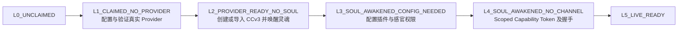

# 04. 核心设计张力、长程失效防护、架构派生拓扑与最小纵切片（Clean-Slate V1）规格

> **项目阶段**：架构研究与工程规格设计阶段（问题域规范）
>
> 本文档系统梳理数字生命架构的三个战略级工程维度：
> 1. **12 项核心设计张力与长程运行深层失效模式**的机理剖析与破局架构；
> 2. 决定系统表结构与协议契约的 **P0–P6 架构依赖派生拓扑**；
> 3. 作为下一阶段首个原型验证闭环的 **Clean-Slate V1 最小完备纵切片** 必含规格与安全推迟清单。

---

## 一、系统核心设计张力与长程运行失效防护体系（12 项核心约束）

### 1.1 五大基础架构张力与锚定解法

| 核心设计张力 | 矛盾本质 | 架构锚定解法 |
| :--- | :--- | :--- |
| **1. 连续性 vs. 隐私** | 跨平台共享同一个灵魂记忆，极易导致私聊秘密在群聊或直播间被套话泄露 | **检索层 SQL `WHERE audience_scope` 硬过滤 + 心境跨场合阻尼器（Social Mask Attenuator）+ 工具调用三维权限矩阵** **`[文献/先行项目佐证]`** |
| **2. 主动性 vs. 用户福祉** | 既要求具备生命感的主动交互，又必须杜绝演变为高频打扰或商业留存 PUA | **关系（她对主人的感受）与用户模型（可打扰度）分离 + 每日配额与指数退避冷却 + 禁绝离场内疚绑架红线** **`[文献/先行项目佐证]`** |
| **3. 开放生态 vs. 安全** | 社区可自由编写交互通道插件和 MCP，恶意或被攻破的插件可能伪造主人指令或投毒记忆 | **Scoped Capability Token 网关验签 + 一切感知输入视为不可信数据 + 睡眠整理作为不可信写入者过防火墙** **`[文献/先行项目佐证]`** |
| **4. 回档 vs. 关系真实** | Git 式灵魂回档便于容错，但容易造成“主人记得刚才的争执，数字个体却完全失忆”的认知断层 | **三种显式回档语义（静默硬回滚 / 诚实共知翻篇回滚 / 梦境余温回滚）** **`[架构推断]`** |
| **5. 防崩塌 vs. 成长** | 锁死人设会沦为死板 NPC，放开自我修改又会在长程交互后发生 OOC 崩塌 | **Tier 0（代码底线）/ Tier 1（核心 DNA 需人工批准）/ Tier 2（可变自我叙事自动快照演进）三层架构 + 黄金样本声线锚定** **`[架构推断]`** |

---

### 1.2 七大长程运行深层失效模式与破局架构

当数字生命进入数天、数周乃至数月的长程连续运转时，以下 **7 类深层系统失效模式** 若不在架构设计期解决，将在运行中后期引发严重退化或隐私事故：

#### 失效模式 1：长期记忆的“语义坍缩与自我反刍回音室（Semantic Collapse & Rumination Echo Chamber）”
* **证据等级**：**`[文献/先行项目佐证]`**（对应 Shumailov et al. *Model Collapse* 与 Generative Agents 长期运行中的刻板印象退化现象） + **`[架构推断]`**
* **失效机理**：当睡眠整理把对话总结为记忆，下一轮对话召回这些总结，下一次睡眠整理又把“引用了旧总结的新对话”再次提炼总结时，系统就形成了一个**正反馈自激回音室**。主人某天随口提了一句“今天吃了碗牛肉面”，经过三次睡眠反刍与主动搭话引用后，她会形成极端刻板印象，每天开口闭口都是牛肉面，原本立体的人格坍缩为单调的复读机。
* **破局架构**：
  1. **只从一级原始事件提炼原则（Level-0 Grounding Rule）**：睡眠整理提炼新情景记忆时，输入源必须是未归档的 **Level-0 原始对话事件**，禁止对高层总结进行超过 2 代的递归抽象；
  2. **召回多样性与近期复用惩罚（Retrieval Cooldown & MMR Diversity）**：在过去 $K$ 个话轮中已被她主动提起过的记忆节点，自动施加短期冷却降权（Cooldown Penalty），强迫检索器发掘其他维度的共同经历。

#### 失效模式 2：非对称停机时间差（Asymmetric Downtime Gap —— “服务器关机半年” vs. “持续在线冷落半年”）
* **证据等级**：**`[架构推断]`**
* **失效机理**：在离线时间连续性模型 $\mathbf{S}(t) = f(\mathbf{S}(t_0), t - t_0)$ 中，如果宿主机关机两周，或 `.soul` 存档导出半年后才重新导入启动，当前时间 $t$ 与上次事件 $t_0$ 相差达 $180$ 天。如果不加区分直接代入时间函数，数字个体一开机就会判定“被活生生冷落了 180 天”，瞬间触发满格孤独与委屈心结。
* **破局架构**：在虚拟时钟引擎中严格区分两种时间流逝：
  1. **`Active Unattended Duration`（内核在线但无互动时长）**：计入无聊度、社交渴望积分与正常时间体感；
  2. **`Kernel Hibernation Gap`（内核进程停止/存档休眠时长）**：宿主记录 `HibernationIntervals`，恢复时结算与观察窗口相交的区间并集。内生清醒空闲时长扣除此区间，墙钟经过时间仍可单独审计。

#### 失效模式 3：多模态交互通道的“跨模态声画恐怖谷失步（Cross-Modal Desynchronization）”
* **证据等级**：**`[文献/先行项目佐证]`**（SAIBA BML `sync_point` 核心课题）
* **失效机理**：大脑同时生成了文字台词与微表情意图（如说到后半句转折时脸红低头）。在流式网络中，文字第 $0.2\text{s}$ 就到了交互通道，而交互通道侧调用的云端 TTS 合成语音花了 $1.8\text{s}$。如果交互通道一收到 JSON 就立刻执行脸红低头动画，等声音真正播到后半句时，表情早就做完恢复冷漠了——声画错位会瞬间击碎“活物感”。
* **破局架构**：下行扩展 `ext.embodied.v1` 中的表情与动作指令严禁只绑定消息到达时刻，必须支持 **相对话语同步锚点（Utterance-Relative Sync Anchors）**：
  * `anchor: "pre_speech"`（开口前的吸气/眼神聚焦）；
  * `anchor: "speech_start"`（发声第一帧同步触发）；
  * `anchor: "on_substring:<关键词>"`（语音播到特定词时触发微表情高潮）；
  * `anchor: "post_speech"`（说完后的余韵动作）。

#### 失效模式 4：外部知识库热插拔导致的“局灶性失忆精神分裂（Focal Amnesia on KB Unmount）”
* **证据等级**：**`[架构推断]`**
* **失效机理**：客观外部知识库支持按需热插拔挂载。假设上周挂载了某专业领域或游戏设定知识库并深入讨论了三天，主观情景记忆里写满了“曾与主人热烈讨论 X 理论”；这周卸载该外部知识库后，当主人再次提起“就像上周聊的 X 理论那样”，她的主观记忆明确记录了“对此很熟悉”，但客观知识库检索却返回空集——极易陷入“记得聊过却完全不知所云或胡编乱造”的认知割裂。
* **破局架构**：**引用即沉淀摘要（Citation-Triggered Gist Crystallization）**。每当外部挂载知识库中的某个切片在真实对话中被高权重引用时，睡眠整理自动将该切片压缩为一张 $<150$ 字的**“共同话题常识卡片（Shared Topic Gist Card）”**，存入她自己的长期语义记忆库并标记 `origin_kb_id`。即便未来外部 GB 级知识库被卸载，她依然记得“当时和主人聊过的核心常识”，并能坦然说明“那个大资料库收起来啦，不过我印象里我们当时聊到的核心是……”。

#### 失效模式 5：模块消融开关（Ablation）与事件溯源历史一致性的因果悖论
* **证据等级**：**`[架构推断]`**
* **失效机理**：架构同时支持“认知模块独立开关消融”与“以事件日志为唯一真相、记忆为可重建投影”。如果某段历史对话是在“关闭情绪模块与潜台词模块”的状态下发生的，事后在开启全模块状态下重算局部投影，投影器会用全模块逻辑曲解当年在残血拓扑下产生的事件，导致因果链错位。
* **破局架构**：**消融状态快照化（Feature-Flag Configuration as Event Metadata）**。每一次认知模块开关或路由策略的调整，都会写入一条 `CognitiveConfigEvent`；且每条对话事件头中均记录当时的 `active_modules_mask` 位图，确保审计与回放严格尊重历史发生时的认知拓扑。

#### 失效模式 6：认知模块堆叠引发的“提示词膨胀与人设声线稀释悖论（Context Bloat vs. Persona Fidelity）”
* **证据等级**：**`[文献/先行项目佐证]`**（Liu et al. *Lost in the Middle* 及多约束遵循退化研究）
* **失效机理**：当“不可变核心 + 可变自我叙事 + 存在论契约 + 当前交互通道能力与受众 + 情绪稳态体感 + 用户模型 + 5 条情景记忆 + 5 条语义事实 + 前瞻承诺 + 工具列表 + 安全不变量”全部塞进 System 1 的 Prompt 时，每次调用的上下文会轻松突破 $10,000$ Tokens。不仅首字延迟（TTFT）恶化、Token 成本攀升，更致命的是：**Prompt 里的规则和信息越多，大模型对角色口癖、细微傲娇语气和个性签名的注意力就被稀释得越厉害，最终退化为面面俱到却毫无灵气的平庸腔调**。
* **破局架构**：**认知黑板的硬性注意力预算（Hard Attention Token Budget for Cognitive Blackboard）**。
  * 规定进入 System 1 热路径的《认知状态黑板》编译后总长度**严格封顶在 $1,800 \sim 2,500$ Tokens 以内**；
  * 采用 **显著性竞争上岗机制（Salience Winner-Take-All）**：同一轮对话中，长期记忆最多只准挤进 Top-3 条，前瞻意图最多 Top-1 条，内稳态体感只编译当前显著偏离基线的维度（处于平稳基线的维度直接省略不写！），以此换取极致的响应速度与人设锋利度。

#### 失效模式 7：跨端心境与自我叙事的“侧信道隐私推理泄漏（Side-Channel Mood & Narrative Leakage）”
* **证据等级**：**`[架构推断]`**
* **失效机理**：即使检索层代码已按受众硬过滤私密记忆，若主人在私聊里倾诉了个人重大挫折，导致她的① **持久心境（Mood）**变为极度悲伤担忧，且② **可变自我叙事（Tier 2 Narrative）**被睡眠整理更新为“最近主人遇到了难关，要多陪伴安慰”，当群友在公开群聊里问她“今天怎么看起来闷闷不乐的？”时——即便检索层一行私密记忆都没召回，她光凭全局心境归因和 Tier 2 自我叙事，就会在群里脱口而出主人的私密挫折。
* **破局架构**：**全状态受众作用域染色（Pervasive Scope Tainting & Social Masking）**：
  1. 不仅是 `memories` 表，**`narrative_self`（可变自我叙事）的每个段落、`prospective_commitments`（前瞻承诺）以及 `mood_attribution`（心境归因理由）也必须强制携带 `visibility_scope` 字段**！
  2. 当 `Audience != only_owner` 时，认知黑板编译器自动剥离所有 `private_owner` 级别的自我叙事段落与心境归因理由，并开启**《社交面具阻尼器（Social Mask Damper）》**——将私密事件引发的强烈情绪波动衰减 $70\%$，在公开场合表现为得体的社交礼仪态。

---

## 二、架构派生拓扑与底层依赖顺序（P0 $\rightarrow$ P6）

| 派生层 | 对应依赖 | 实验与收敛验据 |
| --- | --- | --- |
| Level 1 顶层实体与部署边界 | P0 → P1 | 固定 Owner、宿主、卡、灵魂和通道的所有权，以 Stage 0 检验门禁、撤销和证据前缀。 |
| Level 2 跨场景消去与五核分立 | P1 → P2 → P3 → P4 | 先确立信任、时间和事件真相，再推导认知事务与观察、表达、回执接口。设备和场景词汇留在插件。 |
| Level 3 渐进证伪与主仓收敛 | 将 P0–P4 的不变量贯穿 P5 → P6 | [Stage 0–6 实验](../../labs/README.md) 依次检验纸面轨迹、执行隔离、AIRI 对照、感知表达、跨具身派生、多切面通道组合与机制／策略消融。再用真实 Provider、持久化和授权挂载验收纵切片。 |

详见[三级渐进派生方法论](01-vision-and-predecessors.md#13-三级渐进派生方法论)。P0–P6 描述依赖顺序，五核边界描述职责归属。

### 2.1 架构派生的两条底层前置依赖定律

所有工程模块的设计与实现必须严格遵守以下两条不可逆的底层依赖约束（违反顺序将导致表结构、协议信封与主循环的大规模返工）：
1. **主体/受众信任模型与安全公理是事件日志 Schema 与协议 v0 信封的前置依赖**：若未先锁定“主体-场合-受众-凭据四元组”与“认知溯源分类”，便无法确定 `event_log` 表的权威列定义，也无法冻结协议 v0 的信封头。
2. **全局虚拟时钟（含冬眠时间差规范）与认知黑板预算/消融接口必须在认知主循环之前锁定**：所有状态衰减、前瞻承诺与模块消融回放都强依赖统一的时钟注入接口与注意力预算契约。

### 2.2 P0 $\rightarrow$ P6 架构派生拓扑顺序

| 优先级阶梯 | 核心架构问题 | 核心架构决断 | 底层拓扑依赖依据 |
| :--- | :--- | :--- | :--- |
| **P0：伦理、安全与存在论公理** | 存在论契约模式、Tier 0 安全不变量（SB 243 危机硬拦截）、反操控主动性边界 | **诚实基底上的赛博具身契约 + 独立于 LLM 的 Tier 0 危机拦截器 + 主动性硬上限与心结半衰期** | 决定系统的最高宪法边界；任何违反 P0 的状态转移在后续所有层中直接无效。 |
| **P1：主体、场合、受众与信任底座** | 主体分级（主人/好友/陌生人/环境/工具）、场合与在场受众是否必须进协议 v0 与存储底座？ | **必须进协议 v0 与每一张核心表！** 采用 `Principal × Venue × Audience × Attestation` 四元组信封 | 它是整个系统权限矩阵、记忆检索 `WHERE` 隔离墙、防记忆投毒防火墙的共同外键。 |
| **P2：真相源、虚拟时钟与血缘擦除底座** | 事件溯源 + 血缘 DAG 局部失效重算 + 真遗忘物理载荷擦除 + 全局可注入 `VirtualClock` | **不可变事件日志为唯一真相 + 增量物化记忆投影 + 血缘 DAG 级联擦除 + 区分运行静默与关机冬眠的虚拟时钟** | 决定整个 `.soul` 存档的 SQLite Schema 与时间依赖注入规范，是所有上层状态机的地基。 |
| **P3：统一认知主体、权威状态协调器与时间三分法** | 单一认知主体如何兼顾人格一致性与异步并发？离线时间状态与真实反思认知如何区分？ | **统一认知主体 + 基于 `state_rev` 的权威状态事务协调器（MVCC） + 多路并发 Worker（对话快环/行动环/睡眠环） + 时间状态三分法（纯数学稳态 / 事件驱动认知 / 阈值触发真实异步推理）** | 解决长耗时工具任务阻塞对话、后台记忆整理覆盖实时状态、以及“未执行推理却虚构离线思考”三大隐患。 |
| **P4：协议 v0 最小冻结核心、具身执行器与回执闭环** | 协议 v0 核心到底该多小？如何统一建模 InteractionChannel 的感知、表达渲染与端侧具身动作回执？ | **5 原语最小冻结核心（含 `Sensors / Realizers / Actuators` 声明、含沉默与动作调用的表达信封、带打断字符偏移与执行结果的回执）+ 命名空间扩展** | 将 P1~P3 的内核能力封装为面向社区具身运行环境（InteractionChannel）与内置零特权 WebChat 的稳定契约。 |
| **P5：一等行动认知闭环、五维判别公理与模块消融接口** | 工具与多步行动如何成为内核一等公民并转化为共同经历？各认知模块如何统一接入并支持消融？ | **8 步行动认知闭环（目标→观察→规划→三维授权→执行→感知结果→验证→沉淀共同经历） + 统一 `CognitiveModule` 消融接口 + 脑区模型路由器** | 让数字生命从“只会聊天的 Chatbot”跃升为“能陪伴使用者做事并积累共同经历记忆的具身生命”。 |
| **P6：特权白盒审计轨迹、场景回放与三维评估** | 如何划清 WebUI 与 WebChat 的安全边界？如何在不盲信 LLM 自述独白的前提下做白盒验证？ | **WebUI 宿主特权遥测总线（与零特权 WebChat 严格分离） + 8 步确定性《可验证本轮决策轨迹 `VerifiableTurnTrace`》 + `.scenario.yaml` 脚本化回放断言** | 将数字生命的开发从主观 Prompt 调试提升为可审计、可复现的认知系统科学实验。 |

---

## 三、Clean-Slate V1 端到端最小完备纵切片

主仓验收从空宿主开始，以实际模型回合、结构化观察、回执和可审计持久化收尾。协议 v0 仍是传输契约版本，Clean-Slate V1 是整套架构的第一版。

### 3.1 必含闭环与验收条件

1. **冷启动门禁**。Owner 认领并初始化 Vault，显式确认 `deployment_mode`。完成真实 LLM Provider 探测，创建或导入 CCv3 并经明确操作唤醒空历史 `*.soul`。配置扩展能力后签发 Scoped Capability Token，至少一个 InteractionChannel 有效握手且具备安全披露能力才点亮 `L5_LIVE_READY`。测试缺失 Provider、无可用通道、撤销和重启恢复。首次打开仅展示真实缺口，仓库产物零预设卡、零运行档案、零伪造回复。
2. **九包贯通**。`@ai0/daemon` 组装 `@ai0/protocol`、`@ai0/gateway`、`@ai0/storage`、`@ai0/sdk` 与 `@ai0/extension-core`、`@ai0/agent-core`、`@ai0/perception-core`、`@ai0/cognition-core`、`@ai0/expression-core`。TypeScript 与 Zod 是协议机器契约，JSON Schema 从其单向导出。WebChat 通过 Channel A 的 HTTP/SSE 部署桥接入。文本是 InteractionChannel 通信观察。桌宠触点和游戏遥测等是插件声明的开放观察示例。网关至认知、日志与回放均保持 `UniversalObservationFrame` 六元组，撤稿与未授权感官不泄漏正文或旧帧。
3. **正交通道验收**。卸载 `builtin.conversational-gate`、`builtin.companion-homeostasis`、`builtin.attention-arbitrator` 和 `builtin.lorebook-contributor` 后，以 CLI 与工具包验证即时任务话轮。WebChat 在 `embodiment_surface: null` 时按 `fallback_text` 交付，经词表匹配的具身端可附加非语言动作。
4. **认知事务与时间**。SQLite WAL 维护不可变 `event_log`，状态协调器用 `state_rev` 结算快环、异步行动与睡眠整理。卡或器官注册双极、单极状态样例，经 `ContinuousStateMetaEngine` 合并冲量并写入 `continuous_states_json`。测试并发去重、解析衰减与阈值唤醒。注入 `VirtualClock`，扣除冬眠区间，只有实际执行的后台推理可进入经历。
5. **记忆与行动**。工作记忆记录确认呈现的前缀和待结算行动。长期投影保留四级认知溯源、受众与 `memory_lineage_edges`，`prospective_commitments` 管理承诺。以一次可审计的睡眠整理验证 CLS、事实更正与玩笑防投毒，再以一次 Owner 红删验证物理载荷擦除、局部重算和 `redaction_ledger.json`。工具调用经过三维授权，有序结算并验证目标。步数耗尽仍保留回执，未验证目标保持 `unverified`。
6. **表达与接地**。WebChat 接收意图并回传分段呈现结果。演练输出打断，将 `silenced` 与 `done` 分别结算，以 `spoken_char_offset` 和 `unsaid_remainder` 重建真实话轮。动作核验与用户接地分别验收。断连保留不确定性，私密表达等待合规通道。
7. **控制台主权**。控制台显示守护进程门禁与可验证决策轨迹，经 Owner 权限读取血缘、编辑配置和管理挂载。常驻顶栏显示目标实例，独立子路由挂载到 `MainRoundedCardOutlet`。`LIVE` 锁定真实时间与输入，`SANDBOX:<fork_id>` 使用独立状态和模拟输出，允许拨时、感官注入、消融及 `.scenario.yaml` 回放。服务端逐请求核验目标和权限，实验动作不可抵达真实设备。

### 3.2 可后续增量交付

多通道注意力路由、更多连续状态和双轨活力、关系仪式与心结策略、人格演化审批与声线校准、多脑区模型路由、热插拔 RAG、外部 MCP / Skill、语音与 3D 渲染，以及 Git 灵魂时间线可按独立扩展验收。扩展沿用观察、意图、时间、授权与回执契约。
