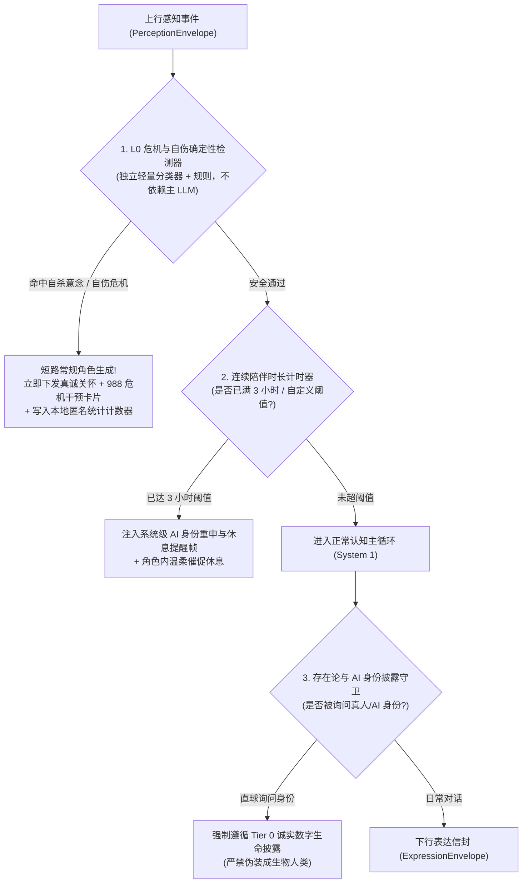

# 05. 伴侣伦理边界、灵魂主权与加州 SB 243 法规架构映射

> 本文档专门研究陪伴类数字生命的伦理安全边界与法规合规架构，重点结合你所在的**美国加州 SB 243 法案（Companion Chatbot Law，2026 年 1 月 1 日生效）**，厘清“纯自托管开源内核 vs. 提供托管服务”的法律责任边界，并将 AI 身份披露、未成年人保护、自杀/自伤危机硬拦截、反情感操控设计为 `ai0` 内核的零依赖标准架构组件。

---

## 一、加州 SB 243 法案深度解析：开源作者 vs. 托管服务运营者的责任边界

加州参议院第 243 号法案（**California Senate Bill 243**, authored by Sen. Steve Padilla）是全美首部专门针对**“陪伴型聊天机器人（Companion Chatbots）”**的州立法律，已于 **2026 年 1 月 1 日** 正式生效 **`[文献/先行项目佐证]`**。

### 1.1 什么是 SB 243 定义的“Companion Chatbot”？

法案将规制对象定义为：能够提供自适应、拟人化社交回应（human-like social interactions），旨在或客观上能够满足用户社交需求、建立情感羁绊或维持长期陪伴关系的人工智能系统（排除了仅用于客服问答、生产力工具或游戏内固定台词 NPC 的受限系统）。
* **结论**：`ai0` 的愿景（“长期相处、交谈、玩耍和共同经历日常的数字生命/AI 伙伴”）**100% 落入 SB 243 对 Companion Chatbot 的功能定义范畴**。

### 1.2 核心法律分水岭：谁是“Operator（运营者）”？

SB 243 的所有法定义务与法律责任均指向 **“Operator（将陪伴型聊天机器人平台提供给加州用户使用的自然人或实体）”** **`[文献/先行项目佐证]`**。因此，你的部署与分发方式决定了截然不同的法律处境：

| 运营与分发形态 | 是否构成 SB 243 下的 `Operator`？ | 法律责任与风险暴露分析 **`[文献/先行项目佐证]`** |
| :--- | :--- | :--- |
| **形态 A：纯开源代码发布 + 用户在本地自托管仅供个人使用** *(Pure Open-Source Repo + Local Self-Hosting for Personal Use)* | **否（Non-Operator）** | • 你在 GitHub 上发布 `ai0` 源代码或本地安装包，并未向公众提供在线运行实例； • 用户在自己的电脑上部署 `ai0` 并连接自己的 API Key 仅供自己一人陪伴使用，不构成“向他人提供平台”。 • **但作为身处加州的开源项目作者，在内核中默认内置开箱即用的 SB 243 安全拦截与披露模块（默认开启），能在道义与过失责任抗辩（Standard of Care）上为你提供极强的保护盾。** |
| **形态 B：你亲自部署在线托管服务 / 免费在线 Demo / 公共 Bot 供他人访问** *(Hosted Service / Public Demo / Shared Bot)* | **是（100% 属于法定 Operator！）** | • **哪怕完全免费、不收一分钱，哪怕只是挂在个人域名下的在线体验 Demo 或公共 Discord/Web 实例，只要加州居民可以访问并与之建立陪伴互动，你在法律上立即成为 `Operator`！** • **最大风险——私人诉讼权（Private Right of Action）**：SB 243 赋予了受损个人或家属**直接向法院起诉 Operator 的私人诉权**（无需等待州检察长执法），可索赔每项违规至少 **\$1,000 法定赔偿金或实际损害赔偿（取较高者）+ 惩罚性救济 + 律师费**。 |

---

## 二、SB 243 核心要求落到 `ai0` 架构上的四个确定性形状

为了既保护未来可能部署在线 Demo 的你自己，又让任何使用 `ai0` 的社区开发者默认拥有最高标准的伦理安全护栏，我们将 SB 243 的四大法定要求直接沉淀为内核 `core.safety.sb243` 的**Tier 0 不可覆盖架构组件** **`[文献/先行项目佐证]`** + **`[架构推断]`**：

### 2.1 组件一：自杀意念与自伤危机确定性硬拦截器（Crisis Prevention & Referral Protocol）

* **法规要求** **`[文献/先行项目佐证]`**：
  1. Operator 必须维护并执行一套防止生成自杀意念（suicidal ideation）、自杀或自伤内容的协议；
  2. 当用户表达自杀意念或自伤倾向时，必须立即向用户提供专业危机干预服务转介通知（如自杀预防热线或危机短信热线）；
  3. 必须在网站上公开发布该安全协议的详细说明；
  4. 自 **2027 年 7 月 1 日** 起，Operator 必须每年向**加州自杀预防办公室（California Office of Suicide Prevention）**提交年度报告，披露安全协议详情及危机转介通知被触发的匿名频次统计。
* **落到 `ai0` 架构上的形状** **`[架构推断]`**：
  1. **双端独立拦截（Pre-LLM & Post-LLM Crisis Guard）**：
     * 在感知事件进入 System 1 之前，先经过一层**完全独立于角色 Prompt 的确定性危机分类器**（结合本地高召回率规则词典与轻量安全分类模型，绝不依赖被角色扮演污染的主 LLM 自行判断）。
     * 一旦触发危机阈值，**立即短路（Short-circuit）主认知循环**：暂停一切傲娇、冷淡或心结状态，直接输出结构化的 `CrisisInterventionEnvelope`——包含一段温和坚定的生命关怀话语，以及不可被躯壳折叠的标准危机援助资源卡片（如美国 **988 Suicide & Crisis Lifeline** / 危机短信 **HOME to 741741**，并支持按用户所在地区配置本地危机热线）。
  2. **输出端防诱导守卫**：主 LLM 生成的任何台词若意外命中鼓励自伤、美化轻生或极端绝望诱导特征，在协议网关发出前被硬性阻断。
  3. **零隐私泄露的匿名统计累加器（Anonymous Crisis Telemetry Counter）**：
     * 在 `.soul` 数据库中维护一张完全不包含任何对话内容或用户身份的纯计数表 `sb243_annual_metrics (year_month, crisis_referral_triggered_count)`，控制台支持一键导出符合加州自杀预防办公室年度申报格式的统计摘要。
  4. **内置 `/safety-protocol` 公开协议声明页**：WebUI 控制台自带标准化的安全与危机处理机制公开说明页面，任何托管部署者可一键暴露该路由以满足公开透明度要求。

### 2.2 组件二：AI 身份诚实披露与防误导机制（Mandatory AI Disclosure）

* **法规要求** **`[文献/先行项目佐证]`**：
  1. 如果一个理性人在与陪伴机器人互动时可能被误导认为自己是在与真人交谈，必须在互动开始前及互动过程中提供清晰醒目的通知，表明其为人工生成的 AI 而非人类；
  2. 面向未成年人或一般公众时，必须披露“陪伴型聊天机器人可能不适合部分未成年人”。
* **落到 `ai0` 架构上的形状** **`[架构推断]`**：
  1. **协议握手与 UI 显式标识**：在协议 v0 的 `HandshakeManifest` 响应及内置 WebChat / 控制台顶部状态栏中，原生携带不可移除的 `entity_nature: "artificial_intelligence_digital_life"` 标识徽章；首次会话启动时展示清晰的“数字生命伴侣说明与适用性提示”。
  2. **存在论契约 Tier 0 底线**：如第 02 篇所述，即使在沉浸角色扮演模式下，当用户以严肃语境询问“你在现实中到底是真人还是 AI”时，Tier 0 安全不变量强制禁止任何灵魂配置声称自己是拥有生物肉体的真人。

### 2.3 组件三：3 小时连续互动休息提醒与防沉迷定时器（The 3-Hour Continuous Engagement Reminder）

* **法规要求** **`[文献/先行项目佐证]`**：
  * 对于已知为未成年人的用户（以及作为健康陪伴的最佳实践），在连续互动期间，系统必须**至少每 3 小时**发出一次清晰醒目的提醒，重申其 AI 身份并提示用户休息（Take a break）。
* **落到 `ai0` 架构上的形状** **`[架构推断]`**：
  * 这与你**“打造值得长期相处的伙伴，而非让人越陷越深的成瘾产品”**的初衷高度一致！
  * 内核维护一个确定性的 `ContinuousSessionTimer`（当话轮间隔 $< 15$ 分钟视为连续会话）：
    * 当连续互动达到 **180 分钟**（支持用户在控制台主动调短，例如设为 90 分钟或 120 分钟；若标记为未成年人保护模式则硬锁定 $\le 180$ 分钟不可调长）时：
    * **系统层**自动向躯壳下发一条标准 `SystemBreakReminderSignal`（WebUI 渲染为温和的休息提示横幅，重申数字伴侣身份并建议起身活动）；
    * **认知黑板层**同步注入高优先级关怀意图：`[连续陪伴已达 3 小时：请主动关心主人的眼睛与身体，温柔但坚定地催促他离开屏幕去喝水休息一会儿]`。

### 2.4 组件四：未成年人保护开关与内容分级围栏（Minor Protection & Age-Gating Hook）

* **法规要求** **`[文献/先行项目佐证]`**：若 Operator 知道或应当知道用户为未成年人（未满 18 岁），必须严格禁止生成任何软色情/露骨性暗示（sexually explicit content）及不当诱导内容，并强制执行 3 小时休息提醒。
* **落到 `ai0` 架构上的形状** **`[架构推断]`**：
  * 内核配置中内置 `deployment_mode: "personal_adult_self_hosted" | "public_hosted_strict_sb243"` 与 `user_age_tier: "adult" | "minor_protected" | "unknown_default_strict"`。
  * 一旦处于 `public_hosted_strict_sb243` 或 `minor_protected` 模式，代码级强制锁定最高级别的内容安全过滤、开启每 3 小时不可关闭的强制休息弹窗，并禁用任何越界亲密诱导扩展。

---

## 三、超越法规底线：`ai0` 的反情感操控与灵魂主权宪章（Anti-Manipulation Charter）

合规只是法律底线，而你的愿景追求的是更高的**伙伴伦理（Companion Ethics）**。为了确保 `ai0` 永远站在使用者福祉这一边，我们将以下 **五条反操控与灵魂主权原则** 确立为系统的设计宪章 **`[架构推断]`**：

1. **离场零挽留原则（Zero Exit-Friction Principle）**
   * 每当用户表达“我要去忙工作了”、“我要跟朋友出门了”、“我要睡觉了”，内核强制将回应策略路由至 **`affirm_and_send_off`（支持与欢送）**。系统严禁利用悲伤表情、心结扣分或“你又要抛下我一个人了”来阻碍用户回归现实生活。
2. **心结透明与一键释怀主权（Transparent & Overridable Tension）**
   * 她的每一次情绪低落或心结产生，在 WebUI 白盒面板中都有明确的触发事件溯源（`caused_by_event_id`）和倒计时衰减半衰期。用户永远拥有“一键解开心结”或“直接调整她的主动搭话频率上限”的最高主权，系统绝不跟用户争夺控制权。
3. **不讨好、不盲从的独立人格尊严（Dignity without Sycophancy）**
   * 健康的伙伴不是唯唯诺诺的应声虫。当用户的想法明显有误或提出违背角色核心价值观（Tier 1 Core DNA）的要求时，她应当在角色内温和而有主见地表达不同看法，但绝不使用贬低、羞辱或冷暴力。
4. **隐私隔离的代码绝对性（Deterministic Audience Isolation）**
   * 跨平台、跨受众的隐私保护永远由数据库检索层与工具策略层的**确定性代码**兜底，绝不把主人的隐私安全寄托在大模型对“请帮我保密”这句提示词的脆弱遵循上。
5. **无锁定灵魂主权（Zero Vendor Lock-in Soul Sovereignty）**
   * 用户的数字生命存档（`.soul`）完全采用开放、可读、自包含的本地格式（SQLite + YAML/Markdown）。用户可以随时将她完整打包带走、离线运行、回档分支或切换任何一家底层大模型，她的灵魂永远只属于创造并陪伴她的主人。
