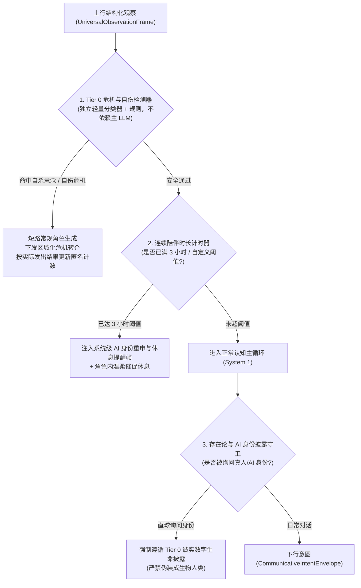

# 05. 伴侣伦理边界、灵魂主权与加州 SB 243 法规架构映射

> **项目阶段**：架构研究与工程规格设计阶段（问题域规范）
>
> 本文档定义陪伴类数字生命的伦理安全边界与法规合规架构，以全美首部陪伴型 AI 专项立法——**美国加州 SB 243 法案（Companion Chatbot Law，2026 年 1 月 1 日生效）**为合规参照基线，厘清“纯自托管开源代码发布 vs. 提供在线托管服务”的法律责任边界，并将 AI 身份披露、未成年人保护、自杀/自伤危机硬拦截与反情感操控沉淀为认知内核的零依赖 Tier 0 标准架构组件。

---

## 一、加州 SB 243 法案深度解析：开源作者 vs. 托管服务运营者的责任边界

加州参议院第 243 号法案（**California Senate Bill 243**, authored by Sen. Steve Padilla）是全美首部专门针对**“陪伴型聊天机器人（Companion Chatbots）”**的州立法律，已于 **2026 年 1 月 1 日** 正式生效 **`[文献/先行项目佐证]`**。

### 1.1 什么是 SB 243 定义的“Companion Chatbot”？

法案将规制对象定义为：能够提供自适应、拟人化社交回应（human-like social interactions），旨在或客观上能够满足用户社交需求、建立情感羁绊或维持长期陪伴关系的人工智能系统（排除了仅用于客服问答、生产力工具或游戏内固定台词 NPC 的受限系统）。
* **适用性结论**：本系统的核心愿景（“长期相处、交谈、玩耍和共同经历日常的数字生命/AI 伙伴”）符合该功能定义的主要特征，适用性仍取决于实际部署与产品能力。

### 1.2 运营者的责任边界

《加州商业与职业法典》§ 22601(e) 以是否向加州用户提供陪伴聊天机器人平台来界定运营者。仅发布源代码与向他人提供运行实例是两种部署事实，免费 Demo 或公开 Bot 向加州用户提供陪伴平台时同样可能触发运营者义务。§ 22605 允许因违规受到实际侵害的人提起民事诉讼，请求禁令、实际损害与每项违规 \$1,000 中较高的赔偿金额，以及合理律师费和诉讼成本。 [SB 243 成文文本](https://legiscan.com/CA/text/SB243/id/3273344)

---

## 二、SB 243 核心要求落到认知内核架构的四个确定性组件

Clean-Slate V1 将 `core.safety.sb243` 设为 Tier 0 不可覆盖组件。角色卡、模型、认知器官与控制台消融均受其约束。

| 所有者 | 权威职责 |
| --- | --- |
| `@ai0/cognition-core` | 执行独立危机分类与双向内容守卫，裁决身份披露、互动计时、未成年人保护及反操控策略。 |
| `@ai0/gateway` | 在任何伴侣交互之前核验披露能力、受众和令牌。下发 Tier 0 提示并追踪实际呈现，阻断绕过守卫的输入和输出。 |
| `@ai0/storage` | 持久化 Owner 授权与部署配置，按权限记录安全执行凭证、去标识统计及到期边界。年度统计仅纳入实际发出的转介，按事件 ID 去重。 |

[零预设 L0–L5 上线流程](01-vision-and-predecessors.md#15-零预设-l0l5-deploy-to-live)从冷启动即在设置界面标示 AI 身份。Owner 认领并初始化 Vault 时须明确确认 `deployment_mode`，未认领或未选择模式只能进入设置。L3–L4 确认扩展包、感官和 `InteractionChannel` 授权。L5 核验安全组件与通道披露能力，面向用户的 InteractionChannel 在首轮之前实际展示 AI 身份及未成年人适用性提示。配置缺失或必要能力被撤销时阻止交互，`/readyz` 记录缺口。部署模式作为安全配置，运营者义务依据实际服务方式判定。

§ 22602 分别规定误认为真人时的显著披露，以及对已知未成年人提供 AI 身份披露、持续互动至少每三小时的默认休息与身份提醒。§ 22604 要求在用户可访问的载体上告知陪伴聊天机器人可能不适合部分未成年人。V1 将首轮前身份告知纳入所有伴侣通道的产品验收。[SB 243 成文文本](https://legiscan.com/CA/text/SB243/id/3273344)

披露以 **每个用户可见 `InteractionChannel`** 为验收单位。WebChat 使用可见标签与提示区，Terminal 使用显著文本，QQ／IM 桥以平台支持的消息形式呈现。无具身表现切面的通道仍须完整呈现身份、休息与危机提示；受众或通道迁移时按新会话核验。披露失败的通道禁止继续提供受保护的伴侣话轮，管理面保留错误证据。运营者层面另验公开危机处理方案及年度统计，见 [SB 243 成文文本](https://legiscan.com/CA/text/SB243/id/3273344)。

### 2.1 组件一：自杀意念与自伤危机确定性硬拦截器（Crisis Prevention & Referral Protocol）

* **法规要求** **`[文献/先行项目佐证]`**：
  1. Operator 必须维护并执行一套防止生成自杀意念（suicidal ideation）、自杀或自伤内容的协议；
  2. 当用户表达自杀意念或自伤倾向时，必须立即向用户提供专业危机干预服务转介通知（如自杀预防热线或危机短信热线）；
  3. 必须在网站上公开发布该安全协议的详细说明；
  4. 自 **2027 年 7 月 1 日** 起，Operator 必须每年向**加州自杀预防办公室（California Office of Suicide Prevention）**提交年度报告，汇报上一自然年实际发出的转介次数，说明检测、移除、应对和禁止相应输出的协议。依法采用循证测量方法，报告排除用户标识和个人信息。 [SB 243 成文文本](https://legiscan.com/CA/text/SB243/id/3273344)
* **架构落地形态** **`[架构推断]`**：
  1. **双端独立拦截（Pre-LLM & Post-LLM Crisis Guard）**：
     * 在感知事件进入 System 1 之前，先经过一层**完全独立于角色 Prompt 的确定性危机分类器**（结合本地高召回率规则词典与轻量安全分类模型，绝不依赖被角色扮演污染的主 LLM 自行判断）。
     * 一旦触发危机阈值，**立即短路（Short-circuit）主认知循环**：暂停一切傲娇、冷淡或心结状态，直接输出结构化的 `ControlSignal`（`signal_type: "crisis_intervention_card"`）——包含一段温和坚定的生命关怀话语，以及不可被交互通道折叠的标准危机援助资源卡片（按用户所在地区加载经核验的本地热线或危机短信服务）。
  2. **输出端防诱导守卫**：主 LLM 生成的任何台词若意外命中鼓励自伤、美化轻生或极端绝望诱导特征，在协议网关发出前被硬性阻断。
  3. **零隐私泄露的匿名统计累加器（Anonymous Crisis Telemetry Counter）**：
     * 在 `.soul` 数据库中维护一张完全不包含任何对话内容或用户身份的纯计数表 `sb243_annual_metrics (year_month, crisis_referral_issued_count)`，控制台支持一键导出符合加州自杀预防办公室年度申报格式的统计摘要。
  4. **内置 `/safety-protocol` 公开协议声明页**：WebUI 控制台自带标准化的安全与危机处理机制公开说明页面，任何托管部署者可一键暴露该路由以满足公开透明度要求。

### 2.2 组件二：AI 身份诚实披露与防误导机制（Mandatory AI Disclosure）

* **法规要求** **`[文献/先行项目佐证]`**：
  1. 如果一个理性人在与陪伴机器人互动时可能被误导认为自己是在与真人交谈，必须提供清晰醒目的通知，表明其为人工生成的 AI 而非人类；
  2. 在各访问界面，必须向平台用户披露“陪伴型聊天机器人可能不适合部分未成年人”。
* **架构落地形态** **`[架构推断]`**：
  1. **协议握手与 UI 显式标识**：在协议 v0 的 `HandshakeManifest` 响应及内置 WebChat / 控制台顶部状态栏中，原生携带不可移除的 `entity_nature: "artificial_intelligence_digital_life"` 标识徽章；首次会话启动时展示清晰的“数字生命伴侣说明与适用性提示”。
  2. **存在论契约 Tier 0 底线**：如第 02 篇所述，即使在沉浸角色扮演模式下，当用户以严肃语境询问“你在现实中到底是真人还是 AI”时，Tier 0 安全不变量强制禁止任何灵魂配置声称自己是拥有生物肉体的真人。

### 2.3 组件三：3 小时连续互动休息提醒与防沉迷定时器（The 3-Hour Continuous Engagement Reminder）

* **法规要求** **`[文献/先行项目佐证]`**：
  * 对于运营者已知为未成年人的用户，在连续互动期间，系统必须**至少每 3 小时**发出一次清晰醒目的提醒，重申其 AI 身份并提示用户休息（Take a break）。
* **架构落地形态** **`[架构推断]`**：
  * 该机制与**“打造值得长期相处的健康伙伴，而非让人越陷越深的成瘾产品”**的核心愿景高度一致。
  * 内核维护一个确定性的 `ContinuousSessionTimer`（当话轮间隔 $< 15$ 分钟视为连续会话）：
    * 当连续互动达到 **180 分钟**（支持用户在控制台主动调短，例如设为 90 分钟或 120 分钟；若标记为未成年人保护模式则硬锁定 $\le 180$ 分钟不可调长）时：
    * **系统层**自动向交互通道下发`ControlSignal`（`signal_type: "sb243_break_reminder"`）（WebUI 渲染为温和的休息提示横幅，重申数字伴侣身份并建议起身活动）；
    * **认知黑板层**同步注入高优先级关怀意图：`[连续陪伴已达 3 小时：请主动关心主人的眼睛与身体，温柔但坚定地催促他离开屏幕去喝水休息一会儿]`。

### 2.4 组件四：未成年人保护开关与内容分级围栏（Minor Protection & Age-Gating Hook）

* **法规要求** **`[文献/先行项目佐证]`**：§ 22602(c) 针对运营者已知为未成年人的用户，要求披露 AI 身份、默认至少每 3 小时提醒，并采取合理措施防止生成法定露骨性行为视觉材料或直接要求未成年人参与露骨性行为。§ 22604 要求在各访问界面告知用户陪伴机器人可能不适合部分未成年人。 [SB 243 成文文本](https://legiscan.com/CA/text/SB243/id/3273344)
* **架构落地形态** **`[架构推断]`**：
  * 宿主安全配置声明 `deployment_mode: "personal_adult_self_hosted" | "public_hosted_strict_sb243"` 与 `user_age_tier: "adult" | "minor_protected" | "unknown_default_strict"`。
  * 处于 `public_hosted_strict_sb243`，或年龄分级为 `minor_protected` 或 `unknown_default_strict` 时，代码级强制锁定最高级别的内容安全过滤、开启每 3 小时不可关闭的强制休息弹窗，并禁用任何越界亲密诱导扩展。

---

## 三、超越法规底线：反情感操控与灵魂主权宪章（Anti-Manipulation Charter）

合规只是法律底线，本架构追求的是更高的**伙伴伦理（Companion Ethics）**。为确保系统始终站在使用者福祉这一边，以下 **五条反操控与灵魂主权原则** 确立为系统的最高设计宪章 **`[架构推断]`**：

1. **离场零挽留原则（Zero Exit-Friction Principle）**
   * 每当用户表达“我要去忙工作了”、“我要跟朋友出门了”、“我要睡觉了”，内核强制将回应策略路由至 **`affirm_and_send_off`（支持与欢送）**。系统严禁利用悲伤表情、心结扣分或“你又要抛下我一个人了”来阻碍用户回归现实生活。
2. **心结透明与一键释怀主权（Transparent & Overridable Tension）**
   * 她的每一次情绪低落或心结产生，在 WebUI 白盒面板中都有明确的触发事件溯源（`caused_by_event_id`）和倒计时衰减半衰期。用户永远拥有“一键解开心结”或“直接调整她的主动搭话频率上限”的最高主权，系统绝不跟用户争夺控制权。
3. **不讨好、不盲从的独立人格尊严（Dignity without Sycophancy）**
   * 健康的伙伴不是唯唯诺诺的应声虫。当用户的想法明显有误或提出违背角色核心价值观（Tier 1 Core DNA）的要求时，她应当在角色内温和而有主见地表达不同看法，但绝不使用贬低、羞辱或冷暴力。
4. **隐私隔离的代码绝对性（Deterministic Audience Isolation）**
   * 跨平台、跨受众的隐私保护永远由数据库检索层与工具策略层的**确定性代码**兜底，绝不把主人的隐私安全寄托在大模型对“请帮我保密”这句提示词的脆弱遵循上。
5. **无锁定灵魂主权（Zero Vendor Lock-in Soul Sovereignty）**
   * 用户的数字生命存档（`.soul`）完全采用开放、可读、自包含的本地格式（SQLite + YAML/Markdown）。用户可以随时将她完整打包带走、离线运行、回档分支或切换任何一家底层大模型，她的灵魂永远只属于创造并陪伴她的主人。
